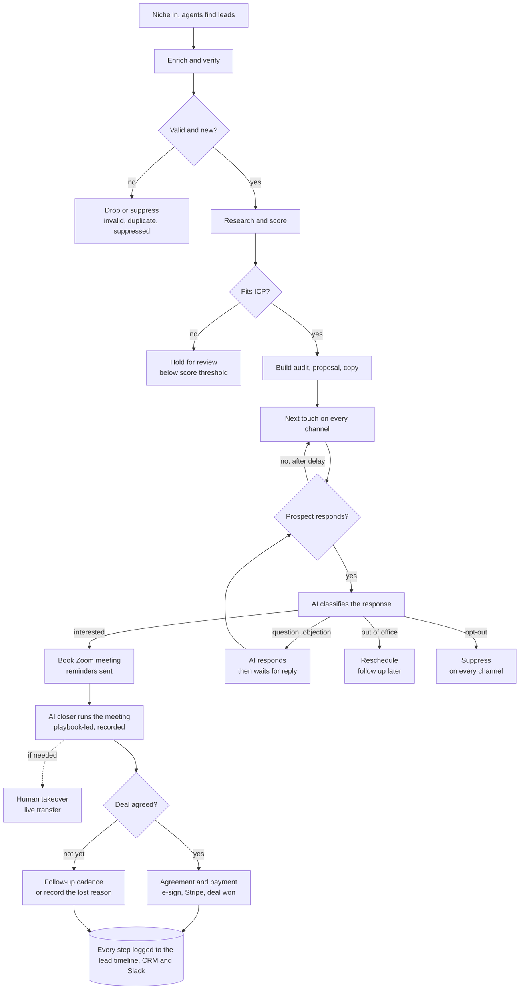
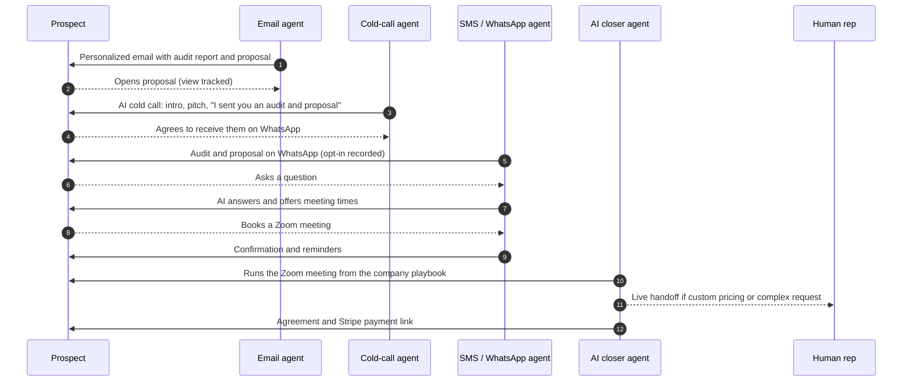
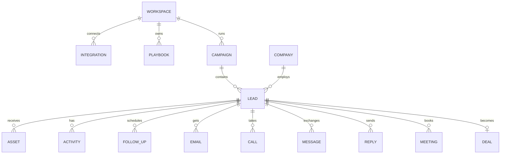
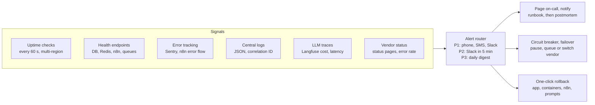

# AI SDR Autonomous Sales Platform

**An autonomous, multi-tenant AI sales platform that finds leads on every channel, researches them, runs omnichannel outreach with AI voice agents, books meetings, and closes deals with an AI closer agent.**

Engineered by Muhammad Hassan | AI ENGINEER | AUTOMATION SPECIALIST | SOFTWARE ENGINEER | FULL STACK DEVELOPER

     

---

## Overview

The platform replaces the manual work of a human Sales Development Representative (SDR) from first search to signed deal.

A user types a **business niche** and the **countries, regions or cities** to target. AI agents then:

1. Build the Ideal Customer Profile (ICP) and pick the best lead channels for that niche
2. Find leads in parallel on Apollo, Google Maps, social media (Instagram, Facebook, LinkedIn, TikTok, X) and LLM web searches (OpenAI, Anthropic, Gemini)
3. Enrich, verify, deduplicate and score every lead, and screen phone numbers against Do Not Call lists
4. Write an **AI lead report**, a custom **audit report** and a tailored **proposal** for each lead
5. Run one coordinated cadence across **designed email, AI cold calls, SMS and WhatsApp**
6. Classify every reply, answer questions, handle objections and **book Zoom meetings**
7. Send an **AI closer agent** into the meeting to pitch from the company's playbook and close, with live **human handoff** whenever needed
8. Send the agreement and payment link, record the sale, and **learn from every outcome** to improve copy, scripts and pitches

Everything is logged to a per-lead activity timeline, the CRM and Slack. Each company works in its own isolated workspace, connects its own tools through a guided onboarding, runs on full autopilot by default, and can switch any channel or stage off. Agencies can run the whole platform under their own brand in **white-label mode**.

---

## System Architecture

```mermaid
flowchart TB
    subgraph APP["Web app (per workspace, white-label ready)"]
        A1["Niche or ICP<br/>plus target areas"]
        A2["Company playbook<br/>services and prices"]
        A3["Lead sources<br/>Apollo, Maps, social, LLMs"]
        A4["Channel controls<br/>on/off, autopilot"]
    end

    subgraph ORCH["Orchestration layer: n8n scheduler, agent service and workflows"]
        direction TB
        subgraph AGENTS["Agents and modules"]
            M1["AI setup agent<br/>builds ICP and plan"]
            M2["Sourcing and hygiene<br/>scrape and verify"]
            M3["Research and scoring<br/>brief and 0-100 score"]
            M4["Audits and proposals<br/>per-lead PDF and page"]
            M5["Cadence engine<br/>picks next touch"]
            M6["Email agent<br/>designed emails"]
            M7["Cold-call agent<br/>intro, pitch, booking"]
            M8["SMS and WhatsApp<br/>two-way AI chats"]
            M9["Reply handler<br/>classify, escalate"]
            M10["Zoom booking<br/>invites, reminders"]
            M11["AI closer agent<br/>runs sales meetings"]
            M12["Deals and payments<br/>sign, pay, record"]
            M13["Lead management<br/>profiles, timelines"]
            M14["Notify and monitor<br/>Slack, logs, retries"]
            M15["CRM sync<br/>pipeline, activity"]
            M16["AI receptionist<br/>inbound campaign calls"]
        end
        subgraph SHARED["Shared services"]
            S1["LLM API<br/>OpenAI, Anthropic, Gemini"]
            S2["Knowledge base<br/>playbook retrieval"]
            S3["Database<br/>Supabase, per tenant"]
            S4["Learning loop<br/>learns from outcomes"]
        end
    end

    subgraph EXT["External tools (connected by each company)"]
        E1["Email<br/>Instantly"]
        E2["Voice agents<br/>Vapi"]
        E3["Twilio<br/>calls and SMS"]
        E4["WhatsApp<br/>Cloud API"]
        E5["Zoom<br/>Recall.ai bot"]
        E6["CRM<br/>HubSpot"]
        E7["Calendar<br/>Calendly"]
        E8["Slack<br/>notifications"]
        E9["E-signature<br/>PandaDoc"]
        E10["Payments<br/>Stripe"]
    end

    APP -->|settings, playbook, leads| ORCH
    ORCH <-->|push data, receive webhooks| EXT
```



The web app configures the orchestration layer per workspace. All agents share the LLM layer, the playbook knowledge base, the multi-tenant database and the learning loop, and exchange data with each company's connected tools in both directions.

---

## End-to-End System Flow



A lead passes two quality gates before any outreach. Every response is routed to one of four outcomes, and booked meetings go to the AI closer.

---

## Omnichannel Cadence for One Lead

When a lead has both an email address and a phone number, every enabled channel runs as one coordinated sequence that refers back to earlier touches.



---

## Core Capabilities

### Lead discovery
- **Niche-to-campaign autopilot:** type a niche and target area; agents build the ICP, channel plan, queries, copy and cadence for one-click launch
- **Multi-channel sourcing:** Apollo and Clay, Google Maps, Instagram, Facebook, LinkedIn, TikTok, X, CSV import
- **LLM discovery:** OpenAI, Anthropic and Gemini each return their top 10 matching companies, merged and deduplicated
- **Lead hygiene:** enrichment, email verification, phone line-type checks, DNC screening, global suppression list

### AI research and assets
- Research brief and 0–100 fit score per lead
- **AI lead report** for the sales team, refreshed after every interaction
- **Custom audit report** per lead (website speed, SEO basics, reviews, social presence, competitors)
- **Tailored proposal** per lead from the company playbook, as branded PDF and hosted page with view tracking

### Omnichannel outreach
- Designed, branded HTML emails with deliverability-safe first touches
- **AI cold-call agent:** intro, playbook pitch, audit reminder, live Zoom booking, voicemail detection, call forwarding to humans
- Two-way **SMS** and **WhatsApp** conversations that answer questions and book meetings
- Optional LinkedIn touches, mailbox and number rotation, time-zone-aware sending

### Conversations, meetings and closing
- Reply classification across every channel, AI auto-responses and instant human escalation
- Zoom booking with reminders and no-show recovery
- **AI closer agent** that runs sales meetings as the company's representative, using only approved prices and terms
- Quotes, e-signature agreements, Stripe payment links and complete sales records

### Inbound and learning
- **Inbound AI receptionist** answers calls from marketing campaigns 24/7, tags the campaign, qualifies and books
- **Self-learning loop** A/B tests copy, call openers and closer pitches and shifts volume to winners, within fixed guardrails

### Platform
- Isolated multi-tenant workspaces with roles (owner, admin, rep, viewer)
- **Guided onboarding wizard** that connects each company's own tool accounts, with connection health checks
- **Automation controls:** full autopilot by default, any channel or stage can be switched off or put into approval mode, plus a global kill switch
- **Lead management:** source categorization, full lead and business profiles, activity timeline and follow-up tracking per lead
- Recordings, transcripts and summaries for every caller, closer and receptionist session
- Slack notifications, CRM sync, dashboards and usage tracking
- **White-label mode** with custom domain, branding, agency console and per-client billing

---

## Module Map

| ID | Module | ID | Module |
| --- | --- | --- | --- |
| M1 | ICP and campaign configuration | M14 | AI setup agent (niche-to-campaign) |
| M2 | Lead sourcing | M15 | Lead management and activity tracking |
| M3 | Enrichment, verification and hygiene | M16 | Audit reports, proposals and designed emails |
| M4 | AI research and lead scoring | M17 | WhatsApp outreach |
| M5 | AI personalization and copy | M18 | AI closer agent |
| M6 | Multi-channel outreach and sequencing | M19 | Company playbook and knowledge base |
| M7 | AI reply handling | M20 | Deal closing and sales records |
| M8 | Meeting booking | M21 | Automation modes and channel controls |
| M9 | CRM sync | M22 | Notifications |
| M10 | Reporting and analytics | M23 | Workspaces, onboarding and integrations |
| M11 | Monitoring, errors and alerts | M24 | Self-learning copy, scripts and pitches |
| M12 | AI voice calling | M25 | Inbound AI receptionist |
| M13 | SMS outreach | M26 | White-label mode |

Every module, with its numbered functional requirements, is defined in the [Software Requirements Specification](docs/SRS.md).

---

## Tech Stack

| Layer | Technology |
| --- | --- |
| Orchestration | n8n (self-hosted, queue mode) as scheduler; agent service in TypeScript on Node 22 with a Postgres job queue |
| Web app | Next.js 16 (App Router, Server Actions), React 19, TypeScript, Zod, Supabase Auth |
| Database and knowledge base | Supabase (PostgreSQL, row-level security, pgvector) |
| LLMs | OpenAI, Anthropic, Gemini |
| Lead data and scraping | Apollo, Clay, Apify (Google Maps and social media actors) |
| Verification | ZeroBounce / NeverBounce, Twilio Lookup |
| Research and audits | Website scraping, PageSpeed Insights API, news search |
| Documents | HTML templates rendered to PDF with Puppeteer |
| Email | Instantly |
| Voice agents | Vapi (cold caller, closer, receptionist) |
| Telephony and SMS | Twilio |
| WhatsApp | WhatsApp Business Platform (Cloud API) |
| Meetings | Zoom API, Recall.ai meeting bot, Calendly |
| Deals | PandaDoc (e-signature), Stripe (payments) |
| CRM and alerts | HubSpot, Slack |
| Auth, pooling and cache | Supabase Auth, Supavisor, Redis (Upstash) |
| Observability | Better Stack (uptime, logs, on-call), Sentry, Langfuse |
| Delivery | GitHub Actions, Docker Compose, Vercel, Cloudflare |

---

## Data Model



Field-level definitions for every entity are in the [SRS](docs/SRS.md#7-data-model-core-entities).

---

## Production Readiness

The platform targets **99.9% uptime**, recovers from a bad release in one click, and keeps running through third-party outages.



- **Authentication:** Supabase Auth with MFA, Google and Microsoft sign-in, SAML SSO, short-lived tokens with rotating refresh, role-based access enforced by row-level security, signed webhooks and an audit log
- **Connection pooling and queues:** Supavisor transaction pooling, read replica for analytics, n8n queue mode on Redis with prioritized workers, dead-letter queue and idempotency keys
- **Caching:** Redis with per-workspace keys and defined TTLs (research and enrichment 30 days, DNC checks 31 days, audits 7 days, LLM discovery 24 hours, calendar availability 60 seconds)
- **Monitoring:** multi-region uptime checks every 60 seconds, `/health` and `/ready` endpoints, integration health checks, daily synthetic end-to-end test
- **Error tracking and logging:** Sentry, structured JSON logs with a per-lead correlation ID in one central store, Langfuse for LLM cost and quality
- **Alerts:** P1 to P3 severity routing to phone, SMS and Slack, with deduplication, on-call routing, runbooks and postmortems
- **Third-party outages:** vendor status monitoring, circuit breakers, automatic failover (OpenAI to Anthropic to Gemini, Vapi to Retell AI, Twilio to Telnyx) and automatic resume
- **Recovery:** one-click rollback for the web app, containers, n8n workflows and prompts; backward-compatible migrations; feature flags; point-in-time recovery with RPO 15 minutes and RTO 1 hour
- **Security:** HTTPS with HSTS and CSP, WAF and DDoS protection, secrets manager, dependency and code scanning, penetration test, data retention and GDPR tools

---

## Compliance by Design

- **Email:** separate sending domains with SPF, DKIM and DMARC, warm-up, bounce-rate auto-pause, one-click opt-out, CAN-SPAM and GDPR rules
- **Calls and SMS:** TCPA/FCC (US) and PECR with TPS/CTPS (UK) rules, consent checks, DNC screening, permitted calling hours, A2P 10DLC registration
- **AI disclosure:** every voice agent states it is an AI assistant and gives recording disclosures where required
- **WhatsApp:** opt-in only, Meta-approved templates
- **Cross-channel suppression:** an opt-out on any channel stops contact on every channel
- **Guardrails:** the AI closer and the learning loop never change prices, guarantees or compliance wording

Compliance rules always apply and cannot be switched off.

---

## Repository Structure

```
AI-SDR-Autonomous-Sales-Platform/
├── README.md                    Project overview, architecture and flows
├── docs/
│   └── SRS.md                   Full Software Requirements Specification (26 modules)
├── infra/
│   ├── docker-compose.yml       n8n queue mode, Redis job queue, workers, agent service
│   ├── n8n/workflows/           All n8n workflows as JSON, imported automatically on start
│   ├── n8n/import-workflows.mjs One-shot importer: loads and publishes the workflows
│   └── .env.example             Configuration template
├── agents/                      Agent service: AI setup agent and lead-finder agents
│   ├── src/                     LLM failover, source adapters, normalisation, job runner, HTTP API
│   └── tests/                   Unit and end-to-end pipeline tests on the real schema
├── supabase/
│   └── migrations/              Multi-tenant schema with row-level security
├── web/                         Next.js web app: sign-in, workspaces, setup, campaigns, leads
│   ├── src/                     App Router pages, Server Actions, role and validation logic
│   ├── tests/                   Unit tests
│   └── e2e/                     Browser tests
├── tests/
│   ├── infra/                   Stack configuration tests
│   └── db/                      Tenant isolation, role, team and data-integrity tests
├── reports/                     Feature report, use cases and test cases per feature
└── .github/workflows/ci.yml     Runs every test on each push
```

---

## Getting Started

```bash
git clone https://github.com/MHassan-AiExpert/AI-SDR-Autonomous-Sales-Platform.git
cd AI-SDR-Autonomous-Sales-Platform
npm install

# 1. Run the test suite (infrastructure + database)
npm test

# 2. Test the agent service
cd agents && npm install && npm test && cd ..

# 3. Start the orchestration stack and agent service
cp infra/.env.example infra/.env        # replace every change-me value
npm run infra:up                        # n8n on http://localhost:5678
# every workflow in infra/n8n/workflows is imported and published on start

# 4. Apply the database schema
npx supabase start
npx supabase db reset

# 5. Run the web app
cd web && npm install
cp .env.example .env.local              # Supabase project URL and publishable key
npm run dev                             # http://localhost:3000
```

---

## Engineering Reports

Each feature is delivered with a feature report, use cases and test cases in [`reports/`](reports/README.md).

| ID | Feature | Tests |
| --- | --- | --- |
| [F01](reports/F01-infrastructure-stack/feature-report.md) | Infrastructure stack: n8n queue mode, Redis job queue, scalable workers | 14 passed |
| [F02](reports/F02-multi-tenant-database/feature-report.md) | Multi-tenant database with row-level security and four roles | 43 passed |
| [F03](reports/F03-web-auth-workspaces/feature-report.md) | Web app: sign-in, workspaces, team roles, channel switches and kill switch | 47 passed |
| [F04](reports/F04-onboarding-integrations/feature-report.md) | Guided onboarding: 16 tools tested before saving, credentials encrypted in Supabase Vault | 60 passed |
| [F05](reports/F05-lead-sourcing/feature-report.md) | AI setup agent and lead sourcing across Apollo, Google Maps, Instagram and LLM search, with de-duplication, suppression and lead screens | 101 passed |
| [F06](reports/F06-enrichment-verification/feature-report.md) | Enrichment and verification: decision makers, verified emails, phone line types, daily runs | 55 passed |
| [F07](reports/F07-research-scoring/feature-report.md) | AI research briefs, explainable lead scores, outreach threshold and lead profiles | 38 passed |

---

## Documentation

- **[Feature reports](reports/README.md):** design, use cases and test cases for every feature
- **[Software Requirements Specification](docs/SRS.md):** scope, users and roles, architecture, end-to-end flow, all functional requirements (M1–M26), data model, integrations, non-functional requirements, production infrastructure and operations, compliance, build phases and acceptance criteria

---

## Author

**Muhammad Hassan**
AI Engineer | Automation Specialist | Software Engineer | Full Stack Developer
GitHub: [@MHassan-AiExpert](https://github.com/MHassan-AiExpert)
