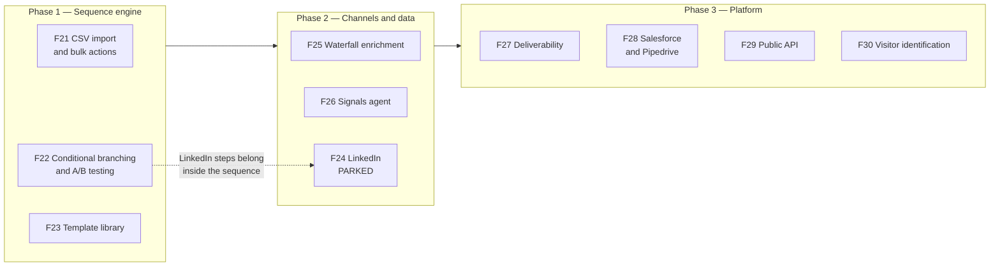

# Roadmap — F21 to F31

Engineered by Muhammad Hassan | AI ENGINEER | AUTOMATION SPECIALIST | SOFTWARE ENGINEER | FULL STACK DEVELOPER

Features F01 to F20 are built, tested and live; see [reports](../reports/README.md). This roadmap covers the next phase, written after a feature-by-feature comparison against the leading AI SDR platforms.

Every feature here carries the same deliverables as the first twenty: a live migration, agent and web code, database, agent and web tests, a feature report, use cases and test cases, pushed to GitHub.

## Order and reasoning

Work runs in three phases. The order is driven by dependencies, not by impact alone.

**Why the sequence engine comes first.** Conditional branching changes how every outreach step is chosen. Any channel added before it would have to be rebuilt once branching lands, LinkedIn most of all.

## Phase 1 — Sequence engine

### F21. CSV import and bulk actions
Upload a lead list, map the columns, and run it through the same hygiene layer as sourced leads: normalize, deduplicate, check against suppressions. Multi-select on the leads list for bulk stage changes, owner assignment, adding to a campaign and suppressing.

Closes a visible hole: the `csv` source channel exists in the schema with no way to use it.

### F22. Conditional branching and A/B testing
Sequence steps choose the next action from what the lead did, rather than only from elapsed days:

| Behaviour | Next step |
| --- | --- |
| Opened, no reply after 2 days | AI call |
| Call reached voicemail | Text follow-up |
| No answer on any channel | Final email, then stop |

Each step can carry up to three variants. The learning agent already measures with significance testing, so it scores the winners rather than a separate A/B engine.

### F23. Shared template library
Reusable sequences, snippets and objection answers per workspace, and as agency defaults for new clients.

## Phase 2 — Channels and data

### F24. LinkedIn outreach — PARKED
In the SRS as FR-6.3 (profile view, connection request, message). The UI toggle exists with no agent behind it.

**Parked pending a decision on approach.** LinkedIn has no sanctioned API for outreach automation. Providers that offer one state plainly that they are not affiliated with or endorsed by LinkedIn, and act on behalf of a user who connects their own account. LinkedIn enforces roughly 200 connection requests per week on a paid account, and shares a bucket of about 100 actions per day across messages, profile views and reactions. Exceeding that pace is how accounts get restricted.

Whatever approach is chosen, the design is fixed: each customer connects their own LinkedIn account, caps are enforced per account, intervals are randomized, failures back off exponentially, new accounts ramp gradually, and the restriction risk is stated in the interface.

### F25. Waterfall enrichment
Replace the single Apollo lookup with a provider chain that stops at the first hit and records which provider found the contact, so match rates per provider can be compared. Falls back to the existing website scrape.

### F26. Signals agent (agent #17)
Watches leads already in the workspace and re-triggers outreach when something changes, with the signal as the hook. Three source tiers, each optional:

| Tier | Signals | Needs |
| --- | --- | --- |
| Built in | Funding and news, hiring activity, technology changes, job changes | No extra vendor |
| Optional paid | Topic surges and in-market accounts | A Bombora or 6sense subscription |
| Optional social | Posts on LinkedIn, X and Reddit describing the problem you solve | A social listening source |

Only the built-in tier is required. The paid and social tiers connect like any other integration and the agent skips them cleanly when they are absent.

## Phase 3 — Platform

### F27. Deliverability dashboard
SPF, DKIM and DMARC checks per sending domain, blocklist monitoring, per-mailbox volume and health. Automatic pausing on bounce and opt-out spikes already exists (F19).

### F28. Salesforce and Pipedrive
The CRM layer was abstracted in F18, so these are mostly new provider modules behind the same sync job.

### F29. Public API and outbound webhooks
A REST API with scoped keys, and events sent out when a lead changes stage, a meeting is booked or a deal is won. Unlocks Zapier and Make without building either.

### F30. Website visitor identification — company level
A tracking script identifies the visiting **company** by reverse IP lookup, matches it to leads and campaigns, and raises a signal. Person-level identification is deliberately out of scope: company-level works in the EU and carries far lower privacy risk.

## Not scheduled

**F31. Parallel dialer for human reps.** Competitors sell this as an add-on for human SDRs. This platform's premise is that the AI makes the calls, so it is recorded here but not planned.

**In-app assistant.** An assistant that answers "why did this campaign stop?" from the workspace's own setup state, job history and analytics. Not in the SRS; worth considering once Phase 1 is done.

## Where this leaves the comparison

| Area | After this roadmap |
| --- | --- |
| Lead sourcing | 4 automated sources plus CSV; waterfall enrichment. LinkedIn still open |
| Lead management | Already ahead of platforms that assume you own a CRM |
| Follow-ups | Conditional branching and variants close the main gap |
| Automation | Signal-based triggering closes the frontier gap |
| Platform | Public API, three CRMs, deliverability visibility |
