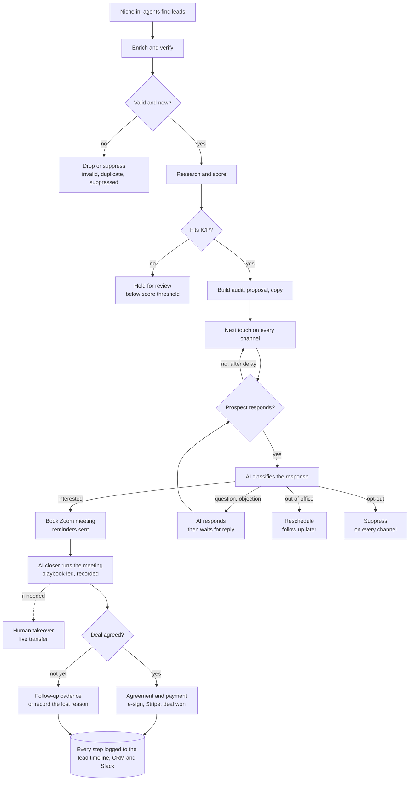

# AI SDR Automated System — Software Requirements Specification

Engineered by Muhammad Hassan | AI ENGINEER | AUTOMATION SPECIALIST | SOFTWARE ENGINEER | FULL STACK DEVELOPER

Version 1.0 · Nov 12, 2026

## 1. Overview

The AI SDR Automated System is an end-to-end outbound sales pipeline that replaces the manual work of a human Sales Development Representative. It sources prospects that match an Ideal Customer Profile (ICP) from B2B databases, Google Maps, social media and AI-powered web search, verifies and enriches them, researches each one with an LLM, runs personalized multi-channel outreach across email, AI voice calls and SMS, handles replies and calls with AI, books meetings, and logs everything to a CRM.

In quick-start mode, the user types only a business niche. AI agents then build the ICP, choose the best lead channels, find leads across all of them, and set up the full campaign for one-click approval.

Every lead gets a custom audit report and proposal. Booked Zoom meetings are run by an AI closer agent that follows the company's own playbook and hands off to a human whenever needed. The platform is multi-tenant and white-label ready: each company connects its own tool accounts through a guided onboarding, runs fully automated by default, and can switch any channel or stage off.

This document defines what the system must do, how it is structured, and how it will be built and accepted. It is the single reference for the build; changes are made here first.

## 2. Goals and scope

**Goals**

- Automate the full SDR cycle from lead sourcing to booked meeting with minimal manual work
- Reach each prospect on the channel that works best: email, AI phone call or SMS
- Personalize every message and call using real research on the prospect and company
- Protect sender reputation and keep deliverability high
- Stay compliant with email, calling and SMS laws in every target region
- Give sales a single, accurate record of every lead and touchpoint in the CRM
- Close deals automatically with an AI closer that follows each company's playbook, and make performance visible from first touch to closed revenue

**In scope**

- Niche-only quick-start where AI agents build the ICP, channels and campaign for the countries, regions or cities the user targets
- Lead sourcing from B2B databases, Google Maps, social media and LLM searches (OpenAI, Anthropic, Gemini), with enrichment, verification and deduplication
- AI research, lead scoring, an AI lead report per lead, and a custom audit report and proposal per lead
- Omnichannel cadences across designed email, AI voice calls, SMS and WhatsApp, with optional LinkedIn touches
- AI reply classification, auto-responses and human escalation on every channel
- Inbound AI receptionist for calls from marketing campaigns
- Zoom meeting booking, reminders and no-show recovery
- AI closer agent for sales meetings, driven by each company's playbook, with human handoff
- Self-learning loop that improves copy, call scripts and closer pitches from real results
- Deal pipeline, agreements, payment links and sales records
- Lead management with source categorization, full profiles and an activity timeline per lead
- Call and meeting recordings, transcripts and summaries for every voice agent
- Slack notifications, CRM sync, reporting and alerting
- Multi-tenant web app with guided tool onboarding, automation modes, per-channel on/off controls and white-label mode for agencies

**Out of scope (version 1)**

- General customer support lines (the inbound AI receptionist covers sales calls from marketing campaigns)
- Building a custom CRM, email-sending, telephony or video-meeting infrastructure
- Paid ad campaigns
- Legal advice on each company's outreach obligations (the platform enforces the rules; each company confirms its own compliance)
- Third-party tool costs: domains, mailboxes, phone numbers, minutes, messages and API credits (paid by each company)

## 3. Users and roles

- **Platform admin (us):** Runs the platform, manages workspaces, monitors health and supports onboarding.
- **Workspace owner (client company):** Connects tool accounts, uploads the company playbook, sets the niche or ICP, chooses automation mode and channels, and views all reports and sales records.
- **Sales rep / closer:** Receives Slack alerts, hot-lead escalations and live call or meeting handoffs, and takes over deals when the AI needs a human.
- **Operator (optional):** Reviews AI drafts, call lists or deals when a stage is in approval mode, and manages lead lists.
- **Prospect (external):** Receives outreach, audits and proposals, talks to the voice agents, and books or attends meetings. Never sees the internal system.

## 4. System architecture

The system is built as modular n8n agents and workflows on a shared, multi-tenant database, so each module can be changed or replaced without touching the rest.

```mermaid
flowchart TB
    subgraph APP["Web app (per workspace, white-label ready)"]
        A1["Niche or ICP<br/>plus target areas"]
        A2["Company playbook<br/>services and prices"]
        A3["Lead sources<br/>Apollo, Maps, social, LLMs"]
        A4["Channel controls<br/>on/off, autopilot"]
    end

    subgraph ORCH["Orchestration layer: n8n agents and workflows"]
        direction TB
        subgraph AGENTS["Agents and modules"]
            M1["AI setup agent<br/>builds ICP and plan"]
            M2["Sourcing and hygiene<br/>scrape and verify"]
            M3["Research and scoring<br/>brief and 0-100 score"]
            M4["Audits and proposals<br/>per-lead PDF and page"]
            M5["Cadence engine<br/>picks next touch"]
            M6["Email agent<br/>designed emails"]
            M7["Cold-call agent<br/>intro, pitch, booking"]
            M8["SMS and WhatsApp<br/>two-way AI chats"]
            M9["Reply handler<br/>classify, escalate"]
            M10["Zoom booking<br/>invites, reminders"]
            M11["AI closer agent<br/>runs sales meetings"]
            M12["Deals and payments<br/>sign, pay, record"]
            M13["Lead management<br/>profiles, timelines"]
            M14["Notify and monitor<br/>Slack, logs, retries"]
            M15["CRM sync<br/>pipeline, activity"]
            M16["AI receptionist<br/>inbound campaign calls"]
        end
        subgraph SHARED["Shared services"]
            S1["LLM API<br/>OpenAI, Anthropic, Gemini"]
            S2["Knowledge base<br/>playbook retrieval"]
            S3["Database<br/>Supabase, per tenant"]
            S4["Learning loop<br/>learns from outcomes"]
        end
    end

    subgraph EXT["External tools (connected by each company)"]
        E1["Email<br/>Instantly"]
        E2["Voice agents<br/>Vapi"]
        E3["Twilio<br/>calls and SMS"]
        E4["WhatsApp<br/>Cloud API"]
        E5["Zoom<br/>Recall.ai bot"]
        E6["CRM<br/>HubSpot"]
        E7["Calendar<br/>Calendly"]
        E8["Slack<br/>notifications"]
        E9["E-signature<br/>PandaDoc"]
        E10["Payments<br/>Stripe"]
    end

    APP -->|settings, playbook, leads| ORCH
    ORCH <-->|push data, receive webhooks| EXT
```

The web app configures the orchestration layer per workspace; its agents share the LLM, knowledge base, database and learning loop, and exchange data with each company's connected tools in both directions.

## 5. End-to-end system flow

A lead passes two quality gates before any outreach, every response is routed to one of four outcomes, and booked meetings go to the AI closer.

In approval mode, a human reviews the personalized copy before the first send. Low-confidence reply classifications go to a human instead of an automatic response.

## 6. Functional requirements (features)

Each requirement has an ID so it can be referenced during the build and in change requests.

**M1. ICP and campaign configuration**

- FR-1.1 Admin defines ICP filters: industry, company size, job titles, seniority, location, technologies, keywords.
- FR-1.2 Admin defines the offer, value proposition, case studies and tone of voice used by the AI.
- FR-1.3 Admin creates multiple campaigns, each with its own ICP, sequence and sending mailboxes.
- FR-1.4 Admin sets daily lead volume and daily sending limits per mailbox.
- FR-1.5 Admin chooses autopilot mode or approval mode (human reviews drafts before sending).
- FR-1.6 Quick-start mode: the admin types a business niche and answers which countries, regions or cities to target; the AI setup agent (M14) then builds the ICP, lead channels and campaign for review.

**M2. Lead sourcing**

- FR-2.1 Pull leads from B2B databases: Apollo, Clay, LinkedIn Sales Navigator exports or CSV upload.
- FR-2.2 Scrape local businesses from Google Maps by keyword and location: name, category, address, phone, website, rating and review count.
- FR-2.3 Scrape public business profiles from social media (Instagram, Facebook, LinkedIn, TikTok and X) by hashtag, keyword, location or competitor followers: handle, bio, follower count, category, website, and public email and phone.
- FR-2.4 LLM-powered discovery: AI agents ask OpenAI, Anthropic and Gemini (with web search) for the top companies that match the ICP and target area, using plain-language criteria (for example "Shopify skincare brands in the UK launched in the last year"), and the top 10 companies from each model are merged, deduplicated and returned as one structured lead list.
- FR-2.5 Normalize leads from every source into one schema, then pass them to enrichment (M3) to find decision-maker contacts.
- FR-2.6 Run sourcing on a schedule (daily) and on demand, per source and per campaign.
- FR-2.7 Tag every lead with its source, campaign and import date, so results can be compared by source.

**M3. Enrichment, verification and hygiene**

- FR-3.1 Enrich each lead with company data (website, size, industry, location, LinkedIn) and contact data.
- FR-3.2 Verify every email (valid, invalid, catch-all, risky) and drop invalid and risky addresses.
- FR-3.3 Deduplicate against the CRM and all past campaigns by email, phone, domain and LinkedIn URL.
- FR-3.4 Maintain a global suppression list (unsubscribed, do-not-call, bounced, existing customers, competitors, do-not-contact domains).
- FR-3.5 Normalize names, job titles and company names before use in copy and call scripts.
- FR-3.6 Find and validate phone numbers, including line type (mobile, landline or VoIP) and country.
- FR-3.7 Screen every number against national Do Not Call registries and the internal do-not-call list, and record the consent basis per lead and channel.

**M4. AI research and lead scoring**

- FR-4.1 Scrape and summarize the company website, recent news and the prospect's public LinkedIn activity.
- FR-4.2 Generate a short research brief per lead: what the company does, likely pain points, relevant trigger events.
- FR-4.3 Score each lead (0 to 100) for ICP fit and intent; only leads above the threshold enter outreach.
- FR-4.4 Store research briefs and scores on the lead record.

**M5. AI personalization and copy generation**

- FR-5.1 Generate a personalized first line and full email body per lead and per sequence step.
- FR-5.2 Generate subject lines and follow-up variations that stay on-brand.
- FR-5.3 Support A/B variants per step.
- FR-5.4 Run a quality check on every draft: no hallucinated facts, no spam trigger words, correct name and company, length limits.
- FR-5.5 Prompt templates are editable by the admin without code changes.

**M6. Multi-channel outreach and sequencing**

- FR-6.1 Push leads and personalized copy into the email sending platform (Instantly, Smartlead or Lemlist).
- FR-6.2 Multi-channel cadences that mix email, AI voice call and SMS steps with configurable order and delays.
- FR-6.3 Optional LinkedIn steps: profile view, connection request, message.
- FR-6.4 Rotate across multiple mailboxes, domains and phone numbers within safe daily limits.
- FR-6.5 Channel rules pick the next touch per lead: for example a call after an email open or link click, an SMS after a missed call, and email only when no compliant phone channel exists.
- FR-6.6 Stop the cadence on every channel automatically on reply, bounce, opt-out, do-not-call request or meeting booked.
- FR-6.7 Send emails, SMS and calls only within allowed hours in the prospect's time zone.

**M7. AI reply handling**

- FR-7.1 Capture all email, SMS and WhatsApp replies, call outcomes and proposal views through webhooks.
- FR-7.2 Classify each reply: interested, question, objection, not now, referral, out of office, wrong person, unsubscribe, negative.
- FR-7.3 Auto-respond to questions and common objections using the approved knowledge base.
- FR-7.4 Handle out of office (reschedule follow-up), referral (create the new contact) and unsubscribe (suppress immediately).
- FR-7.5 Escalate interested and high-value replies to a human instantly through Slack or email, with full context.
- FR-7.6 Low-confidence classifications go to human review instead of an automatic response.

**M8. Meeting booking**

- FR-8.1 Send a booking link or propose specific time slots from live calendar availability, by email, by SMS or live during a call.
- FR-8.2 Book through Calendly or Google Calendar, create the Zoom meeting link automatically, and send confirmation by email, SMS and WhatsApp.
- FR-8.3 Notify the assigned sales rep with the lead's research brief and full conversation history, including call summaries.
- FR-8.4 Send SMS meeting reminders before the meeting to reduce no-shows.

**M9. CRM sync**

- FR-9.1 Create or update the contact, company and deal in the CRM (HubSpot, Pipedrive, GoHighLevel or Airtable).
- FR-9.2 Log every email, SMS and call (with recording, transcript and summary), plus every reply, classification, status change and meeting.
- FR-9.3 Move leads through pipeline stages automatically.

**M10. Reporting and analytics**

- FR-10.1 Dashboard showing leads sourced, verified, contacted, opened, replied, positive replies and meetings booked, plus calls placed, connect rate, call outcomes, SMS delivered and SMS replies.
- FR-10.2 Metrics by campaign, channel, sequence step, A/B variant, mailbox and phone number.
- FR-10.3 Automated weekly summary report by email or Slack.

**M11. Monitoring, errors and alerts**

- FR-11.1 Log every workflow run with status and errors.
- FR-11.2 Retry failed API calls automatically with backoff.
- FR-11.3 Alert the admin on repeated failures, bounce-rate spikes, low API credits or paused campaigns.
- FR-11.4 Pause a mailbox or campaign automatically when bounce or spam-complaint thresholds are crossed.

**M12. AI voice calling**

- FR-12.1 Place outbound cold calls with an AI voice agent (Vapi, Retell AI or Bland AI) on Twilio numbers with local caller ID.
- FR-12.2 Open with a short intro and a personalized reason for calling, drawn from the lead's research brief and audit.
- FR-12.3 Pitch using the company playbook: the key problem found, the service that fixes it, and one proof point.
- FR-12.4 Remind the prospect that a custom audit report and proposal were sent by email, and offer to send them on WhatsApp; WhatsApp consent is asked for and recorded on the call.
- FR-12.5 Follow an editable call script: introduction, qualification questions, pitch, objection handling and booking.
- FR-12.6 Book Zoom meetings live on the call using real-time calendar availability.
- FR-12.7 Detect voicemail and leave a short pre-approved message that mentions the audit, or hang up, based on settings.
- FR-12.8 Forward the call to an available human rep whenever the agent detects a need (hot prospect, complex question, explicit request), with a short spoken summary.
- FR-12.9 Answer inbound callbacks on the same numbers with the lead's full context.
- FR-12.10 Record, transcribe and summarize every call; classify the outcome (booked, interested, callback, not interested, wrong number, do not call) and update the lead timeline.
- FR-12.11 Identify the caller as an AI assistant for the company and give a recording disclosure where the law requires it.
- FR-12.12 Retry unanswered calls a limited number of times at different days and times.

**M13. SMS outreach**

- FR-13.1 Send personalized SMS steps through Twilio from registered numbers.
- FR-13.2 Hold two-way SMS conversations: the AI reads incoming texts, answers questions and books meetings by text.
- FR-13.3 Route SMS replies through the same classification and escalation rules as email replies (M7).
- FR-13.4 Opt the contact out of all channels immediately on STOP, UNSUBSCRIBE and similar keywords.
- FR-13.5 Keep messages short, include sender identity and avoid links in the first message to protect deliverability.
- FR-13.6 Track delivery status, failures and carrier filtering per number.

**M14. AI setup agent (niche-to-campaign autopilot)**

- FR-14.1 The user types a business niche and the system asks which countries, regions or cities to target (plus the optional offer and daily volume); AI agents set up everything else and focus every search on those areas.
- FR-14.2 An ICP agent turns the niche into a full ICP: target industries, company size, decision-maker titles, locations, pain points and buying triggers.
- FR-14.3 A source-planning agent picks the best lead channels for the niche (for example Google Maps for local businesses, Instagram and TikTok for consumer brands, Apollo and LinkedIn for B2B companies) and writes the search queries, keywords, hashtags and filters for each.
- FR-14.4 Lead-finder agents run every selected channel in parallel: Apollo, Google Maps, social media platforms and LLM searches on OpenAI, Anthropic and Gemini.
- FR-14.5 Results from all channels are merged, deduplicated, enriched, verified and scored automatically (M3 and M4).
- FR-14.6 A campaign agent drafts the value proposition, email sequence, SMS messages and call script for the niche, and proposes a multi-channel cadence.
- FR-14.7 The admin reviews a one-page setup summary (ICP, channels, sample leads, sample messages) and launches with one click, or edits any part first.
- FR-14.8 Channels and queries that produce better leads and replies get more volume over time (M24).
- FR-14.9 Each niche setup can be saved as a reusable template.

**M15. Lead management and activity tracking**

- FR-15.1 Categorize every lead by source channel (Apollo, Google Maps, Instagram, Facebook, LinkedIn, TikTok, X, LLM web search, CSV) and by campaign, niche and stage.
- FR-15.2 Filter, search and sort leads by channel, niche, location, score, stage, owner and last activity.
- FR-15.3 Each lead has a full profile: contact details (name, title, email, phone, social handles) and business details (company, website, industry, size, location, Google rating and reviews, social follower counts, research brief and score).
- FR-15.4 Each lead has a complete activity timeline: every email, SMS, call (with recording, transcript and summary), reply, status change, note and meeting, in date order.
- FR-15.5 Track follow-ups per lead: what was sent, when the next touch is due, on which channel, and how many touches remain in the cadence.
- FR-15.6 Show every lead's current status (new, contacted, engaged, interested, meeting booked, won, lost, not interested, do not contact) and how long it has been in that status.
- FR-15.7 Let reps add notes and tasks, reassign owners, and schedule manual follow-ups from the lead profile.
- FR-15.8 Flag leads with overdue follow-ups or no activity for a set number of days.
- FR-15.9 Report results by channel: leads found, contacted, replied, meetings and won deals per source, so the best channels are clear.
- FR-15.10 Export lead lists with their full profile and activity history to CSV or the CRM.

**M16. Personalized audit reports, proposals and designed emails**

- FR-16.1 Generate a custom audit report per lead from its data: website quality and speed, SEO basics, Google rating and reviews, social presence, competitors, and the gaps the company's service solves.
- FR-16.2 Generate a tailored proposal per lead from the company playbook: problems found, recommended services, expected outcomes, pricing options and a booking link.
- FR-16.3 Deliver both as branded PDFs and hosted web pages with the company's logo and colors; track opens, pages viewed and time spent.
- FR-16.4 Send designed, branded HTML emails personalized per lead, with the audit and proposal linked.
- FR-16.5 Keep first-touch emails light (minimal images, one link) to protect deliverability; richer designs go to leads who have engaged.
- FR-16.6 Fact-check every audit and proposal against the collected lead data; no invented numbers or claims.
- FR-16.7 Asset views trigger next actions, for example a call shortly after a lead opens the proposal.
- FR-16.8 Generate an AI lead report per lead for the sales team: company summary, fit score and reasons, pain points, decision-makers, engagement history across channels, likely objections, recommended next action and deal likelihood; refreshed after every interaction.

**M17. WhatsApp outreach**

- FR-17.1 Send audit reports, proposals, follow-ups and meeting reminders through the WhatsApp Business Platform using approved message templates.
- FR-17.2 Hold two-way AI conversations on WhatsApp: answer questions, handle objections and book meetings.
- FR-17.3 Message only leads who have opted in (for example, agreed on a call or by reply); free-form replies only within WhatsApp's 24-hour customer service window.
- FR-17.4 Route WhatsApp replies through the same classification and escalation rules as other channels (M7).

**M18. AI closer agent**

- FR-18.1 When a meeting is booked, create the Zoom meeting, send invites and reminders by email, SMS and WhatsApp, and track attendance.
- FR-18.2 Before each meeting, build a deal brief: lead profile, research, audit, proposal, every past touch and the objections raised so far.
- FR-18.3 A separate AI closer agent runs the meeting as the company's sales representative: discovery, tailored pitch, pricing, objection handling and the close.
- FR-18.4 The closer joins Zoom as a voice participant through a meeting-bot service, or runs the session as a phone call, based on settings.
- FR-18.5 The closer uses only the company playbook: approved services, packages, prices, discounts and guarantees; it never invents terms.
- FR-18.6 Hand off to a human whenever the agent judges it necessary (custom pricing, large deal, complex question, frustrated prospect, explicit request): live transfer when a rep is available, otherwise a booked human follow-up.
- FR-18.7 On a yes, send the agreement and payment link and confirm next steps; on "not yet", schedule follow-ups; on a no, record the reason.
- FR-18.8 Recover no-shows automatically with reschedule outreach by SMS, WhatsApp and email.
- FR-18.9 Record, transcribe and summarize every closer session, and score it (objections, talk ratio, outcome) for review.
- FR-18.10 State that it is an AI assistant at the start of each meeting.

**M19. Company playbook and knowledge base**

- FR-19.1 Each company provides its playbook: services, packages and prices, pitch points, case studies, testimonials, objection responses, guarantees, discount limits and qualification criteria.
- FR-19.2 Accept the playbook as documents, a website URL or a guided form; store it in a knowledge base that every agent retrieves from.
- FR-19.3 Version the playbook; every call and meeting logs the version it used.
- FR-19.4 Set guardrails per workspace: maximum discount, claims never to make, topics to avoid and escalation triggers.

**M20. Deal closing and sales records**

- FR-20.1 Deal pipeline per workspace: meeting booked, meeting held, proposal sent, negotiation, won, lost.
- FR-20.2 Generate quotes and agreements from playbook pricing and send them for e-signature.
- FR-20.3 Send payment links and invoices; mark a deal won when it is signed or paid.
- FR-20.4 Keep a sales record per deal: value, services sold, closed by (AI closer or human), source channel, every transcript and document.
- FR-20.5 Attribute revenue to channel, campaign and agent.
- FR-20.6 Hand won deals to the company's onboarding process (email, task or CRM stage).

**M21. Automation modes and channel controls**

- FR-21.1 Full autopilot is the default: scraping, research, outreach on every channel, pitching, booking and closing run with no manual steps.
- FR-21.2 Every outbound channel (email, AI calls, SMS, WhatsApp, LinkedIn) can be switched on or off per workspace and per campaign, for example cold email only.
- FR-21.3 Any stage can be switched to approval mode, where drafts, call lists or deals wait for a human OK.
- FR-21.4 The AI closer can be switched off so booked meetings go to human reps.
- FR-21.5 When a lead has both email and phone, all enabled channels run as one coordinated cadence that references earlier touches (the call mentions the emailed audit; the SMS follows a missed call).
- FR-21.6 A global kill switch pauses all outreach instantly.
- FR-21.7 Compliance rules always apply and cannot be switched off.

**M22. Notifications**

- FR-22.1 Send Slack notifications for chosen events: hot lead, positive reply, proposal opened, meeting booked or starting, human handoff needed, deal won or lost, daily summary and system errors.
- FR-22.2 Each notification carries lead context and links to the lead profile, recording and transcript.
- FR-22.3 Handoff alerts let a rep accept with one click and join the live call or meeting.
- FR-22.4 Users choose events, channels (Slack, email, mobile push) and quiet hours.

**M23. Workspaces, onboarding and integrations**

- FR-23.1 Each company gets an isolated workspace with its own data, playbook, campaigns and connected accounts.
- FR-23.2 A guided onboarding wizard walks each company through connecting its tool accounts (lead data, scrapers, email platform, Twilio, voice agent, WhatsApp Business, Zoom, calendar, CRM, Slack, e-signature, payments, LLM API), with a test check per connection.
- FR-23.3 Setup checklists for domains and mailboxes (SPF, DKIM, DMARC, warm-up), A2P 10DLC registration and WhatsApp template approval.
- FR-23.4 Monitor connection health and alert when a token expires or credits run low.
- FR-23.5 Team members and roles per workspace: owner, admin, rep, viewer.
- FR-23.6 A web app for setup, channel toggles, lead management, timelines, recordings, deals and reports.
- FR-23.7 Track usage per workspace (leads, emails, minutes, messages) for cost visibility and billing.

**M24. Self-learning copy, scripts and closer pitches**

- FR-24.1 Track results for every email variant, SMS, call script section and closer pitch: opens, replies, positive replies, call-to-meeting rate and close rate.
- FR-24.2 Run A/B and multi-variant tests automatically across subject lines, copy, call openers, pitch angles and objection responses.
- FR-24.3 Analyze call and meeting transcripts to find which phrases, answers and objection handling lead to meetings and closed deals.
- FR-24.4 Shift volume to winning variants and retire losing ones once results are statistically significant.
- FR-24.5 Feed winning patterns back into prompts, scripts and closer pitches; every change is versioned and can be rolled back.
- FR-24.6 Learn separately per workspace, niche, channel and region, so each company's agents improve on its own results.
- FR-24.7 Stay inside guardrails: learning never changes prices, guarantees, compliance wording or playbook limits.
- FR-24.8 Show a learning report: what changed, why, and the measured improvement.

**M25. Inbound AI receptionist**

- FR-25.1 Answer inbound calls 24/7 on tracking numbers used in marketing campaigns (ads, landing pages, social posts, flyers).
- FR-25.2 Match the caller to an existing lead, or create a new lead tagged with the campaign that drove the call.
- FR-25.3 Greet the caller, answer questions from the company playbook, qualify them and book a Zoom meeting or callback.
- FR-25.4 Transfer hot or complex calls to an available human rep; otherwise take a message and alert the team on Slack.
- FR-25.5 After the call, send the booking details or requested information by SMS or WhatsApp, with the caller's consent.
- FR-25.6 Record, transcribe and summarize every inbound call, and log it on the lead timeline.
- FR-25.7 Report inbound calls by campaign: volume, qualified calls, meetings booked and deals won.

**M26. White-label mode**

- FR-26.1 Agencies can resell the platform under their own brand: logo, colors, app name and custom domain.
- FR-26.2 Login pages, emails, audits, proposals, reports and notifications carry the agency's brand, with no mention of the underlying platform.
- FR-26.3 An agency console to create and manage client workspaces, set plans and limits, and view usage per client.
- FR-26.4 Per-client billing: usage export, or Stripe billing configured by the agency.
- FR-26.5 Agencies can set default playbooks, templates and cadences for their clients.
- FR-26.6 Client data stays isolated per workspace; agency staff access client workspaces only through assigned roles.

## 7. Data model (core entities)

The system keeps its own operational database (PostgreSQL or Supabase) alongside the CRM, so state, logs and suppression survive tool changes.

| Entity | Key fields |
| --- | --- |
| Workspace | id, company name, plan, owner, members and roles, automation mode, enabled channels, target areas, branding, white-label settings (domain, logo, colors, sender names), parent agency |
| Integration | id, workspace id, tool, status, last health check, credits remaining |
| Playbook | id, workspace id, version, services, packages and prices, pitch points, objections, guardrails |
| Campaign | id, workspace id, name, niche, ICP filters, offer, cadence id, channels, mailboxes, phone numbers, mode (autopilot / approval), status |
| Lead | id, workspace id, name, email, phone, line type, social handles, title, LinkedIn URL, company id, source channel, source query, niche, verification status, consent per channel, score, AI lead report, stage, owner, next follow-up date, campaign id, inbound campaign (if any) |
| Company | id, name, domain, industry, size, location, Google rating and reviews, social follower counts, research brief |
| Asset | id, lead id, type (audit / proposal), PDF URL, web URL, views, time spent, created at |
| Activity | id, lead id, type (email / SMS / WhatsApp / call / reply / note / status change / meeting / asset view), channel, summary, link to record, actor (AI / human), created at |
| Follow-up | id, lead id, channel, due at, cadence step, status (pending / done / skipped / overdue), assigned to |
| Email | id, lead id, step, subject, body, variant, status (draft / approved / sent), sent at |
| Call | id, lead id, agent (caller / closer / receptionist), number used, direction, duration, outcome, recording URL, transcript, summary, handed off (yes / no) |
| Message | id, lead id, channel (SMS / WhatsApp), direction, body, template, delivery status, classification, sent at |
| Reply | id, lead id, channel, body, classification, confidence, action taken, handled by (AI / human) |
| Meeting | id, lead id, time, Zoom link, booked via (email / SMS / WhatsApp / call), run by (AI closer / human), attended, recording URL, transcript, outcome |
| Deal | id, lead id, stage, value, services, quote URL, agreement status, payment status, closed by (AI / human), source channel, closed at |
| Suppression | email, phone or domain, channel, reason, added at |
| Run log | id, workspace id, workflow, status, error, started at, finished at |

## 8. Integrations and tech stack

Final tools are confirmed in discovery based on budget and the client's existing accounts.

| Layer | Recommended | Alternatives |
| --- | --- | --- |
| Orchestration | n8n (self-hosted) | Make, custom Python (FastAPI) |
| Web app | Next.js + Supabase Auth | React + FastAPI |
| LLM | OpenAI GPT models | Anthropic, Gemini |
| Knowledge base (playbook) | Supabase pgvector | Pinecone, Qdrant |
| B2B lead data | Apollo | Clay, Sales Navigator export, CSV |
| Google Maps scraping | Apify Google Maps Scraper | Outscraper, Bright Data |
| Social media scraping | Apify actors (Instagram, Facebook, TikTok, LinkedIn) | Bright Data, PhantomBuster |
| LLM lead discovery | OpenAI, Anthropic and Gemini APIs with web search | Perplexity API, Exa, Tavily |
| Email verification | ZeroBounce or NeverBounce | MillionVerifier |
| Phone data | Apollo or Clay phone enrichment + Twilio Lookup (line type) | Lusha, Kaspr |
| Web research and audits | Website scraping + PageSpeed Insights API + news search API | Firecrawl, Perplexity API |
| Audit and proposal PDFs | HTML templates rendered with Puppeteer | PDFMonkey, Gotenberg |
| Email sending | Instantly | Smartlead, Lemlist |
| AI voice agents (caller, closer, receptionist) | Vapi | Retell AI, Bland AI |
| Telephony and SMS | Twilio | Telnyx, Plivo |
| WhatsApp | WhatsApp Business Platform (Cloud API) | Twilio WhatsApp, 360dialog |
| Meetings | Zoom API + Recall.ai meeting bot | Google Meet + Recall.ai |
| E-signature | PandaDoc | DocuSign |
| Payments | Stripe payment links and invoices | PayPal |
| LinkedIn (optional) | HeyReach or Expandi | Lemlist LinkedIn steps |
| Calendar | Calendly | Google Calendar |
| CRM | HubSpot | Pipedrive, GoHighLevel, Airtable |
| Database | Supabase (PostgreSQL) | Airtable for small volume |
| Notifications | Slack | Email, mobile push |
| Dashboard | Built into the web app | Looker Studio, Metabase |

## 9. Non-functional requirements

- **Multi-tenancy:** Each workspace's data, playbook, recordings and credentials are fully isolated (row-level security); one workspace can never see another's data.
- **Scalability:** Handle at least 500 new leads per day per campaign and many workspaces at once; scale by adding workers, mailboxes and phone numbers, not by redesign.
- **Reliability:** Every workflow is idempotent, so a retry never sends a duplicate email or message, places a duplicate call, or creates a duplicate record.
- **Speed:** Replies are classified within 5 minutes; hot leads and handoff requests reach a human within 5 minutes.
- **Voice quality:** All voice agents answer in under 1 second per turn, handle interruptions naturally, and support configurable voices and languages.
- **Security:** Credentials encrypted per workspace; recordings and transcripts stored encrypted with role-based access; no card data stored (payments run through Stripe).
- **Cost control:** LLM calls use the cheapest model that meets quality; research is cached per company; daily caps on call minutes and message volume per workspace.
- **Maintainability:** Modular workflows (one per module), named and documented; prompts, scripts and playbooks stored as editable, versioned templates.
- **Observability:** Full run logs, error alerts and a health view of every integration per workspace.

## 10. Compliance and deliverability

**Email**

- Separate sending domains from the main company domain, each with SPF, DKIM and DMARC configured.
- Mailbox warm-up before any campaign goes live, and kept running during campaigns.
- Conservative daily limits per mailbox, ramped up gradually.
- Bounce rate kept under 2%; mailboxes pause automatically above the threshold.
- Every email includes a clear opt-out; unsubscribes are suppressed instantly and permanently.
- Outreach follows CAN-SPAM and GDPR rules: business contacts only, legitimate-interest basis, sender identity and address included, data deletion on request.

**Voice calls and SMS**

- Calls and texts follow TCPA and FCC rules (US), PECR with TPS/CTPS screening (UK), and local equivalents in each target country.
- AI-voiced calls and automated texts to mobile numbers are placed only where the required consent exists; leads without a compliant phone channel stay on email.
- Every number is screened against national Do Not Call registries before the first call or SMS.
- Calls and SMS go out only within permitted local hours (in the US, 8 am to 9 pm prospect time).
- The agent states it is an AI assistant, names the company and the purpose of the call, and gives a recording disclosure where required.
- SMS numbers are registered for A2P 10DLC (US) before sending; STOP opt-outs are honored instantly.
- A do-not-call or opt-out request on any channel suppresses the contact on every channel.
- The consent basis is recorded per lead and channel for audit.

**LinkedIn**

- LinkedIn automation stays within safe daily action limits to protect accounts.

**Scraping and data collection**

- Collect only publicly available business data from Google Maps, social media and the web.
- Use established scraping providers with rate limiting, and respect each platform's terms of use.
- Store only the fields needed for outreach (data minimization) and delete data on request.

**WhatsApp**

- Business-initiated WhatsApp messages go only to leads who have opted in, using Meta-approved templates.
- Opt-outs on WhatsApp suppress the contact on every channel.

**AI closer, meetings and payments**

- The closer states it is an AI assistant, and meeting recording consent is requested at the start.
- The closer offers only prices, discounts and terms from the approved playbook.
- Agreements are signed through an e-signature provider; payments run through Stripe, so the platform never stores card data.

**Inbound receptionist and self-learning**

- The receptionist states it is an AI assistant and gives a recording disclosure where required.
- Self-learning changes only wording, timing and order; prices, guarantees, compliance wording and playbook limits never change automatically.

## 11. Assumptions, constraints and dependencies

- Each company connects its own tool accounts through the guided onboarding: data provider, scrapers, email platform, voice agent, Twilio, WhatsApp Business, Zoom, calendar, CRM, Slack, e-signature, payments and LLM API.
- Each company pays for its own subscriptions, API credits, domains, mailboxes, phone numbers, call minutes, messages and registration fees.
- Each company supplies its playbook (services, prices, pitch points, objection responses, guarantees) and brand assets; agent quality depends on playbook quality.
- Each company confirms its target countries so calling, SMS and WhatsApp rules can be set per region.
- Voice, SMS and WhatsApp reach depends on phone data coverage and consent; not every lead will have a compliant phone channel.
- The AI closer joining Zoom depends on the meeting-bot service and the meeting host's settings.
- System quality depends on third-party data accuracy and API uptime; rate limits of each tool cap throughput.
- LinkedIn automation carries platform risk and is optional.
- Results (reply, connect, meeting and close rates) depend on the offer, market and list quality, so the system guarantees function, not sales outcomes.

## 12. Build phases

Each phase ends with a client review before the next begins. Timeline is set once tools and volume are confirmed.

1. **Discovery and system design:** Confirm channels, target countries, tools and volume; finalize architecture, data model, prompts, scripts and playbook format. Covers M1.
2. **Platform foundation:** Multi-tenant workspaces, white-label mode, web app, roles, guided onboarding wizard and integration health checks. Covers M21, M23 and M26.
3. **Data layer:** Lead sourcing (B2B databases, Google Maps, social media, LLM discovery), enrichment, email and phone verification, DNC screening, deduplication and suppression. Covers M2 and M3.
4. **AI layer:** AI setup agent, playbook knowledge base, research briefs, lead scoring, copy generation, and audit report and proposal generation. Covers M4, M5, M14, M16 and M19.
5. **Outreach layer:** Designed emails, omnichannel cadences, mailbox and number rotation, channel rules and stop rules. Covers M6.
6. **Voice, SMS and WhatsApp layer:** AI cold-call agent, inbound AI receptionist, voicemail, call forwarding, callbacks, two-way SMS and WhatsApp, A2P and template registration. Covers M12, M13, M17 and M25.
7. **Conversation and booking layer:** Reply and call-outcome capture, classification, auto-responses, escalation, Zoom booking, reminders and no-show recovery. Covers M7 and M8.
8. **Closing layer:** AI closer agent, deal briefs, Zoom meeting bot, human handoff, deal pipeline, agreements, payments and sales records. Covers M18 and M20.
9. **Lead management, CRM, reporting and monitoring:** Lead profiles, AI lead reports, source categorization, activity timelines and follow-up tracking, self-learning loop, CRM sync, Slack notifications, dashboard, logging and alerts. Covers M9 to M11, M15, M22 and M24.
10. **Testing and launch:** End-to-end test with a seed list, test numbers and test meetings, pilot workspace, tuning, documentation and video walkthrough.
11. **Post-launch support:** Fixes, prompt, script and playbook tuning, and performance optimization.

## 13. Acceptance criteria

- [ ] A new company completes guided onboarding, connects every tool and passes all connection checks
- [ ] The system asks for target countries, regions or cities, and every lead found falls inside them
- [ ] Typing only a niche produces an editable ICP, channel plan and campaign, plus a verified lead list from every selected channel
- [ ] LLM searches on OpenAI, Anthropic and Gemini each return their top 10 matching companies, merged and deduplicated into the lead list
- [ ] In full autopilot, a test lead goes from scraping to outreach, booked Zoom meeting, AI closer session and signed or paid deal with no manual steps
- [ ] Switching any channel or stage off (for example, cold email only) changes behaviour immediately; the kill switch stops all outreach
- [ ] No invalid, duplicate or suppressed contact receives an email, call, SMS or WhatsApp message
- [ ] Every lead receives a correct, fact-checked audit report and proposal, and asset views are tracked
- [ ] Every lead has an up-to-date AI lead report after each interaction
- [ ] The AI cold-call agent delivers intro, pitch and the audit and proposal reminder, records WhatsApp consent, and books a live meeting on test calls
- [ ] The AI closer follows the playbook, never offers unapproved prices or terms, and forwards to a human when triggered
- [ ] Voicemail detection, call forwarding and inbound callbacks work on test calls
- [ ] The inbound receptionist answers test calls to campaign numbers, tags the campaign, qualifies, books or transfers, and logs the call
- [ ] Two-way SMS and WhatsApp conversations are classified correctly and can book meetings; any opt-out suppresses every channel
- [ ] No call or message reaches a DNC-listed number, goes out outside allowed hours, or is sent without the required consent
- [ ] Replies are classified correctly on a labelled test set of at least 50 replies, with low-confidence cases routed to a human
- [ ] Every caller, closer and receptionist session is recorded, transcribed and summarized; every deal has a complete sales record
- [ ] Every lead, email, call, message, reply, note, meeting and deal appears in the CRM and on the lead's activity timeline, with its source channel shown
- [ ] The self-learning loop shifts volume to a winning variant in a test, logs the change, and never alters prices or compliance wording
- [ ] Slack notifications fire for every selected event with working links
- [ ] A white-label agency can brand the app with its own domain and logo, create client workspaces, and no platform branding appears to clients
- [ ] One workspace can never access another workspace's data
- [ ] Dashboard figures match the source tools and CRM; forced failures trigger retries and alerts
- [ ] Documentation and video walkthrough delivered

## 14. Future enhancements

- Intent data signals (website visitors, hiring, funding) to trigger outreach
- Real-time call coaching and live suggestions for human reps
- AI-generated personalized video messages per lead
- Mobile app for reps to take handoffs and review leads on the go
- Marketplace of ready-made niche playbooks and templates
