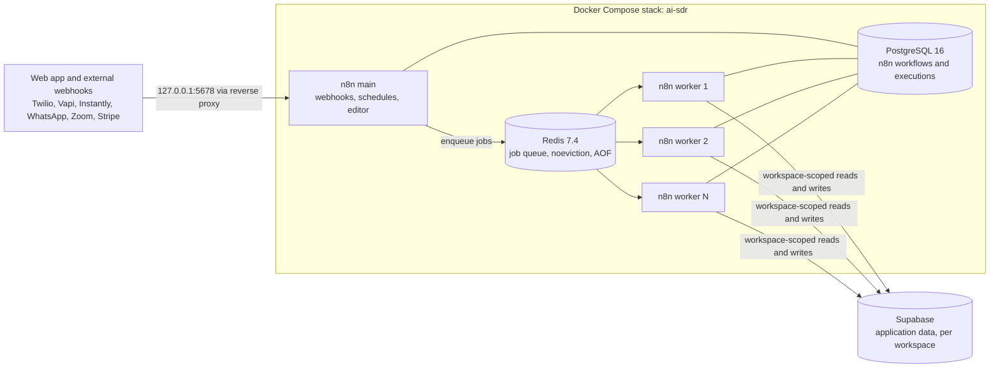

# F01 — Infrastructure Stack

Engineered by Muhammad Hassan | AI ENGINEER | AUTOMATION SPECIALIST | SOFTWARE ENGINEER | FULL STACK DEVELOPER

| | |
| --- | --- |
| Feature ID | F01 |
| SRS reference | Section 10.2 (connection pooling and queues), Section 10.8 (deployment) |
| Location | `infra/docker-compose.yml`, `infra/.env.example`, `tests/infra/` |
| Automated tests | 14 passed, 0 failed |

## 1. Summary

The orchestration layer that runs every AI agent for every subscriber. One shared n8n system runs in **queue mode**: a main instance receives webhooks and schedules, Redis holds the job queue, and a pool of stateless workers executes jobs for all workspaces in parallel. Throughput grows by adding workers, with no change per subscriber.

## 2. Architecture



## 3. Components

| Service | Image | Role |
| --- | --- | --- |
| `n8n` | `n8nio/n8n:2.47.5` | Main instance: receives webhooks, runs schedules, enqueues jobs |
| `n8n-worker` | `n8nio/n8n:2.47.5` | Executes jobs from the queue; 2 replicas by default, 10 concurrent jobs each |
| `redis` | `redis:7.4-alpine` | Job queue; password-protected, append-only persistence, `noeviction` |
| `n8n-postgres` | `postgres:16.6-alpine` | n8n's own state (workflows, execution history) |

Application data (workspaces, leads, deals) is not stored here. It lives in Supabase and is defined by the migrations in `/supabase` (feature F02).

## 4. Design decisions

| Decision | Reason |
| --- | --- |
| Queue mode instead of a single n8n process | Many subscribers run at once; workers process jobs in parallel and one stuck job cannot block the rest |
| Workers are stateless and replicated | Capacity scales with `--scale n8n-worker=N`; a crashed worker is restarted and its jobs are retried |
| Redis `noeviction` and append-only file | A queued call or email must never be dropped under memory pressure or lost on restart |
| Exact image versions | Reproducible deployments and one-step rollback to the previous pinned tag |
| Health check on every service, ordered start-up | Workers start only after the main instance is healthy; the main instance only after database and queue are healthy |
| Required secrets use `${VAR:?}` | The stack refuses to start with a missing secret instead of running insecurely |
| Port bound to `127.0.0.1` | n8n is reachable only through a TLS reverse proxy, never directly from the internet |
| Separate database for n8n state | Orchestration state and tenant data have different owners, backups and access rules |
| JSON logs and execution pruning | Logs are ready for central logging; execution history is kept for 14 days by default |

## 5. Configuration

All settings come from `infra/.env` (template: `infra/.env.example`).

| Variable | Required | Purpose |
| --- | --- | --- |
| `N8N_DB_PASSWORD` | Yes | Password of the n8n database |
| `REDIS_PASSWORD` | Yes | Password of the job queue |
| `N8N_ENCRYPTION_KEY` | Yes | Encrypts credentials stored by n8n; must never change after first start |
| `PLATFORM_HMAC_SECRET` | Yes | Signs requests between the web app and n8n |
| `N8N_WORKER_REPLICAS` | No (2) | Number of worker containers |
| `N8N_WORKER_CONCURRENCY` | No (10) | Jobs each worker runs at once |
| `N8N_DB_POOL_SIZE` | No (5) | Database connections per n8n process |
| `WEBHOOK_URL`, `N8N_HOST`, `N8N_PROTOCOL` | No | Public address used in webhook URLs |
| `SUPABASE_URL`, `SUPABASE_SERVICE_ROLE_KEY` | For workflows | Access to application data from workflows |

Capacity with defaults: 2 workers × 10 jobs = 20 jobs running at once. Database connections stay bounded at (1 main + N workers) × `N8N_DB_POOL_SIZE`.

## 6. Operations

```bash
cp infra/.env.example infra/.env      # then replace every change-me value
npm run infra:up                      # start the stack
npm run infra:ps                      # health of every service
npm run infra:scale                   # scale to 4 workers
npm run infra:down                    # stop (data is kept in volumes)
```

Rollback: set the previous image tag in `docker-compose.yml` and run `npm run infra:up`. Data persists in the named volumes `n8n_postgres_data`, `redis_data` and `n8n_data`.

## 7. Security

- No secret is written in the repository; `.env` files are git-ignored and the template holds placeholders only
- Redis and PostgreSQL are reachable only on the internal Docker network
- n8n telemetry is disabled
- Subscriber tool credentials are not stored in n8n; they are loaded per workspace at run time (SRS 10.1)

## 8. Verification

14 automated configuration tests and Docker Compose's own validation pass on every commit (see `test-cases.md`). The deployment checklist in the same document confirms the running stack on each Docker host.
