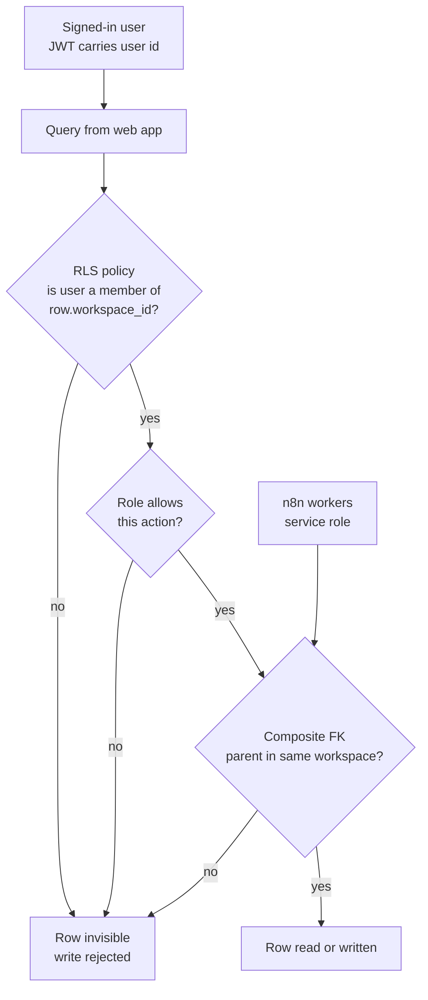
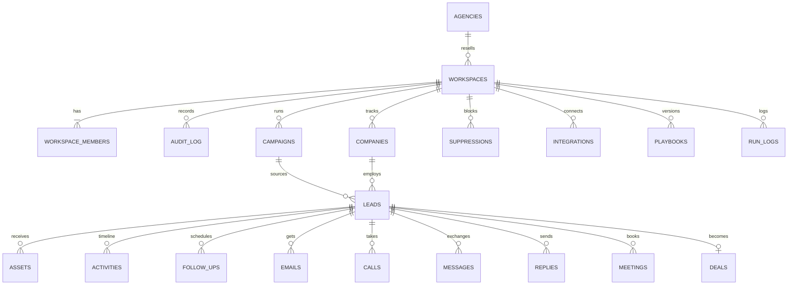

# F02 — Multi-Tenant Database with Row-Level Security

Engineered by Muhammad Hassan | AI ENGINEER | AUTOMATION SPECIALIST | SOFTWARE ENGINEER | FULL STACK DEVELOPER

| | |
| --- | --- |
| Feature ID | F02 |
| SRS reference | Section 7 (data model), Section 9 (multi-tenancy), Section 10.1 (access control), M15, M20, M21, M23 |
| Location | `supabase/migrations/`, `tests/db/` |
| Database | PostgreSQL (Supabase) |
| Automated tests | 42 passed, 0 failed |

## 1. Summary

The data foundation of the platform. Every subscriber company works in its own **workspace**, and every row of business data carries that workspace's ID. PostgreSQL row-level security guarantees that a user can only reach rows of workspaces they belong to, with four roles deciding what they may change. The schema stores the complete sales journey: campaigns, companies, leads, every touch on every channel, meetings, deals, suppression, integrations and playbooks.

## 2. Isolation model

Tenant isolation is enforced in the database itself, in two independent layers:

1. **Row-level security.** Every table has RLS enabled. Policies call `app.is_member(workspace_id)` and `app.has_role(workspace_id, roles)`, so a query from the web app can never return or change another company's rows, whatever the application code does.
2. **Composite foreign keys.** Child rows reference parents by `(workspace_id, id)`. A lead in workspace A cannot point to a campaign in workspace B, and an activity cannot be attached to another company's lead. This holds even for the backend service role, which bypasses RLS.



## 3. Roles and permissions

| Action | Owner | Admin | Rep | Viewer |
| --- | --- | --- | --- | --- |
| Read all workspace data | Yes | Yes | Yes | Yes |
| Create and update leads, activities, follow-ups, emails, calls, messages, meetings, deals, suppressions | Yes | Yes | Yes | No |
| Delete leads and other sales records | Yes | Yes | No | No |
| Manage campaigns, integrations and playbooks | Yes | Yes | No | No |
| Change workspace settings, channel switches and the kill switch | Yes | Yes | No | No |
| Add or remove reps and viewers | Yes | Yes | No | No |
| Grant or remove owner and admin roles | Yes | No | No | No |
| Read the audit log and run logs | Yes | Yes | No | No |
| Delete the workspace | Yes | No | No | No |

Anonymous visitors have no access to any table. A workspace always keeps at least one owner.

## 4. Data model



### Tables

| Table | Purpose | Key rules |
| --- | --- | --- |
| `agencies` | White-label resellers that own client workspaces | Managed by the agency owner |
| `workspaces` | One per subscriber company: plan, automation mode, channel switches, kill switch, target areas, branding | Defaults to full autopilot with email, voice, SMS and WhatsApp on |
| `workspace_members` | Users and their role in a workspace | Creator becomes owner; last owner is protected |
| `audit_log` | Member, channel, automation and kill-switch changes | Written only by triggers; read by owners and admins |
| `campaigns` | Niche, ICP, offer, target areas, channels, mode, daily lead limit | Written by owners and admins |
| `companies` | Business a lead works for: domain, industry, size, Google rating and reviews, research brief | One row per domain per workspace |
| `leads` | Contact details, source channel, verification, consent per channel, score, AI lead report, stage, owner, next follow-up | One lead per email per workspace; needs at least one contact method |
| `assets` | Audit reports and proposals with view tracking | |
| `activities` | The per-lead timeline of every event | Indexed for newest-first reads |
| `follow_ups` | Next touches with channel, due date and cadence step | Overdue is derived from status and due date |
| `emails`, `calls`, `messages` | Every send and call, with recording, transcript and summary for calls | Idempotency key prevents duplicate sends |
| `replies` | Inbound replies with classification and confidence | Nine reply classes |
| `meetings` | Zoom meetings, how they were booked, who ran them, outcome | |
| `deals` | Pipeline stage, value, agreement and payment status, who closed | One sales record per lead |
| `suppressions` | Emails, domains and phone numbers that must never be contacted | Normalised and unique per workspace |
| `integrations` | Connected tools and their health | Stores a vault reference, never the secret |
| `playbooks` | Versioned company playbook and guardrails | Exactly one live version per workspace |
| `run_logs` | Workflow runs with a correlation ID | Written by the backend only |

## 5. Design decisions

| Decision | Reason |
| --- | --- |
| Shared schema with `workspace_id` on every row | One database serves every subscriber; adding a subscriber needs no new infrastructure |
| RLS in the database rather than filters in application code | A bug in a query cannot leak another company's data |
| `SECURITY DEFINER` helpers with an empty `search_path` | Policies stay fast and non-recursive, and cannot be hijacked through schema shadowing |
| Composite foreign keys on `(workspace_id, id)` | Tenant integrity also holds for the service role used by workers |
| Idempotency key unique per workspace on emails, calls and messages | A retried job can never send or call twice |
| Case-insensitive unique email per workspace | The same person is never worked twice inside one company, yet two companies can target the same prospect |
| Money stored as integer cents with a currency code | No rounding errors in deal values |
| Text columns with `CHECK` constraints for states | Invalid stages, channels and outcomes are rejected, and new values are added with a simple migration |
| Secrets referenced, not stored | Tool credentials live encrypted in the vault; this schema holds only a reference |
| Audit rows written by triggers | Access and outreach changes are recorded even if application code forgets to log them |
| Indexes lead with `workspace_id` | Every query is scoped to one workspace, so every index is too |

## 6. Indexes for the main screens

| Screen or job | Index |
| --- | --- |
| Leads list filtered by stage, owner or source channel | `leads (workspace_id, stage)`, `(workspace_id, owner_id)`, `(workspace_id, source_channel)` |
| Follow-ups due and overdue | `leads (workspace_id, next_follow_up_at)`, `follow_ups (workspace_id, status, due_at)` |
| Lead timeline | `activities (workspace_id, lead_id, created_at desc)` |
| Deal pipeline board | `deals (workspace_id, stage)` |
| Upcoming meetings | `meetings (workspace_id, starts_at)` |
| Inbound caller lookup | `leads (workspace_id, phone)` |
| Trace one lead across workflows | `run_logs (correlation_id)` |

## 7. Database functions

| Function | Purpose |
| --- | --- |
| `app.is_member(workspace_id)` | True when the signed-in user belongs to the workspace |
| `app.has_role(workspace_id, roles[])` | True when the signed-in user holds one of the roles |
| `app.is_suppressed(workspace_id, email, phone)` | True when the email, its domain or the phone is on the workspace's suppression list |

## 8. Applying the schema

```bash
npx supabase start            # local Supabase
npx supabase db reset         # applies every migration in supabase/migrations
npx supabase db push          # applies pending migrations to the linked project
```

Migrations are plain SQL, run in file-name order and are never edited after release; changes ship as new migrations so a code rollback never breaks the schema.

## 9. Verification

42 automated tests apply the real migrations to PostgreSQL and exercise them as each role, as an outsider, as an anonymous visitor and as the service role (see `test-cases.md`).
