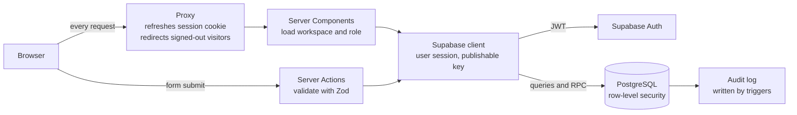
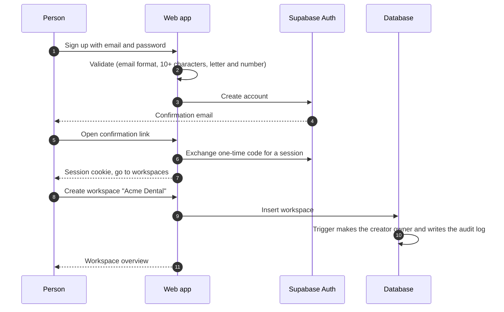

# F03 — Web App: Sign-In, Workspaces, Team and Settings

Engineered by Muhammad Hassan | AI ENGINEER | AUTOMATION SPECIALIST | SOFTWARE ENGINEER | FULL STACK DEVELOPER

| | |
| --- | --- |
| Feature ID | F03 |
| SRS reference | Section 10.1 (authentication and access control), M21 (automation modes and channel controls), M23 (workspaces and roles) |
| Location | `web/`, `supabase/migrations/20261112123230_workspace_member_rpcs.sql`, `tests/db/team.test.mjs` |
| Stack | Next.js 16 (App Router, Server Actions), React 19, Supabase Auth, TypeScript, Zod |
| Automated tests | 22 unit, 9 database, 16 browser: 47 passed, 0 failed |

## 1. Summary

The web application subscribers sign in to. A person creates an account, confirms their email, creates a workspace for their company and becomes its owner. From there they build their team with four roles, switch outreach channels on or off, choose autopilot or approval mode, switch the AI closer on or off, and pause all outreach with one button. Every screen shows only what the person's role allows, and every change is enforced again by the database.

## 2. Screens

| Route | Purpose | Access |
| --- | --- | --- |
| `/` | Landing page with sign-up and sign-in | Public; signed-in users go to their workspaces |
| `/signup` | Create an account with email and password | Public |
| `/login` | Sign in; returns to the page the person wanted | Public |
| `/auth/callback`, `/auth/confirm` | Complete email confirmation links | Public, one-time code or token |
| `/auth/signout` | End the session | POST only |
| `/workspaces` | List the person's workspaces; create a new one | Signed in |
| `/w/[id]` | Overview: leads, open deals, team size, channels, kill switch | Workspace members |
| `/w/[id]/members` | Team list, add by email, change role, remove | Members read; owners and admins manage |
| `/w/[id]/settings` | Company name, automation mode, AI closer, channel switches | Members read; owners and admins change |

## 3. Architecture



All data access runs on the server with the signed-in person's own session. The app holds no privileged key: the service-role key is never used by the web app, so the database's row-level security is the single authority on who can read or change what.

## 4. Sign-up and sign-in flow



## 5. Design decisions

| Decision | Reason |
| --- | --- |
| Server Components and Server Actions only; no client-side data fetching | The session never leaves HTTP-only cookies and no data API is exposed to browser scripts |
| The web app uses only the publishable key | A bug in the app cannot bypass row-level security |
| Role rules exist twice: `lib/roles.ts` for what to show, RLS for what is allowed | The interface hides what a person cannot do; the database refuses it even if the interface is bypassed |
| Updates and deletes ask the database to return the changed rows | A change blocked by RLS matches zero rows, which the app reports as "no permission" instead of a false success |
| Workspaces the person is not in return "not found" | The existence of other companies' workspaces is never revealed |
| Team functions `workspace_members_list` and `workspace_member_add` run as definer with explicit role checks | Member emails live in the auth schema, which clients cannot read; the functions expose only the team of a workspace the caller belongs to |
| `next` redirect parameter is restricted to in-app paths | Prevents open-redirect phishing through sign-in links |
| Sign-out accepts POST only | Another site cannot sign a person out with a link or image |
| Validation runs before any call to the auth service | Malformed input costs no network call and cannot be used to probe accounts |
| Forms keep what was typed after an error and work without JavaScript | Fewer retyping errors; resilient on slow connections |
| Security headers on every response (HSTS, no-sniff, frame deny, referrer policy) | Baseline browser protections from SRS 10.9 |

## 6. Roles in the interface

| Element | Owner | Admin | Rep | Viewer |
| --- | --- | --- | --- | --- |
| Overview, team list, settings (read) | Yes | Yes | Yes | Yes |
| Save settings, channel switches, AI closer | Yes | Yes | Read-only | Read-only |
| Pause or resume all outreach | Yes | Yes | Hidden | Hidden |
| Add a member | Any role | Rep or viewer | Hidden | Hidden |
| Change role or remove a member | Anyone but themselves | Reps and viewers | Hidden | Hidden |

## 7. Configuration

`web/.env.local` (template: `web/.env.example`):

| Variable | Purpose |
| --- | --- |
| `NEXT_PUBLIC_SUPABASE_URL` | Supabase project URL |
| `NEXT_PUBLIC_SUPABASE_PUBLISHABLE_KEY` | Publishable key; safe in the browser because RLS protects the data |
| `NEXT_PUBLIC_SITE_URL` | Public address of the app, used in confirmation links |

```bash
cd web
npm install
cp .env.example .env.local    # fill in the project URL and publishable key
npm run dev                   # http://localhost:3000
npm test                      # unit tests
npm run build && npm run start
npx playwright install chromium && node e2e/signed-out.e2e.mjs   # browser tests against the running app
```

## 8. Security notes

- Passwords are handled only by Supabase Auth; the app never stores or logs them
- Sign-in errors use one message for wrong email and wrong password
- Database error text is never shown; errors are mapped to fixed messages
- The Supabase security advisor lists the two team functions as definer functions callable by signed-in users. This is intended: both check the caller's membership and role before returning or changing anything, and anonymous callers are refused.

## 9. Verification

See `test-cases.md`: 22 unit tests for roles, validation and error mapping; 9 database tests for the team functions; 16 browser tests of the running app; a live check of the team functions on the hosted database; and a signed-in acceptance walkthrough.
