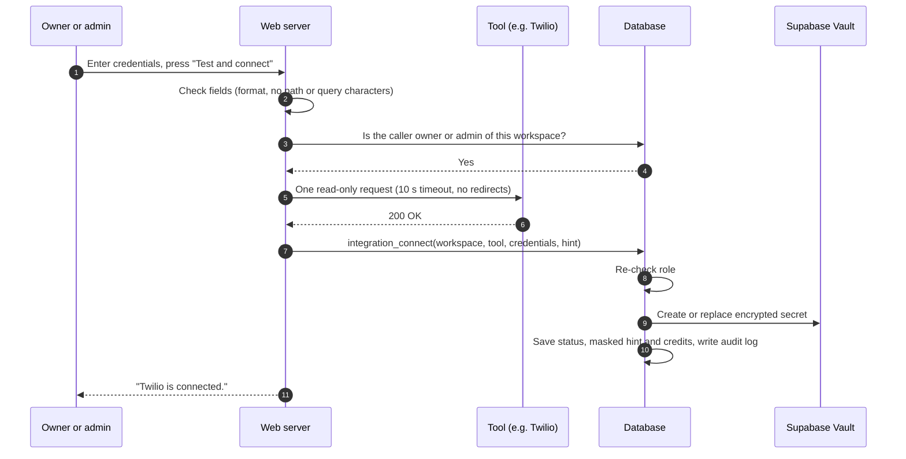
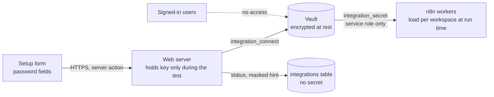

# F04 — Guided Onboarding and Tool Connections

Engineered by Muhammad Hassan | AI ENGINEER | AUTOMATION SPECIALIST | SOFTWARE ENGINEER | FULL STACK DEVELOPER

| | |
| --- | --- |
| Feature ID | F04 |
| SRS reference | M23 (FR-23.2 guided onboarding, FR-23.3 setup checklists, FR-23.4 connection health), Section 10.1 (encrypted credentials), Section 10.9 (secrets) |
| Location | `web/src/lib/integrations.ts`, `web/src/lib/connection-tests.ts`, `web/src/app/w/[workspaceId]/setup/`, `supabase/migrations/20261112171937_integration_vault.sql` |
| Automated tests | 18 database, 26 unit, 16 browser: 60 passed, 0 failed |
| Live checks | Vault round-trip and access rules verified on the hosted database |

## 1. Summary

Each subscriber company connects its own accounts for 16 tools through a guided Setup page. The page works out which tools the company's enabled channels need, tests every set of credentials against the real service before saving, stores the credentials encrypted in Supabase Vault, and tracks manual steps such as domain authentication and SMS registration. A progress bar and an overview prompt show what is left before outreach can start.

## 2. Supported tools

| Tool | Used for | Credentials | Connection test |
| --- | --- | --- | --- |
| OpenAI | Research, writing, reply handling, lead discovery | API key | List models |
| Anthropic | Alternative or backup language model | API key | List models |
| Google Gemini | Alternative model and lead discovery | API key | List models |
| Apollo | B2B lead data and enrichment | API key | Auth health check |
| Apify | Google Maps and social media scraping | API token | Current user |
| ZeroBounce | Email verification | API key | Credit balance (stored) |
| Instantly | Email sequences | API key (v2) | List accounts |
| Twilio | Numbers for AI calls and SMS | Account SID, auth token | Account status must be active |
| Vapi | AI voice agents | Private API key | List assistants |
| WhatsApp Business | Audits, proposals, reminders | Phone number ID, access token | Phone number lookup (number stored) |
| Zoom | Meetings | Account ID, client ID, client secret | Server-to-Server OAuth token |
| Calendly | Availability and booking links | Personal access token | Current user |
| HubSpot | Optional CRM sync | Private app token | List contacts |
| Slack | Team alerts | Bot token | `auth.test` (workspace name stored) |
| PandaDoc | Agreements for e-signature | API key | List documents |
| Stripe | Payment links and invoices | Secret or restricted key | Balance |

Every test is a single read-only request; nothing is created or charged in the company's accounts.

## 3. Which tools a company needs

The plan is calculated from the workspace's channel switches and the AI closer setting (`buildOnboardingPlan`).

| Step | Tools (any one completes it) | Required when |
| --- | --- | --- |
| Language model | OpenAI, Anthropic, Gemini | Always |
| Lead sources | Apollo, Apify | Always |
| Email verification | ZeroBounce | Email on |
| Email sending | Instantly | Email on |
| AI voice agents | Vapi | Voice on, or AI closer on |
| Phone numbers | Twilio | Voice or SMS on |
| WhatsApp | WhatsApp Business | WhatsApp on |
| Meetings | Zoom | Always |
| Calendar | Calendly | Always |
| Team alerts | Slack | Always |
| Agreements | PandaDoc | AI closer on |
| Payments | Stripe | AI closer on |
| External CRM | HubSpot | Never (optional) |

| Manual step | Required when |
| --- | --- |
| Sending domains authenticated (SPF, DKIM, DMARC) | Email on |
| Mailboxes warmed up | Email on |
| A2P 10DLC registration approved | SMS on |
| WhatsApp templates approved | WhatsApp on |

Progress = completed required steps ÷ all required steps (tool steps plus manual steps). A tool counts only while its status is `connected`; `error` and `expired` do not.

## 4. Connection flow

If the test fails, nothing is saved and the person sees why (rejected, account not found, rate limited, service error, unreachable).

## 5. Credential security

| Rule | How it is enforced |
| --- | --- |
| Secrets are stored encrypted | Supabase Vault; the integrations table holds only a reference |
| Nobody can read a secret back through the app | `integration_secret` is executable by the service role only; signed-in users have no access to the vault schema |
| Only owners and admins connect or disconnect | Checked in the web server before the test, and again inside the database function |
| A company cannot point its row at another company's secret | Clients have no insert, update or delete rights on the integrations table; only the functions write it |
| Secrets never appear in messages, logs or the audit log | Error messages are fixed text; the audit log records the tool and status only |
| Disconnect deletes the secret | The vault entry is removed and the row marked disconnected |
| Deleting a workspace deletes its secrets | Trigger purges every vault entry of the workspace |
| Request addresses cannot be manipulated | Identifiers used in URLs (Twilio SID, WhatsApp number ID, Zoom account ID) must match strict patterns and are URL-encoded |
| Only the last four characters are ever shown | `maskSecret` stores `•••• abcd` as the hint |
| Secrets stay out of request addresses | Sent in headers, except ZeroBounce, whose API only accepts the key as a query parameter |

## 6. Database changes

| Change | Purpose |
| --- | --- |
| `integrations.tool` limited to the 16 supported tools | Rejects unknown tools |
| `integrations.last_error` | Last failure message from a test or health check |
| `workspaces.setup_checklist` | Manual steps ticked off by owners and admins |
| Direct client writes to `integrations` revoked | All writes go through the functions below |
| `integration_connect` | Owner/admin: store credentials in the vault and record the test result |
| `integration_disconnect` | Owner/admin: delete credentials, mark disconnected |
| `integration_secret` | Service role: decrypted credentials for workers |
| `integration_health_update` | Service role: record scheduled health checks; never revives a disconnected tool |
| `purge_workspace_secrets` trigger | Removes a deleted workspace's credentials |

## 7. Screens

- **Setup** (`/w/[id]/setup`): progress bar; one card per needed step with each tool's status (Connected, Needs attention, Expired, Not connected), masked key, credits, workspace or phone number, and last check time; "Test and connect", "Replace credentials" and "Disconnect and delete credentials" for owners and admins; manual setup checklist; a note listing steps not needed with the current channels.
- **Overview**: a "Finish setup" card with the percentage until everything required is done.
- Reps and viewers see statuses but no forms.

## 8. Design decisions

| Decision | Reason |
| --- | --- |
| Test before save, never save failing credentials | The company knows immediately that a key works; agents never start with broken tools |
| Role checked before calling the third-party service | The form cannot be used to test stolen keys against other services |
| One read-only probe per tool, 10 s timeout, redirects refused | Fast, harmless, and cannot be bounced to another host |
| "Any one of" steps for models and lead sources | Companies choose their provider; the platform fails over between connected models (SRS 10.7) |
| Plan derived from channel switches | Cold-email-only companies are not asked for Twilio, WhatsApp or Stripe |
| Re-testing stored credentials is done by the backend health check, not the browser | The web app can never read a stored secret |

## 9. Known limits

- A signed-in owner or admin could call `integration_connect` directly with `check_status = 'connected'`, skipping the test. The effect is limited to their own workspace and is corrected by the scheduled health check, which re-tests stored credentials (built with the n8n workers).
- The Supabase advisor lists `integration_connect` and `integration_disconnect` as definer functions callable by signed-in users. This is intended: both check the caller's role first.
- Connection tests call live third-party APIs, so they were verified with mocked responses; the first real connection per tool is part of the acceptance walkthrough.
