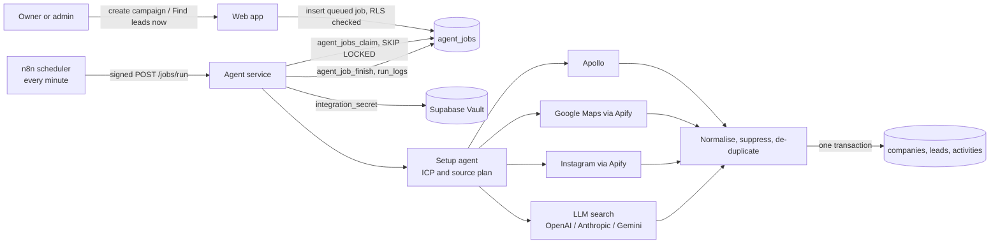

# F05 — AI Setup Agent and Multi-Channel Lead Sourcing

Engineered by Muhammad Hassan | AI ENGINEER | AUTOMATION SPECIALIST | SOFTWARE ENGINEER | FULL STACK DEVELOPER

| | |
| --- | --- |
| Feature ID | F05 |
| SRS reference | M1 (FR-1.1, 1.3, 1.4, 1.6), M2 (FR-2.1 to 2.7), M14 (FR-14.1 to 14.5), M15 (lead timeline), Section 10 (queue, retries, logging, failover, pooling) |
| Location | `agents/` (agent service), `supabase/migrations/20261112175255_agent_jobs.sql`, `infra/docker-compose.yml` (`agent-service`), `infra/n8n/workflows/agent-scheduler.json`, `web/src/app/w/[workspaceId]/campaigns/`, `web/src/app/w/[workspaceId]/leads/`, `web/src/lib/campaigns.ts` |
| Automated tests | 15 database, 55 agent service, 8 web unit, 4 infrastructure, 16 browser: 98 passed, 0 failed |
| Live checks | Job queue table, access rules and claim function verified on the hosted database |

## 1. Summary

A company types the niche it sells to and the countries or cities it targets. The AI setup agent turns that into an ideal customer profile (industries, company size, decision-maker titles, pain points, buying triggers) and a search plan for each lead source. Lead-finder agents then search Apollo, Google Maps, Instagram and web-search language models at the same time, using the company's own connected accounts. Every result is cleaned into one format, checked against the do-not-contact list, de-duplicated against the company's existing leads and stored with its source, campaign, company record and a first timeline entry. The campaign page shows the profile, the plan, every agent run and its numbers; the leads page lists leads by source and stage.

## 2. Architecture

| Part | Responsibility |
| --- | --- |
| Web app | Creates campaigns, queues `campaign_plan` and `lead_sourcing` jobs, shows plans, runs and leads |
| `agent_jobs` table | Durable queue. One active job per campaign and type; retries for crashed workers; kill switch respected |
| n8n scheduler | Wakes the agent service every minute with an HMAC-signed request. Holds no business logic and no customer credentials |
| Agent service | TypeScript service in `agents/`. Claims jobs, runs agents, writes results. Stateless, so it scales with `--scale agent-service=N` |
| Supabase Vault | Each company's tool credentials, read only by the backend for that company's jobs |

## 3. The setup agent

Input: niche, target areas, optional offer, and which tools the company has connected.

The agent asks the first connected language model for one JSON object with the profile and a plan per source. OpenAI is called with a strict JSON schema; Anthropic and Gemini are given the same schema in the instructions and their answer is parsed and validated. If a provider fails or returns something that does not fit the schema, the next connected provider is tried (Section 10.7).

The plan is then made safe to run, in code rather than trusted from the model:

| Rule | Why |
| --- | --- |
| Target areas the company typed replace any location the model chose | Every search stays in the company's market (FR-14.1) |
| Repeated titles, terms and hashtags are removed; counts are capped | Bounded cost per run |
| Apollo employee ranges must look like `11,50` | Apollo rejects other formats |
| Hashtags are reduced to letters, digits and underscores | Invalid hashtags make the scraper fail |
| A source is switched off when its tool is not connected | Apollo needs Apollo, Google Maps and Instagram need Apify, LLM search needs any language model |
| A source the model switched off stays off | B2B niches do not search Instagram, local shops do not search Apollo |

The plan is saved on the campaign (`icp`, `source_plan`) and re-checked against connected tools on every sourcing run, so connecting Apify later is picked up after a re-plan, and disconnecting a tool stops its source at once.

## 4. Lead sources

| Source | How | What a lead gets | Cost control |
| --- | --- | --- | --- |
| Apollo | People search (no credits, no emails) up to 5 pages, then bulk enrichment 10 people per call | Name, title, email, phone, LinkedIn, company, domain, industry, size, location | Only as many people as the remaining daily limit are enriched; credits used are reported |
| Google Maps | Apify `compass~crawler-google-places`, one run per target area, closed places skipped, contacts scraped from each website | Business name, category, address, phone, website, rating, review count, email, Instagram, Facebook, LinkedIn, Maps link | Places per search sized from the daily limit |
| Instagram | Apify hashtag scraper finds posting accounts, then the profile scraper reads them | Handle, business name, category, website, followers, public email and phone, or an email found in the bio | Posts per run capped at 200; personal accounts skipped |
| LLM search | Each connected model with web search answers each planned question with its top 10 companies | Company, website, location, and a public email or phone only when published | Up to 4 questions per model; one model failing does not stop the others |

## 5. Clean, check and store

1. **Normalise.** Emails lower-cased and junk addresses dropped (noreply, example domains, image file names). Phones reduced to digits with an optional `+`. Websites reduced to a domain, ignoring link pages and social sites. Instagram handles and LinkedIn profile links reduced to one form. Ratings rounded, text trimmed.
2. **Suppress.** Anything matching the company's suppression list by email, email domain, phone or company domain is dropped and counted.
3. **Split.** A lead must have an email, phone, LinkedIn profile or social handle (the database enforces the same rule). Companies found without any contact, mostly from LLM search, are saved as company records for enrichment (F06) and counted as "without contact".
4. **De-duplicate.** One set of identity keys (email, phone, LinkedIn, Instagram handle, and the domain for nameless business leads) is shared across stored leads and every source in the run, so a clinic found on Google Maps and again by an LLM is stored once.
5. **Limit.** The campaign's daily lead limit is applied across all sources.
6. **Store in one transaction.** Companies are matched by domain and enriched, never duplicated; leads are inserted with `source_channel`, `source_query`, campaign and niche; each new lead gets a timeline entry such as "Found by the lead sourcing agent on Google Maps (dentist in Austin, Texas)". An email that another job stored a moment earlier is counted as a duplicate, not an error.

## 6. Job queue and reliability

| Concern | Design |
| --- | --- |
| Double clicks | Unique index allows one queued or running job per campaign and type |
| Several workers | `agent_jobs_claim` uses `FOR UPDATE SKIP LOCKED`, so a job is never handed out twice |
| Crashed worker | A job running longer than 15 minutes is put back in the queue, and failed after 3 attempts |
| Kill switch | When outreach is paused, sourcing jobs wait; planning still runs |
| Partial failure | Sources run in parallel and are isolated. If Apify rejects the key, Google Maps and Instagram are reported as failed, the Apify connection is flagged in Setup, and Apollo and LLM leads are still saved. The job fails only when every source fails |
| Overlapping runs | One run per agent-service process at a time; the next scheduler tick tries again |
| Observability | Every job writes a `run_logs` row and JSON log lines carrying the job's `correlation_id` |
| Connection pooling | The service connects through the Supabase transaction pooler with prepared statements off |
| Secrets | Credentials are read per job from Vault and never logged; provider error messages are fixed sentences that never include keys or response bodies |

## 7. Agent service API

| Endpoint | Auth | Purpose |
| --- | --- | --- |
| `POST /jobs/run` | `x-timestamp` and `x-signature` = HMAC-SHA256 of `timestamp.body` with `PLATFORM_HMAC_SECRET`, valid for 5 minutes, compared in constant time | Claims and runs up to `JOBS_PER_RUN` jobs; returns each job's outcome |
| `GET /health` | None | 200 when the database answers, 503 otherwise; used by the container health check and uptime monitors |

Requests over 16 KB are refused. The service has no public port; only n8n on the internal network reaches it.

## 8. Screens

| Screen | Contents |
| --- | --- |
| Campaigns | List with niche, target areas and status; "New campaign" for owners and admins |
| New campaign | Name, niche, target areas (one per line, up to 10), optional offer, leads per day, "Find leads right away" |
| Campaign | Leads found, profile, each source with its search terms or why it is off, agent buttons (Find leads now, Re-plan, Pause), and a history of agent runs with results in plain words |
| Leads | Counts by source as filters, search by name, email, phone or title, stage filter, campaign filter, 50 per page, company with domain and Google rating, contact details, source and stage |

Signed-out visitors are sent to sign-in and returned to the same page, now including its filters.

## 9. Configuration

| Variable | Where | Purpose |
| --- | --- | --- |
| `AGENT_DATABASE_URL` | `infra/.env` | Supabase transaction pooler URI for the backend |
| `PLATFORM_HMAC_SECRET` | `infra/.env` | Shared by n8n and the agent service |
| `AGENT_SERVICE_REPLICAS`, `AGENT_JOBS_PER_RUN` | `infra/.env` | Throughput |
| `OPENAI_MODEL`, `GEMINI_MODEL` | `infra/.env` | Optional overrides (defaults `gpt-4.1-mini`, `gemini-2.5-flash`) |
| `ANTHROPIC_MODEL` | `infra/.env` | Anthropic is used once this names a current model id |

Import `infra/n8n/workflows/agent-scheduler.json` into n8n and activate it to start the minute-by-minute runs.

## 10. Design decisions

| Decision | Reason |
| --- | --- |
| Agents in a TypeScript service, n8n as scheduler | Agent logic is tested code with types and unit tests; n8n stays a thin, replaceable trigger. No customer builds workflows, which keeps n8n use within its license |
| Queue in Postgres, not only Redis | Jobs are visible to the web app under row-level security, survive restarts and carry their own results |
| Node runs TypeScript directly | No build step and no compiled output to drift from the source |
| Plan validated in code | Model output is never trusted for locations, limits or tool use |
| Companies without contacts kept | LLM search and Maps often find the right business before a person; enrichment in F06 turns those into leads |
| Sources in parallel with isolated failures | One provider outage never empties a run |

## 11. Known limits and next steps

| Item | Plan |
| --- | --- |
| Daily automatic runs per active campaign (FR-2.6) | F06 adds a daily schedule; today runs start on campaign creation and on demand |
| Enrichment and verification (M3) | F06: decision-maker emails for company-only records, ZeroBounce verification, phone line type |
| Facebook, TikTok, X, LinkedIn, Clay and CSV sources | Same adapter shape; added with the enrichment feature |
| Apollo enrichment response fields | Built to Apollo's documented shape; confirm with a real key during the acceptance walkthrough |
| Learning which sources perform best (FR-14.8) | M24 self-learning feature |
