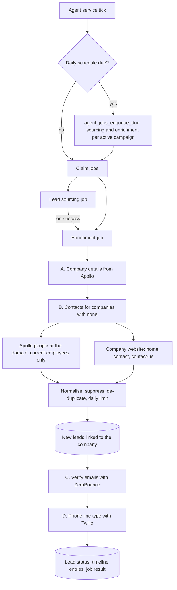

# F06 — Enrichment, Verification and Daily Scheduling

Engineered by Muhammad Hassan | AI ENGINEER | AUTOMATION SPECIALIST | SOFTWARE ENGINEER | FULL STACK DEVELOPER

| | |
| --- | --- |
| Feature ID | F06 |
| SRS reference | M3 (FR-3.1, 3.2, 3.3, 3.4, 3.5, 3.6), M2 (FR-2.6 daily runs), M15 (lead timeline), Section 10 (retries, isolation, outbound request safety) |
| Location | `agents/src/enrichment.ts`, `agents/src/sources/website.ts`, `agents/src/sources/verify.ts`, `agents/src/sources/apollo.ts`, `supabase/migrations/20261112185127_enrichment.sql`, `web/src/app/w/[workspaceId]/campaigns/`, `web/src/app/w/[workspaceId]/leads/` |
| Automated tests | 8 database, 29 agent service, 2 web unit, 16 browser: 55 passed, 0 failed |
| Live checks | New columns, job type, scheduling functions and their access rules verified on the hosted database |

## 1. Summary

Lead sourcing (F05) often finds the right business before it finds a person to contact. The enrichment agent closes that gap and makes every contact safe to use before outreach starts:

- **Decision makers:** for companies found without a contact, Apollo is searched by the company's domain with the campaign's decision-maker titles, and up to two people still working there become leads.
- **Company website:** when Apollo has no one, or is not connected, the agent reads the company's own home and contact pages for a public business email and phone.
- **Company details:** industry, size, location and LinkedIn are filled in from Apollo.
- **Email verification:** every email is checked with ZeroBounce and marked valid, invalid, catch-all or risky.
- **Phone checks:** every phone with a country code is checked with Twilio Lookup for line type (mobile, landline, VoIP) and country, and stored in E.164 format.
- **Daily runs:** every active campaign now finds new leads and enriches them once a day, and each sourcing run hands over to enrichment immediately.

Each step uses the company's own connected tools, writes a timeline entry on the lead, and reports its numbers on the campaign page.

## 2. Flow

## 3. Steps in detail

| Step | Runs when | Per run | Outcome |
| --- | --- | --- | --- |
| A. Company details | Apollo connected | 25 companies with a domain and missing industry or size | Fills only empty fields; each company is looked up once |
| B. Contacts | Always | 50 companies of the campaign with no lead | Up to 2 named decision makers per company from Apollo, otherwise the website's business email and phone. Company marked enriched, no contact found, or skipped |
| C. Email verification | ZeroBounce connected and email channel on | 200 unchecked emails, 5 at a time | `verification_status` set; check time stored; timeline entry |
| D. Phone line type | Twilio connected and calls, SMS or WhatsApp on | 100 unchecked phones, 5 at a time | Line type, country and E.164 number stored; numbers without a country code marked unknown |

ZeroBounce results map as follows: `valid` → valid, `catch-all` → catch-all, `invalid`, `spamtrap`, `abuse` and `do_not_mail` → invalid, anything else → risky. The outreach features send only to valid addresses by default, as FR-3.2 requires.

Twilio line types map as follows: `mobile` and `personal` → mobile, `landline` → landline, `fixedVoip` and `nonFixedVoip` → VoIP, everything else → unknown.

## 4. Rules that keep the data clean

| Rule | Detail |
| --- | --- |
| Same checks as sourcing | New contacts go through the same normalisation, suppression list and de-duplication as F05, and count towards the campaign's daily lead limit |
| Current employer only | Apollo matches people who used to work at a domain too; only people whose current company domain matches are kept |
| Fair, predictable limit | Companies are handled in the order they were found. Contacts held back by the daily limit leave the company pending for the next day |
| Retry only what can change | A company with no domain is skipped; one whose Apollo and website checks ran cleanly with nothing found is marked "no contact found". If Apollo failed, the company stays pending |
| Nothing checked twice | Emails and phones record when they were checked; later runs skip them, so credits are not spent twice |
| Names tidied | Names typed in all capitals or all lower case become title case ("KIM BRIGHT" → "Kim Bright", "JOHN MCDONALD" → "John McDonald"); mixed case is kept (FR-3.5) |
| Channels respected | Emails are not verified when email is off; phones are not checked when calls, SMS and WhatsApp are all off |

## 5. Failure handling

| Situation | Behaviour |
| --- | --- |
| ZeroBounce out of credits or key rejected | Verification stops for this run, the job still succeeds, ZeroBounce is flagged in Setup with the message, and the emails stay unchecked for the next run |
| Twilio or Apollo key rejected | Same pattern: that step stops, the tool is flagged, other steps continue |
| Tool not connected | The step is skipped and the result says which tool to connect |
| A website is slow, broken or not HTML | That company is skipped for this run; others continue |

## 6. Website reading is guarded

Domains come from scraped data, so the website reader treats them as untrusted (SRS 10.9):

- Only `http` and `https` on ports 80 and 443, with no credentials in the address and no IP-address hosts.
- Every hostname is resolved first; if any address is loopback, private, link-local (including the cloud metadata address), carrier-grade NAT, multicast or another non-public range, the request is refused.
- Redirects are followed manually, up to 3, and every hop is checked again.
- 8-second timeout, HTML only, the first 1 MB read at most, and three pages per company.

## 7. Daily scheduling

`agent_jobs_enqueue_due(hours)` runs at the start of every agent-service tick. For every **active** campaign with a niche, in a workspace that is **not paused**, it queues a sourcing job and an enrichment job when none was queued in the last `SCHEDULE_HOURS` (default 24, `0` switches it off). The unique active-job index means scheduled, chained and manual jobs never double up. A finished sourcing job also calls `agent_job_enqueue` to start enrichment straight away. Both functions are callable by the backend only.

## 8. Database changes

| Change | Purpose |
| --- | --- |
| `agent_jobs.type` allows `enrichment` | New job type, queueable by owners and admins from the app |
| `companies.campaign_id`, `source_channel` | Which campaign and source found the company, so its contacts carry the right channel tag |
| `companies.enrichment_status`, `enriched_at` | pending, enriched, no contact found, skipped |
| `leads.phone_country`, `email_checked_at`, `phone_checked_at` | Verification results and when they were taken |
| Indexes on enrichment and verification queues | The agent's selects stay fast as data grows |
| `agent_jobs_enqueue_due`, `agent_job_enqueue` | Daily schedule and sourcing-to-enrichment hand-off |

## 9. Screens

| Screen | Change |
| --- | --- |
| Campaign | New figures for verified emails and companies awaiting contacts; an "Enrich and verify" button; enrichment runs described in plain words ("2 new contacts from 4 companies; 5 emails checked (2 valid, 1 invalid, 2 uncertain); 3 phones checked …") |
| Leads | Each email shows its check result (Verified, Invalid, Catch-all, Risky, Not checked); each phone shows line type and country; new "Email check" filter |

## 10. Configuration

| Variable | Default | Purpose |
| --- | --- | --- |
| `AGENT_SCHEDULE_HOURS` (`infra/.env`) | 24 | Hours between automatic runs per active campaign; 0 turns the schedule off |

No new credentials: enrichment uses the Apollo, ZeroBounce and Twilio accounts each company connected in Setup (F04).

## 11. Known limits and next steps

| Item | Plan |
| --- | --- |
| National Do Not Call registry screening (FR-3.7) | Added with AI voice calling, where it is enforced before every dial |
| Consent basis per channel (FR-3.7) | Recorded by the outreach features as each channel is used |
| Phones without a country code | Marked unknown; voice calling will infer the country from the company's location before dialling |
| AI research briefs and lead scoring (M4) | Next feature (F07) |
