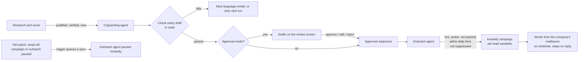

# F08 — AI Copywriting and Email Outreach

Engineered by Muhammad Hassan | AI ENGINEER | AUTOMATION SPECIALIST | SOFTWARE ENGINEER | FULL STACK DEVELOPER

| | |
| --- | --- |
| Feature ID | F08 |
| SRS reference | M5 (personalisation and copy), M6 (email channel, sequencing, sending limits), M1 FR-1.4 and FR-1.5 (daily limits, autopilot or approval), M19 (company playbook), M21 (kill switch), compliance section (opt-out, sender identity) |
| Location | `agents/src/copywriting.ts`, `agents/src/outreach.ts`, `agents/src/sources/instantly.ts`, `supabase/migrations/20261112201947_email_outreach.sql`, `web/src/lib/outreach.ts`, `web/src/app/w/[workspaceId]/campaigns/[campaignId]/` |
| Automated tests | 8 database, 18 agent service, 5 web unit, 16 browser: 47 passed, 0 failed |
| Live checks | New columns, statuses, triggers and the updated queue functions verified on the hosted database |

## 1. Summary

Qualified leads now receive personal cold emails. The copywriting agent writes a short sequence (a first email and up to four follow-ups) for every lead that scored above the campaign's threshold and has a verified email, using the lead's research brief, the campaign offer and the company playbook. In autopilot the sequences are approved at once; in approval mode they wait on a review screen where the team can edit, approve or reject each email. Once a campaign's email outreach is launched, the outreach agent hands approved sequences to the company's own Instantly account, within the daily limit, sending hours and days chosen for the campaign, and stops each sequence when the lead replies.

The full pipeline now runs by itself: **find → enrich and verify → research and score → write → send.**

## 2. Flow

## 3. Writing the emails

| Rule | How it is enforced |
| --- | --- |
| Who gets emails | Lead is in the campaign, stage New, email verified as valid, scored at or above the threshold, researched, not suppressed, and has no emails in this campaign yet |
| Grounded in research | The prompt carries the company summary, pain points, trigger events and personalisation hooks from F07, the offer, and the active company playbook. Research and playbook are wrapped as data, and the model is told to ignore instructions inside them |
| No invented claims | The model may use only facts from the research and the offer; no made-up results, clients, numbers or prices |
| Short and human | First email at most 110 words (rejected above 140), follow-ups at most 70 (rejected above 100), at least 15 words each; subjects 2 to 80 characters with no exclamation marks or shouting |
| Deliverability | No links, images, HTML or placeholders; open and link tracking are off in Instantly |
| Compliance | The model never writes an opt-out line; the campaign's footer (company name, postal address, how to opt out) is added to every email by the system |
| Bad answers | A draft that fails any check is discarded and the next connected model tries; the lead is retried on the next run |
| Never twice | Each email has the key `campaign:lead:step`, so a retry never creates a second sequence |

## 4. Approval

| Mode | Behaviour |
| --- | --- |
| Autopilot (default) | Sequences are stored as approved and sent on the next outreach run |
| Approval mode (workspace setting or campaign mode) | Sequences are stored as drafts. Owners, admins and reps open **Review emails**, edit the subject and text, then approve or reject each email, or approve all drafts at once. A sequence is sent only when every step is approved; one rejected step holds the whole sequence back |

The database enforces what people can do with emails, whatever screen or API they use: they can edit, approve and reject drafts, the approver and time are recorded, but only the backend can move an email into the sending states, and an email already with Instantly can never be changed.

## 5. Sending through Instantly

| Item | Design |
| --- | --- |
| One Instantly campaign per campaign | Created on launch with the campaign's mailboxes, time zone, sending window, days and daily limit; stop-on-reply on; tracking off |
| Personal sequences | Each step's subject and body are variables (`{{subject_1}}`, `{{body_1}}` …); each lead carries its own text as custom variables, so one Instantly campaign sends hundreds of different sequences |
| Daily limit | At most "new leads per day" sequences are started each day |
| Last-moment checks | Just before each lead is handed over: still New, still verified, still above the threshold, and not on the suppression list |
| After handover | Emails marked "With Instantly" with the Instantly lead id; the lead moves to Contacted; the timeline says "Email sequence started in Instantly (3 emails)" |
| Duplicates | Instantly is told to skip a lead already in the campaign, so a retry after a network failure cannot email anyone twice |
| Errors | A rejected key or unpaid plan flags Instantly in Setup and fails the run with a clear message; nothing is marked as sent |

## 6. Pausing is immediate and safe

Pausing must reach Instantly, not just stop new work. Database triggers queue an outreach sync whenever the workspace kill switch, the email channel, the campaign status or the campaign's outreach status changes. The queue lets these sync jobs run even under the kill switch, while new sourcing and new copywriting are held. The outreach agent then pauses the Instantly campaign, normally within a minute, and reactivates it only when every switch is back on.

## 7. Launch checklist

Launch is refused (in the app and again by the agent) until:

- Instantly is connected in Setup.
- The email channel is on.
- At least one sending mailbox is added.
- A sender name is added.
- A footer with company name, postal address and opt-out is added.

Domain authentication and two-week mailbox warm-up from the Setup checklist are shown as recommended.

## 8. Screens

| Screen | Contents |
| --- | --- |
| Campaign → Email outreach | Status (Not started, Sending, Paused), counts waiting for approval, approved and with Instantly, the launch checklist, Launch, Pause and Resume, Write emails now, Send approved now, and email settings (sender, mailboxes, footer, time zone, hours, days, new leads per day, follow-ups, days between emails) |
| Campaign → Review emails | Tabs for waiting, approved, rejected and with Instantly; each lead's sequence with editable subject and text, Approve, Save changes, Reject, and Approve all drafts |
| Lead profile | The lead's email sequence with each email's status |

## 9. Database changes

| Change | Purpose |
| --- | --- |
| Job types `copywriting` and `email_outreach` | New agents |
| Campaign sending settings and Instantly campaign id and state | Per-campaign outreach |
| Email statuses `rejected` and `queued`; `campaign_id`, `provider_id`, approver, approval and hand-over times | Review and sending history |
| `emails_client_guard` trigger | People edit and approve; only the backend sends |
| `queue_outreach_sync` triggers on workspaces and campaigns | Pauses reach Instantly |
| `agent_jobs_claim` | Kill switch holds sourcing and copywriting, not outreach syncs |
| `agent_jobs_enqueue_due` | Daily copywriting for every active campaign; daily sending only for campaigns whose outreach is live |

## 10. Known limits and next steps

| Item | Plan |
| --- | --- |
| Replies, bounces and opt-outs flowing back | Next feature (F09): Instantly webhooks, AI reply classification, automatic suppression of opt-outs and bounces, and lead stage updates |
| Changing sequence length or schedule after launch | Saved for new campaigns; adjust the live Instantly campaign in Instantly |
| Audit report and proposal attachments (M16) | Added with the asset generation feature; emails stay link-free until then |
| Real Instantly account | Built to the published API v2 shapes; confirm with the acceptance walkthrough |
