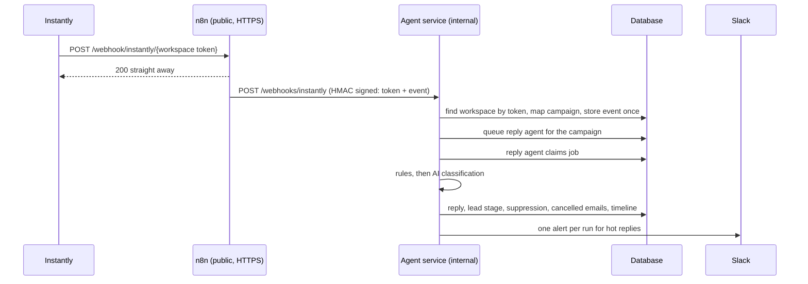

# F09 — Inbound Events, AI Reply Handling and Slack Alerts

Engineered by Muhammad Hassan | AI ENGINEER | AUTOMATION SPECIALIST | SOFTWARE ENGINEER | FULL STACK DEVELOPER

| | |
| --- | --- |
| Feature ID | F09 |
| SRS reference | M7 (AI reply handling), M3 FR-3.4 (suppression of opt-outs and bounces), M11 (alerts), M15 (lead stages and timeline), compliance section (opt-out honoured on every channel), Section 10 (idempotent webhooks, signed internal calls) |
| Location | `agents/src/replies.ts`, `agents/src/webhooks.ts`, `agents/src/sources/slack.ts`, `agents/src/server.ts`, `infra/n8n/workflows/instantly-events.json`, `supabase/migrations/20261112211938_reply_handling.sql`, `web/src/app/w/[workspaceId]/inbox/`, `web/src/lib/replies.ts` |
| Automated tests | 6 database, 1 infrastructure, 15 agent service, 5 web unit, 16 browser: 43 passed, 0 failed |
| Live checks | New table, columns, access rules and the token function verified on the hosted database |

## 1. Summary

Everything that happens after an email goes out now flows back into the platform:

- **Sends** are recorded per step.
- **Bounces** mark the address invalid and suppress it.
- **Unsubscribes** suppress the address on every channel and move the lead to Do not contact.
- **Replies** are read by the AI reply agent. It sorts each one into one of nine types, writes a one-line summary, moves the lead to the right stage and stops the rest of the sequence.
- **Suggested answers** are drafted for interested leads, questions, objections and referrals.
- **Alerts:** hot replies are sent to the team's Slack channel in one message per run, with a link to the lead.
- **Inbox:** a new page shows every reply, filterable, with the suggested answer and a button to answer in Instantly.

## 2. How events arrive

| Control | Detail |
| --- | --- |
| Per-workspace address | Each workspace has a 64-character random token in its webhook address. Owners and admins see it under Settings and can replace it; the old address stops working at once |
| One public entry point | n8n receives the webhook and replies immediately, then forwards it signed with the shared HMAC secret. The agent service stays off the internet |
| Unknown or probed tokens | Answered with the same 404 as a wrong path, so tokens cannot be guessed by watching responses |
| Exactly once | Each event's key (type, lead, email id, time, step) is unique per workspace; Instantly retries are stored once |
| Size | Bodies up to 512 KB; HTML copies of emails are dropped, text versions kept |
| Unmatched events | Events for campaigns not created by the platform, or leads not in the workspace, are kept and marked ignored |

## 3. What each event does

| Instantly event | Result |
| --- | --- |
| `email_sent` | Earliest queued email marked sent; timeline "Email 1 sent" |
| `reply_received` | Classified (below); reply stored with summary, subject, suggested answer and conversation link; remaining emails cancelled unless it is an out-of-office |
| `auto_reply_received` | Stored as out of office; sequence continues |
| `email_bounced` | That email marked bounced, the rest cancelled, address marked invalid and suppressed |
| `lead_unsubscribed` | Suppressed, all pending emails cancelled, lead moved to Do not contact |
| `lead_interested`, `lead_not_interested`, `lead_meeting_booked`, `lead_meeting_completed`, `lead_closed` | Labels a person set in Instantly: lead stage updated, recorded as a human action |
| `account_error` | Slack alert about the mailbox |
| Anything else | Stored and marked ignored |

## 4. Reading replies

| Type | Lead stage | Extra action |
| --- | --- | --- |
| Interested | Interested | Slack alert, suggested answer |
| Question | Engaged | Slack alert, suggested answer |
| Referral | Engaged | Slack alert, suggested answer |
| Objection | Engaged | Suggested answer |
| Not now | Engaged | Follow-up task in 30 days |
| Out of office | unchanged | Sequence continues |
| Wrong person | unchanged | Noted on the timeline |
| Unsubscribe | Do not contact | Suppressed on every channel, all pending emails cancelled |
| Negative | Not interested | No answer drafted |

**Safety rules before the AI.** Wording such as "unsubscribe", "remove me", "stop emailing me" or a reply of just "stop" is always treated as an opt-out, whatever the model would say, and is never sent to the model. Out-of-office wording is recognised the same way. Without a connected language model, replies are kept as questions for a person to read.

**The AI step.** The reply is passed as untrusted data inside `<reply>` tags, the model must return one of the nine types with a confidence, a summary and an optional answer, and the answer is checked: links are removed, and no answer is kept for opt-outs, out-of-office, wrong person, not now or negative replies.

**Stages only move forward.** A later event never undoes progress (an "engaged" reply does not demote a booked meeting), won deals stay won, an opt-out always wins, and a lead marked not interested comes back only with a genuinely interested reply.

## 5. Slack alerts

Hot replies from one run are posted in one message to the workspace's channel (Settings, Team alerts), for example:

> **Austin dentists**: a reply needs you
> • **Interested**: Kim Bright (Bright Teeth): Wants a call on Tuesday. Open lead

Text from replies is escaped so it cannot mention `@here` or format the message. If Slack refuses (channel missing, app not invited, token revoked), the run still succeeds, the reason is shown in Agent activity, and a revoked token flags Slack in Setup.

## 6. Screens

| Screen | Contents |
| --- | --- |
| Inbox (new tab) | Replies to handle, handled, or all; filter by type or "Needs an answer"; each reply shows the lead, company, type with confidence, summary, full text, suggested answer, "Answer in Instantly", and "Mark as handled" |
| Lead profile | Replies with type, summary and suggested answer; email statuses now include sent, bounced and cancelled |
| Settings | Slack alert channel; for owners and admins, the Instantly webhook address with instructions and "Create a new address" |

Only links that point to Instantly are stored and shown, so a forged event cannot plant a phishing link in the inbox.

## 7. Database changes

| Change | Purpose |
| --- | --- |
| `inbound_events` | Every event stored once with status received, processed, ignored or failed; readable by owners and admins, writable only by the backend |
| `workspaces.webhook_token`, `slack_channel` | Webhook address and alert channel |
| `workspace_rotate_webhook_token` | Owners and admins replace a leaked address |
| `replies` additions | Campaign, source event, subject, summary, suggested answer, conversation link (Instantly only), handled time |
| Email status `cancelled` | Steps that will not be sent after a reply, bounce or opt-out |
| Job type `reply_handling` | Reply agent; not held by the kill switch, because inbound events must still be recorded |

## 8. Configuration

| Variable | Where | Purpose |
| --- | --- | --- |
| `NEXT_PUBLIC_WEBHOOK_BASE_URL` | `web/.env.local` | Public HTTPS address of n8n, used to show each workspace's webhook address |
| `PUBLIC_APP_URL` | `infra/.env` | App address for "Open lead" links in Slack |

The `Instantly events` workflow is imported and published automatically with the stack.

## 9. Known limits and next steps

| Item | Plan |
| --- | --- |
| Sending the suggested answer from the platform, and booking the meeting automatically | Next feature (F10): calendar booking with Calendly or Zoom, and approved AI answers sent through Instantly |
| Webhook token visibility | Shown only to owners and admins in the app; other members can technically read it through the data API, so it can be rotated at any time |
| Replies on SMS and WhatsApp | Use the same reply agent when those channels are built |
