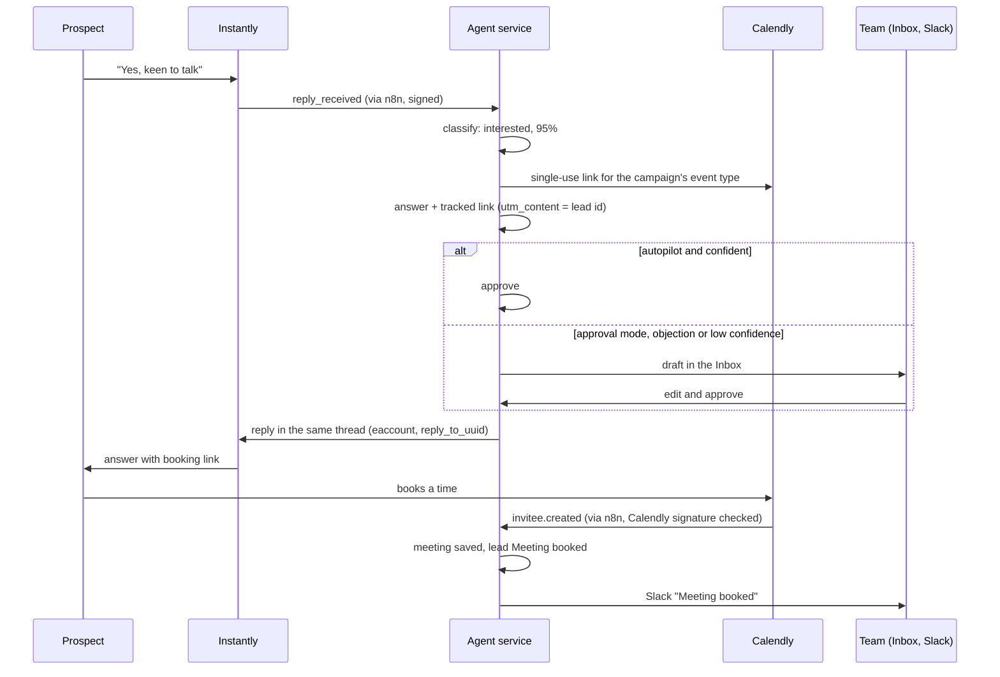

# F10 — AI Answers and Meeting Booking

Engineered by Muhammad Hassan | AI ENGINEER | AUTOMATION SPECIALIST | SOFTWARE ENGINEER | FULL STACK DEVELOPER

| | |
| --- | --- |
| Feature ID | F10 |
| SRS reference | M7 (answering replies), M8 (meeting booking with Calendly and Zoom), M1 FR-1.5 (autopilot or approval), M11 (alerts), M15 (stages and timeline), M21 (kill switch) |
| Location | `agents/src/answers.ts`, `agents/src/booking.ts`, `agents/src/sources/calendly.ts`, `agents/src/replies.ts`, `infra/n8n/workflows/calendly-events.json`, `supabase/migrations/20261112223817_meeting_booking.sql`, `supabase/migrations/20261112223852_hold_answers_on_kill_switch.sql`, `web/src/app/w/[workspaceId]/inbox/`, `web/src/app/w/[workspaceId]/meetings/` |
| Automated tests | 6 database, 1 infrastructure, 13 agent service, 2 web unit, 16 browser: 38 passed, 0 failed |
| Live checks | New columns, triggers, the private Calendly table and the updated queue verified on the hosted database |

## 1. Summary

An interested reply now ends in a booked meeting without anyone leaving the platform:

1. The reply agent drafts an answer and adds a single-use Calendly booking link made for that lead.
2. In autopilot, confident answers to interested prospects, questions and referrals are approved on their own. Objections, low-confidence replies and approval-mode workspaces wait for a person.
3. A person can edit any answer in the Inbox and press **Approve and send**.
4. The answer goes out as a reply in the same Instantly thread, from the mailbox that wrote to the prospect, with the campaign footer.
5. When the prospect books, Calendly notifies the platform. The meeting is recorded with its Zoom or other join link, the lead moves to Meeting booked, and the team gets a Slack message. Cancellations move the lead back to Interested.
6. A new **Meetings** page lists upcoming and past meetings, and each lead profile shows its meetings.

## 2. Flow

## 3. Answers

| Rule | Detail |
| --- | --- |
| What gets an answer | Interested, question, referral and objection replies |
| Booking link | Interested, question, referral and objection answers end with "Pick a time that suits you here: …", a one-time Calendly link carrying the lead id, so the booking matches even if the prospect books with another address |
| Automatic sending | Only in autopilot, only when the campaign allows it, only for interested, question or referral, only at 85% confidence or more, and only when the original email is known |
| Human approval | Editing is open until the answer is sent; the database records who approved it and refuses any change after sending. An empty answer cannot be approved |
| Same thread | Sent with Instantly's reply endpoint, using the original email id and sending mailbox, subject "Re: …", plain-text and HTML versions, footer added |
| Safe HTML | Text is escaped; only Calendly booking links become clickable |
| Last-moment check | Just before sending: the lead must not be suppressed or Do not contact. If they opted out meanwhile, the answer is marked "Not sent" with the reason |
| Exactly once | Each answer is moved to "sending" by a single update, so two workers can never send it twice |
| Failures | Shown on the reply in the Inbox with the reason; the answer can be approved again. A rejected key flags Instantly in Setup |
| Kill switch | Approved answers wait while outreach is paused and go out when it resumes |

## 4. Booking

| Part | Detail |
| --- | --- |
| Event type | The campaign's chosen Calendly event type, or the first active one |
| Webhook set-up | On the first booking link, the agent registers a Calendly webhook for `invitee.created` and `invitee.canceled` at `<n8n>/webhook/calendly/<workspace token>`, with a random 64-character signing key that is stored where no signed-in user can read it |
| Verification | n8n forwards the exact body Calendly signed and the `Calendly-Webhook-Signature` header; the agent checks the HMAC-SHA256 over `t.body` with the workspace's key and rejects anything older than 5 minutes |
| Matching | First by the lead id in the link, then by the invitee's email |
| Recorded | Start and end time, event name, invitee, join link (Zoom when the event type uses Zoom), cancel and reschedule links (Calendly only), campaign, and who runs it: the AI closer when it is on, otherwise the team |
| Once only | A booking is stored once per Calendly invitee |
| Cancelled | Meeting marked cancelled; the lead returns to Interested unless another meeting is still booked |
| Alert | "Meeting booked: Kim Bright (Bright Teeth), Wed, 18 Nov 2026 15:00 UTC, Open lead"; a Slack problem never loses the booking |

## 5. Screens

| Screen | Change |
| --- | --- |
| Inbox | Each reply shows its answer and status (Draft, Waiting to send, Sent, Not sent with the reason); edit the text, then Approve and send or Save draft |
| Campaign | "Replies and booking": automatic answers on or off, and the Calendly event type to use |
| Meetings (new tab) | Upcoming and past meetings: time, prospect and company, meeting name and join link, AI closer or team, status |
| Lead profile | Meetings list and the answer under each reply |

## 6. Database changes

| Change | Purpose |
| --- | --- |
| `replies` answer fields | Original email id and mailbox, answer, status, error, time sent, approver, booking link |
| `replies_client_guard` trigger | People edit and approve answers; only the backend sends; the prospect's words and classification cannot be changed |
| `queue_reply_send` trigger | Approving an answer starts the sender at once |
| `campaigns.auto_answer`, `booking_event_type` | Campaign reply settings |
| `calendly_subscriptions` | Calendly webhook and signing key per workspace; no access for any signed-in user |
| `meetings` additions | Campaign, end time, status, provider and invitee id, event and invitee details, Calendly cancel and reschedule links |
| `inbound_events.provider` allows `calendly` | Calendly notifications stored like Instantly events |
| `agent_jobs_claim` | The kill switch also holds `reply_send` |

## 7. Configuration

| Variable | Where | Purpose |
| --- | --- | --- |
| `N8N_PUBLIC_URL` | `infra/.env` | Public HTTPS address of n8n; used to register the Calendly webhook |

The `Calendly events` workflow is imported and published with the stack. Calendly webhooks need a paid Calendly plan.

## 8. Known limits and next steps

| Item | Plan |
| --- | --- |
| Zoom meetings without Calendly | Calendly creates the Zoom link when the event type uses Zoom; direct Zoom scheduling arrives with the voice agents |
| Several Calendly users in one company | One booking calendar per workspace; per-rep routing later |
| Next feature (F11) | AI voice calling with Vapi and Twilio: cold calls to qualified leads with mobile or landline numbers, Do Not Call screening, call recordings and transcripts |
