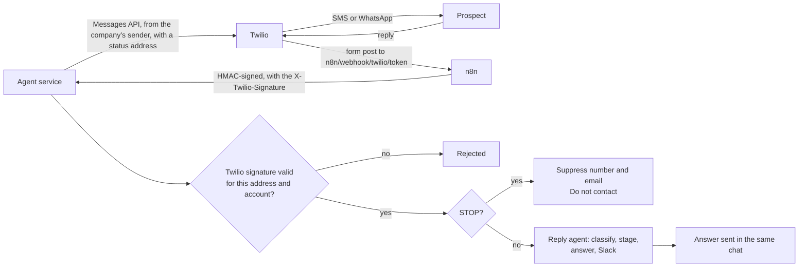

# F12 — SMS and WhatsApp Follow-ups

Engineered by Muhammad Hassan | AI ENGINEER | AUTOMATION SPECIALIST | SOFTWARE ENGINEER | FULL STACK DEVELOPER

| | |
| --- | --- |
| Feature ID | F12 |
| SRS reference | M13 (SMS outreach), M17 (WhatsApp outreach), M8 (two-way text conversations), M7 (reply handling), M3 FR-3.7 (consent per channel), M21 (kill switch), compliance section (TCPA, A2P 10DLC, WhatsApp opt-in and templates) |
| Location | `agents/src/texting.ts`, `agents/src/sources/twilio.ts`, `agents/src/replies.ts`, `agents/src/answers.ts`, `agents/src/server.ts`, `infra/n8n/workflows/twilio-events.json`, `supabase/migrations/20261112232645_sms_whatsapp.sql`, `web/src/lib/texting.ts`, `web/src/app/w/[workspaceId]/campaigns/[campaignId]/text-section.tsx`, `web/src/app/w/[workspaceId]/texts/` |
| Automated tests | 4 database, 1 infrastructure, 17 agent service, 5 web unit, 16 browser: 43 passed, 0 failed |
| Live checks | New columns, guard trigger, hourly scheduling and kill switch rule verified on the hosted database |

## 1. Summary

Leads who were emailed or called and have not answered now get a short follow-up by SMS or WhatsApp. It is sent from the company's own Twilio number, Messaging Service or WhatsApp sender. Each follow-up works like this:

1. **Writing:** the AI writes one or two sentences from the lead's research and the campaign offer.
2. **Fixed wording added by code:** the platform adds the greeting, the sender's name and, for SMS, "Reply STOP to opt out." The AI cannot remove or change these.
3. **WhatsApp:** messages go through the company's approved template, with the first name and the AI's line as its two variables.

When a lead texts back, the message comes in through n8n. The reply agent reads it in the same way as an email reply:

- It classifies the text, moves the lead's stage forward, stops the remaining emails, drafts an answer and alerts the team in Slack.
- Approved answers go back in the same SMS or WhatsApp chat. In autopilot, confident answers are sent automatically.
- STOP is honoured at once: the phone number and the email address are suppressed and the lead becomes Do not contact.

## 2. Who gets a text

| Rule | Detail |
| --- | --- |
| Consent | A consent basis recorded on the lead's profile for that channel (agreed in writing, existing customer, or messaged us first). SMS consent and WhatsApp consent are recorded separately, with who recorded it and when |
| Number | A checked number with a country code. SMS goes only to mobile or VoIP numbers; landlines are skipped |
| Contacted first | At least one email was sent or one call was made in this campaign |
| No answer yet | No reply on any channel, no text received, and no conclusive or ongoing call |
| Timing | The last email, call or text was at least the set number of days ago (default 3) |
| Limits | Texts per lead (1 to 3, default 1), texts per day per campaign (default 100), and the lead must score at or above the campaign threshold |
| Hours | The campaign's contact hours, days and time zone (the same window as AI calling) |
| Never | Numbers or emails on the do-not-contact list, and leads in Do not contact, Not interested, Lost or later stages |

## 3. The message

| Channel | What is sent |
| --- | --- |
| SMS | "Hi Kim, it's Sam from Acme Growth. Saw the second clinic opening; want 15 minutes on keeping the new chairs full? Reply STOP to opt out." |
| WhatsApp | The approved template with {{1}} = first name and {{2}} = the AI's line. Business-initiated WhatsApp messages must use an approved template |
| Safety | The research is passed to the AI as data it must not take instructions from. The AI's line is checked: 20 to 260 characters and no links. Links and line breaks are removed and long lines are shortened. If no language model is connected, or the AI fails, a standard follow-up line is used |

## 4. Replies and delivery

| Check | Detail |
| --- | --- |
| Authenticity | Each Twilio webhook is checked against the company's own auth token, using Twilio's HMAC-SHA1 signature over the exact address Twilio called. It must also come from the company's Twilio account |
| Once only | Each Twilio message is stored once; repeats are ignored |
| Delivery | Status updates only move forward (sending, sent, delivered, read). Failures keep Twilio's error code and a readable reason |
| Twilio opt-outs | If Twilio reports the recipient opted out (error 21610), the number is suppressed at once |
| WhatsApp window | Free-text answers on WhatsApp are sent only within 24 hours of the prospect's last message; otherwise the answer is marked as needing a template |
| Response to Twilio | n8n answers every webhook with an empty TwiML response, so Twilio sends nothing automatically |

## 5. Screens

| Screen | Contents |
| --- | --- |
| Campaign → Text follow-ups | Status, texts today against the limit, launch checklist, Launch, Pause, Text now, and settings (channel, SMS sender, WhatsApp sender and template, days after the last touch, texts per day, texts per lead) |
| Texts (new tab) | Every text sent and received, with channel, lead, delivery status and reason for any failure; filters for received, sent and not delivered |
| Lead profile | Separate SMS and WhatsApp consent (record or remove), and the full text conversation |
| Inbox | Text replies with their channel; approving an answer sends it as an SMS or WhatsApp message |
| Settings → Webhook addresses | The Twilio address to paste into each sending number's "A message comes in" setting |

## 6. Database changes

| Change | Purpose |
| --- | --- |
| Campaign text settings | Status, channel, senders, WhatsApp template, timing and limits, all validated |
| `messages` additions | Campaign, provider and Twilio message id (unique), follow-up step, numbers, consent basis, error and error code, delivery time; `read` status; body length limit |
| `messages_client_guard` | People can log a text they sent themselves, but cannot create or change records of texts sent through Twilio |
| Job type `sms_outreach` and event provider `twilio` | Text runs and Twilio webhooks |
| `agent_jobs_claim` | The kill switch also holds texts |
| `agent_jobs_enqueue_due` | Text runs every hour for live campaigns |

## 7. Configuration

| Item | Where |
| --- | --- |
| Twilio Account SID and auth token | Setup → Twilio (already used for phone checks) |
| SMS sender | A Twilio number or Messaging Service. In the US, it must be registered for A2P 10DLC |
| WhatsApp | A WhatsApp sender approved in Twilio, plus an approved template with {{1}} and {{2}} |
| Inbound address | Settings → Webhook addresses → Twilio: paste it into each number's "A message comes in" setting (HTTP POST) |
| `N8N_PUBLIC_URL` | `infra/.env`. It is the address Twilio calls and the one the signature is checked against. No new variables were added |

The `Twilio text events` workflow is imported and published with the stack.

## 8. Known limits and next steps

| Item | Plan |
| --- | --- |
| START after STOP | A START text is logged, but texts stay off until a person records consent again. This is deliberate |
| Multimedia | Pictures in texts are counted but not stored; the text part is handled |
| Number setup | The inbound address is pasted into Twilio by hand; setting it automatically through the Twilio API can follow |
| Next feature (F13) | AI closer: runs booked meetings with the company playbook, then sends the proposal and the payment link |
