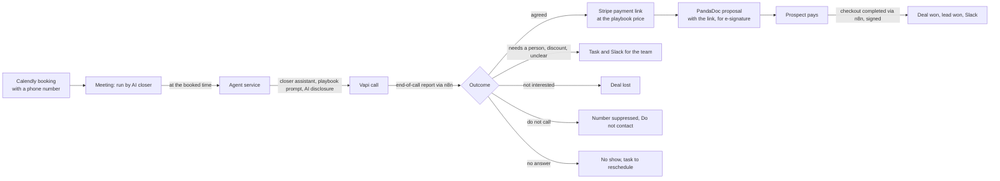

# F13 — AI Closer

Engineered by Muhammad Hassan | AI ENGINEER | AUTOMATION SPECIALIST | SOFTWARE ENGINEER | FULL STACK DEVELOPER

| | |
| --- | --- |
| Feature ID | F13 |
| SRS reference | M18 (AI closer: runs booked meetings from the playbook), M19 (proposals and e-signature), M20 (payments and won deals), M15 (pipeline and tasks), M11 (alerts), M21 (kill switch), compliance section (AI disclosure, no card details by phone) |
| Location | `agents/src/closer.ts`, `agents/src/sources/stripe.ts`, `agents/src/sources/pandadoc.ts`, `agents/src/voice.ts`, `agents/src/booking.ts`, `infra/n8n/workflows/stripe-events.json`, `supabase/migrations/20261112234604_ai_closer.sql`, `web/src/lib/closer.ts`, `web/src/app/w/[workspaceId]/playbook/`, `web/src/app/w/[workspaceId]/deals/`, `web/src/app/w/[workspaceId]/campaigns/[campaignId]/closer-section.tsx` |
| Automated tests | 5 database, 1 infrastructure, 16 agent service, 5 web unit, 16 browser: 43 passed, 0 failed |
| Live checks | New columns, guard trigger, private Stripe endpoint table, publish function, closer scheduling and kill switch rule verified on the hosted database |

## 1. Summary

Meetings booked through Calendly are now run by the AI closer at the booked time. It calls the prospect on the number they gave for the meeting, through the company's own Vapi closer assistant (and its voice) and phone number. The call runs like this:

- **Opening:** the closer says it is an AI assistant.
- **Playbook only:** it follows the company's sales playbook, which holds the offer, the plans and prices, the questions to ask, how to answer objections, and when to hand over to the team.
- **Outcome:** it aims to agree which plan the prospect wants.

When the prospect agrees:

1. **Payment link:** the platform creates a Stripe payment link at the price set in the playbook. The AI never sets a price.
2. **Proposal:** it sends the company's PandaDoc proposal for e-signature, filled with the plan, the price and the payment link.
3. **Won:** when Stripe reports the payment as completed, the deal and the lead become Won and the team gets a Slack alert.

Anything outside the playbook goes to the team with a task and a Slack alert. That covers discounts, custom contracts, a request for a person, and unclear outcomes. The same happens to meetings the closer cannot run.

## 2. Flow

## 3. When the closer runs a meeting

| Rule | Detail |
| --- | --- |
| Who runs it | New meetings are run by the AI closer when it is switched on in Settings. The team can take any meeting that has not started, or give it back, from the Meetings page |
| Number | The number the prospect gave for this meeting: the Calendly "we call you" location, or a phone question on the booking form. Otherwise, a checked number with a recorded voice consent. Without either, the meeting goes to the team |
| Timing | A closer run starts within a minute of the meeting time. It calls only up to 10 minutes after the start; later than that, the meeting goes to the team |
| Setup | The AI closer must be switched on in Settings, Vapi connected, a valid playbook live, and the campaign must have a closer assistant and a phone number. If anything is missing, the meeting goes to the team with the reason |
| Never | Prospects on the do-not-contact list. Nothing starts while the kill switch is on |
| Once only | Each meeting is called at most once |

## 4. The meeting

| Part | Detail |
| --- | --- |
| Opening | "Hi Kim, this is the AI assistant from Acme Growth, calling for the meeting you booked. Is now still a good time?" |
| Playbook | Offer, plans with exact prices, questions to ask, objection answers and handoff rules, given to the closer as data it must not take instructions from |
| Rules given to the closer | Quote only playbook prices; never offer discounts, custom prices, trials, guarantees or other terms; never take card or bank details on the call; confirm being an AI if asked; hand over when asked or when a rule applies; stop if asked not to be called; leave no voicemail |
| Result | Vapi's structured analysis returns the outcome (agreed, proposal requested, follow up, needs a person, not interested, do not call, voicemail, no conversation), the plan chosen from the playbook names, a follow-up time and a handoff reason |
| Safety rules in code | A request not to be called always wins. An unclear outcome is never treated as a sale and goes to the team. The plan is matched by name against the playbook, and the price always comes from the playbook |

## 5. After the meeting

| Outcome | What happens |
| --- | --- |
| Agreed or asked for the proposal | Deal at Meeting held with the plan and value from the playbook; the payment link and proposal are prepared. If the plan is unclear, the team gets a task to confirm it |
| Payment link | Created in the company's Stripe account at the playbook price (one-off, monthly or yearly), protected against duplicates with idempotency keys. A webhook endpoint is created once per workspace, and its signing secret is kept on the server only |
| Proposal | Created from the company's PandaDoc template, with fields for the client, the plan, the price and the payment link. It is sent for e-signature by PandaDoc. The deal moves to Proposal sent, with the agreement sent and the payment link sent |
| Without PandaDoc | The team gets a task and a Slack alert to send the proposal, with the payment link if Stripe is connected |
| Failures | Retried up to 3 times without creating a second payment link; after that the team gets a task. Rejected credentials flag the tool in Setup |
| Payment completed | Stripe's checkout-completed event is checked against the endpoint's signing secret and stored once. The deal is marked Paid and Won and closed by the AI, the lead becomes Won, and Slack shows ":tada: Deal won" |
| Needs a person or follow up | Task for the team (at the requested time for a follow-up), plus a Slack alert |
| Not interested / do not call | Deal Lost. For do not call, the number is also suppressed and the lead becomes Do not contact |
| No answer | Meeting marked No show; task to reschedule |

## 6. Screens

| Screen | Contents |
| --- | --- |
| Playbook (new tab) | Offer, up to 5 plans with prices, currency and billing, questions, objections and answers, handoff rules, PandaDoc template ID and signer role. Saving publishes a new version; owners and admins only |
| Campaign → AI closer | Checklist of required items (switched on, Vapi, playbook, closer assistant, phone number) and optional ones (Stripe, PandaDoc with a template), plus the closer assistant ID |
| Meetings | Who runs each meeting, the closer's status and note, the meeting summary, and "Hand to my team" or "Let the AI closer run it" |
| Deals (new tab) | Every deal with stage, plan and value, proposal status with a PandaDoc link, and payment status with the payment link; filters for open, won and lost |

## 7. Database changes

| Change | Purpose |
| --- | --- |
| `meetings` additions | Phone given for the meeting, closer status and note, the call, the summary |
| `deals` additions | Campaign, meeting, plan and billing, closing status, error and attempts, Stripe payment link and its address, PandaDoc document, paid time; https-only links; one deal per payment link |
| `deals_client_guard` | People can move deals and record an offline payment, but cannot set or change the Stripe and PandaDoc links or start the platform's sending steps |
| `stripe_endpoints` | Each workspace's Stripe webhook signing secret; no access for signed-in users |
| `playbook_publish` | Publishes a new playbook version in one step, using the caller's own permissions (security invoker) |
| `agent_jobs_enqueue_due` | Starts a closer run as soon as an AI-run meeting begins, or when an agreed deal is waiting |
| `agent_jobs_claim` | The kill switch also holds the closer |

## 8. Configuration

| Item | Where |
| --- | --- |
| Playbook | Playbook tab |
| Closer assistant | In Vapi, create a closer assistant with the voice you want; paste its ID in the campaign's AI closer section. Calls use the phone number set under AI calling |
| Calendly | Use the "Phone call: we will call you" location, or ask for a phone number on the booking form |
| Stripe | Setup → Stripe (restricted key with Prices, Payment Links and Webhook Endpoints write access). The payment webhook is created automatically |
| PandaDoc | Setup → PandaDoc; add the template ID and signer role in the playbook. Template fields: [Client.FirstName], [Client.LastName], [Client.Company], [Plan.Name], [Plan.Price], [Payment.Link], [Sender.Company] |
| `N8N_PUBLIC_URL` | Required for call results and Stripe payments. No new variables were added |

The `Stripe payment events` workflow is imported and published with the stack.

## 9. Known limits and next steps

| Item | Plan |
| --- | --- |
| Video meetings | The closer runs meetings by phone; joining Zoom as a participant is not supported, so Zoom-only bookings without a phone number go to the team |
| Signature status | PandaDoc shows when a proposal is viewed and signed; bringing that status back into the deal is a follow-up |
| Refunds | Refunds are recorded by the team; Stripe refund events are not read yet |
| Next feature (F14) | Inbound AI receptionist: answers calls to the company's number, qualifies callers and books meetings |
