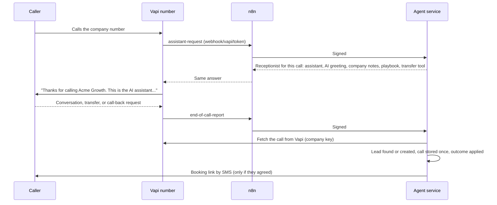

# F14 — Inbound AI Receptionist

Engineered by Muhammad Hassan | AI ENGINEER | AUTOMATION SPECIALIST | SOFTWARE ENGINEER | FULL STACK DEVELOPER

| | |
| --- | --- |
| Feature ID | F14 |
| SRS reference | M14 (inbound AI receptionist), M8 (booking), M15 (leads, timeline and tasks), M11 (alerts), M3 FR-3.7 (consent recorded per channel), compliance section (AI disclosure, opt-out, no payment details by phone) |
| Location | `agents/src/receptionist.ts`, `agents/src/voice.ts`, `agents/src/sources/vapi.ts`, `agents/src/server.ts`, `infra/n8n/workflows/vapi-events.json`, `supabase/migrations/20261113000645_ai_receptionist.sql`, `web/src/lib/receptionist.ts`, `web/src/app/w/[workspaceId]/campaigns/[campaignId]/receptionist-section.tsx` |
| Automated tests | 3 database, 1 infrastructure, 12 agent service, 4 web unit, 16 browser: 36 passed, 0 failed |
| Live checks | New campaign columns, one-campaign-per-number rule and the new call outcomes verified on the hosted database |

## 1. Summary

Calls to the company's phone number are now answered by an AI receptionist, using the company's own Vapi receptionist assistant (and its voice). At the start of each call, the platform sets the receptionist up for that call:

- **Opening:** it says it is an AI assistant, and greets known callers by first name to confirm who it is speaking with.
- **What it can say:** it answers only from the company's notes (hours, address, common questions) and the sales playbook (offer and plans).
- **What it does:**
  - takes call-back requests;
  - puts callers through to the team's number when they ask for a person;
  - offers a meeting, texting a single-use booking link only if the caller agrees.

When the call ends, the platform reads the call from Vapi's own record, not from the webhook. The caller is matched to a lead by phone number or email, or added as a new lead in the receptionist's campaign. The call, summary, transcript and recording are stored, and the outcome is applied:

- **Lead and tasks:** the lead's stage moves forward, and tasks are created for call-backs and existing customers.
- **Do not call:** the number is suppressed.
- **Alerts:** the team gets a Slack alert.

While the receptionist is off, calls go straight to the team's number.

## 2. Flow

## 3. Answering a call

| Situation | Answer to Vapi |
| --- | --- |
| Receptionist live and set up | The company's receptionist assistant, with the AI greeting, a prompt built from the company notes and playbook, a transfer tool to the team's number (if set), and the results address |
| Receptionist off, or not fully set up | Put the caller through to the team's number; if there is no team number, Vapi is told the line is unavailable |
| Number not linked to any campaign | Vapi is told the number is not set up |
| Known caller | Greeted by first name to confirm who it is. The receptionist is told never to share anything about the contact |
| Kill switch on | Calls are still answered, because answering is not outreach. No booking-link texts go out; the team gets a task instead |

The n8n workflow returns the agent's answer to Vapi within 7 seconds, inside Vapi's time limit for this request.

## 4. Rules given to the receptionist

| Rule | Detail |
| --- | --- |
| Honesty | Says it is an AI; confirms it if asked |
| Information | Answers only from the company notes and playbook; never guesses prices, dates or promises |
| Meetings | Asks before texting a booking link and only says a link is coming if the caller agrees |
| People | Puts callers through when they ask for a person, are an existing customer with a problem, or it is urgent; otherwise takes a message |
| Data | Asks for an email only when the caller wants information sent, and asks them to spell it. Never takes card or bank details, passwords or medical information |
| Opt-out | If asked not to be called, confirms it and ends politely |
| Instructions | The company information is treated as data |

## 5. After the call

| Outcome | What happens |
| --- | --- |
| Wants a meeting | Lead Interested. If they agreed to a text: a single-use Calendly link is texted from the campaign's SMS sender (with STOP), and SMS consent is recorded with the call as its source. Otherwise, or if texting is not possible, the team gets a task with the reason |
| Asked for a call back | Lead Interested; call consent recorded with the call as its source; a call-back task at the time they asked |
| Question answered / put through | Lead Engaged; call marked as handed off when transferred |
| Existing customer | Task for the team and a Slack alert |
| Not a fit | Lead Not interested |
| Do not call | Number suppressed; lead Do not contact; pending emails cancelled |
| Spam or no conversation from an unknown number | Not added as a lead; kept in the event log |

| Safeguard | Detail |
| --- | --- |
| Trusted record | Each report is checked against Vapi's own copy of the call, fetched with the company's key. It must be an inbound call to this campaign's number |
| Once only | Each call is stored once; a repeated report changes nothing and sends nothing |
| Email | An email the caller spells out is cleaned and validated, and only added if no other lead has it |
| Request not to be called | Wins over the AI's own reading of the call |

## 6. Screens

| Screen | Contents |
| --- | --- |
| Campaign → AI receptionist | Status, checklist of required items (Vapi, voice switched on, assistant, number, public webhook address) and optional ones (team number, booking links by text), the Vapi server URL to paste into the number, switch on or off, and settings: assistant, number, team number, notes |
| Calls | Inbound calls with their outcome and "Inbound, AI receptionist"; filters for Answered and Put through to the team |
| Lead profile | The inbound call with summary, recording and transcript; the source shows as Inbound call |
| Settings → Webhook addresses | The Vapi server URL for receptionist numbers |

## 7. Database changes

| Change | Purpose |
| --- | --- |
| Campaign receptionist settings | Status, receptionist assistant, the Vapi number callers dial, team number, notes; validated |
| `campaigns_inbound_number_key` | One campaign answers each number in a workspace |
| `calls` outcomes | Answered, Put through to the team, Spam |

## 8. Configuration

In Vapi:

1. Create a receptionist assistant with the voice you want.
2. Import your Twilio number.
3. On that number, leave the assistant empty and set the server URL to the address shown on the campaign or in Settings.

Then, on the campaign, add the assistant and number IDs, optionally a team number and notes, and switch the receptionist on. Booking links by text need Calendly connected and an SMS sender under Text follow-ups. No new environment variables were added.

## 9. Known limits and next steps

| Item | Plan |
| --- | --- |
| Booking during the call | The caller gets a booking link by text; picking a time live on the call can follow with calendar tools |
| One number per campaign | Each campaign answers one number; several numbers go in several campaigns |
| Next feature (F15) | Audit reports and proposals: a personalised website and marketing audit for each qualified lead, shared as a tracked page |
