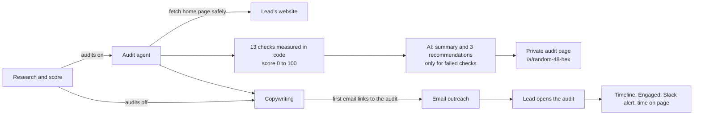

# F15 — Website and Marketing Audits

Engineered by Muhammad Hassan | AI ENGINEER | AUTOMATION SPECIALIST | SOFTWARE ENGINEER | FULL STACK DEVELOPER

| | |
| --- | --- |
| Feature ID | F15 |
| SRS reference | M16 (personalised audit reports shared as tracked pages), M6 (personalised outreach), M15 (timeline and stages), M11 (alerts) |
| Location | `agents/src/audit.ts`, `agents/src/sources/website.ts`, `agents/src/copywriting.ts`, `agents/src/jobs.ts`, `supabase/migrations/20261113001928_website_audits.sql`, `supabase/migrations/20261113002305_website_audits_manual_links.sql`, `web/src/app/a/[token]/`, `web/src/lib/audit.ts`, `web/src/app/w/[workspaceId]/campaigns/[campaignId]/audit-section.tsx` |
| Automated tests | 4 database, 12 agent service, 3 web unit, 17 browser: 36 passed, 0 failed |
| Live checks | New columns, guard trigger, the two shared-page functions and their permissions verified on the hosted database |

## 1. Summary

With audits on, each qualified lead gets a free audit of their website and marketing, made from their own home page and public reviews.

- **Measured in code:** every check is measured by the platform, not judged by the AI.
- **Written by the AI:** a short summary and the three recommendations most worth doing, each tied to a check that did not pass.
- **Shared privately:** the audit is shared on a private page behind a 48-character random link, with the lead's company name and first name and nothing more about them.
- **Linked from the first email:** the system adds one line to the first email, after the email checks: "I put together a short, free audit of Bright Dental's website and marketing: https://…".
- **Tracked:** when the lead opens it, the open goes on their timeline, the lead moves to Engaged and the team gets a Slack alert. Time on the page is counted, and team members previewing it while signed in are not counted.

## 2. Flow

## 3. The checks

| Check | Pass | Could be better | Needs work |
| --- | --- | --- | --- |
| Secure connection | Loads over HTTPS | — | Only HTTP |
| Page title | 10 to 70 characters | Too short or long | Missing |
| Search description | 50 to 170 characters | Too short or long | Missing |
| Works on phones | Mobile viewport set | — | Missing |
| One main heading | Exactly one H1 | Several | None |
| Loads quickly | Up to 1.5 s and 500 KB | Up to 3 s and 1.5 MB | Slower or heavier |
| Easy to call | Tap-to-call link | Number shown, not tappable | No number |
| Easy to get in touch | Form | Email link only | Neither |
| Online booking | Booking tool or "book" button | — | None |
| Visitor tracking | Analytics or ad pixel | — | None |
| Business details for search engines | Structured data | Missing | — |
| Social profiles | Two or more linked | One | None |
| Google reviews | 4.5+ stars and 50+ reviews | 4.0+ and 20+ | Lower |

The score counts a pass as 1 and a warning as half, over the checks that could be measured. A business with no known Google rating is not marked down for it.

## 4. Safety

| Rule | Detail |
| --- | --- |
| Fetching | The home page is fetched with the same protections as research: public addresses only, standard ports, at most 4 redirects, 8-second limit, 1 MB limit. HTTPS is tried first, then HTTP |
| The AI's part | It receives only the measured results and the research summary, as data. Its output is checked: recommendations must refer to checks that did not pass, with no links or HTML; otherwise a standard recommendation for each failed check is used. If no language model is connected, the standard recommendations are used |
| The link | 48 random hex characters. Unknown, expired (120 days) or unfinished audits show the not-found page |
| What the page shows | Title, score, checks, summary, recommendations, the lead's company and first name, the sender's company and name. Never the lead's email or phone |
| Database access | Visitors can only call two functions, both checked against the link: one reads that audit, one counts a visit. The assets table itself stays closed to visitors. Only the platform can create a shared audit or change one; team members can still attach an audit or proposal they made themselves |
| Counting | An open counts once per visit. Time is added in pieces of at most 10 minutes, with a cap of 24 hours. Signed-in team members are not counted |
| Search engines | The page asks not to be indexed |

The security advisor lists the two shared-page functions as callable without signing in. This is intended: they are the only way to reach a shared audit, they require its private link, and they return no contact details.

## 5. Pipeline

| Step | Detail |
| --- | --- |
| Order | With audits on: research, then audits, then copywriting. With audits off: research, then copywriting, as before |
| Waiting | With audits on, emails are written for a lead once its audit has been tried. A lead without a readable website still gets its emails, without the audit line |
| Email line | Added by the system to the first email only, after the AI's email passes its checks. Only links with at least 30 days of validity left are used |
| Once only | One audit per lead per campaign |
| Alerts | The first open queues the audit agent, which posts one Slack message for all audits opened since the last run |

## 6. Screens

| Screen | Contents |
| --- | --- |
| Campaign → Website audits | On or off, audits ready, audits opened |
| Lead profile → Website audit | Score, link to the audit, opens and time on the page, or why there is no audit |
| Shared audit page (public) | Prepared by, greeting, score, summary, "What to fix first", every check with its result, and a reply-to-the-email prompt |

## 7. Database changes

| Change | Purpose |
| --- | --- |
| Campaign `audit_enabled` | Audits per campaign, off by default |
| `assets` additions | Campaign, status, title, score, content, private link token, expiry, first and last view, alert time, error; one audit per lead per campaign |
| `assets_client_guard` | Shared audits (with a private link) are created and changed only by the platform; team members can still attach their own audit or proposal links (second migration) |
| `audit_public(token)` | What a visitor with the link may see |
| `audit_view(token, seconds)` | Counts a visit, adds time, and on the first open adds the timeline entry, moves the lead to Engaged and queues the alert |
| Job type `audit_reports` | Audit runs and alerts |

## 8. Configuration

Turn audits on in the campaign. `PUBLIC_APP_URL` (agent service) must be the address of the web app so links point to it; it is already used for Slack links. No new variables were added.

## 9. Known limits and next steps

| Item | Plan |
| --- | --- |
| One page | The audit reads the home page; deeper crawls (service pages, blog) can follow |
| Page speed | Measured as the server's response time and page size; a full browser speed test (images, scripts) can follow |
| PDF | The audit is a web page so opens can be tracked; a PDF download can be added |
| Next feature (F16) | Self-learning: weekly analysis of what wins replies and meetings, feeding the playbook and copy |
