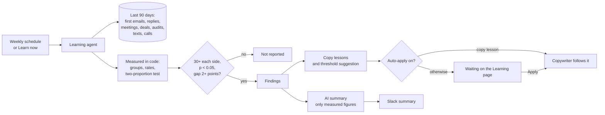

# F16 — Self-Learning

Engineered by Muhammad Hassan | AI ENGINEER | AUTOMATION SPECIALIST | SOFTWARE ENGINEER | FULL STACK DEVELOPER

| | |
| --- | --- |
| Feature ID | F16 |
| SRS reference | M24 (self-learning copy, scripts and pitches), M5 (personalisation and copy), M4 (lead scoring threshold), M10 (results reporting), M11 (alerts) |
| Location | `agents/src/learning.ts`, `agents/src/copywriting.ts`, `agents/src/store.ts`, `supabase/migrations/20261113040900_self_learning.sql`, `web/src/lib/learning.ts`, `web/src/app/w/[workspaceId]/learning/` |
| Automated tests | 4 database, 11 agent service, 3 web unit, 17 browser: 35 passed, 0 failed |
| Live checks | New tables locked to read-only for members, the decision function, campaign columns and the weekly schedule verified on the hosted database |

## 1. Summary

Every week, for each active campaign, the learning agent looks at the leads whose first email went out in the last 90 days and what happened next. It counts a lead as having won interest when they replied positively (interested, question or referral) or booked a meeting.

It compares groups along eight dimensions:

- subject line style (question or statement)
- subject line length
- first email length
- lead source
- lead score band
- whether the lead got a website audit
- a text follow-up
- an AI call

A difference is reported only when all of these hold:

- at least 30 leads on each side;
- a two-proportion test says it is unlikely to be chance (p below 0.05);
- the gap is at least 2 percentage points.

What happens with the results:

- **Lessons:** better copy patterns become lessons for the copywriter, such as "Write the first subject line as a short question."
- **Score threshold:** if the lowest band of leads that qualify does clearly worse, the agent suggests raising the score threshold.
- **Who decides:** owners and admins apply or dismiss each suggestion. With auto-apply on, copy lessons are applied as they are found; threshold changes always wait for a person.
- **Summary:** the AI writes only the weekly summary, and any figure it uses must be one the code measured.
- **Slack:** the team gets a Slack summary with a link to review.

## 2. Flow

## 3. What is measured

| Dimension | Groups |
| --- | --- |
| Subject line style | Question or statement |
| Subject line length | Four words or fewer, or five or more |
| First email length | Under 60 words, 60 to 100, over 100 |
| Lead source | Apollo, Google Maps, Instagram, AI web search, inbound calls, imports |
| Lead score | Bands of 10 (60 to 69, 70 to 79 and so on) |
| Website audit | With or without |
| Text follow-up | With or without |
| AI call | With or without |

Each group is compared with the rest of its dimension. When a dimension has only two groups, only one of the two mirror-image findings is kept. Score bands keep both, because a weak lowest band is what moves the threshold.

## 4. What it can change

| Suggestion | When | Effect when applied |
| --- | --- | --- |
| Copy lesson | A subject style, subject length or email length does clearly better | Added to the campaign's lessons (at most 8, newest kept); the copywriter's prompt lists them under "Lessons from this campaign's own results", below its own rules |
| Score threshold | The lowest band that qualifies does clearly worse than the rest | The campaign threshold moves up to the next band |
| Information only | Sources, audits, texts and calls | Shown as findings; nothing changes automatically |

Lessons are written by the platform from fixed wording, not by the AI. The same lesson is not suggested again while it is waiting or in use. A dismissed one can come back only from new results.

## 5. Safety

| Rule | Detail |
| --- | --- |
| Evidence | Every suggestion carries the measured figures behind it ("…won interest 25.0% of the time (15 of 60), against 5.0% for the rest (3 of 60)") |
| AI summary | Only figures that the code measured may appear, written as measured, with no links. Otherwise the standard summary is used |
| Decisions | Members can read reports and suggestions but cannot write them. Applying, dismissing or removing goes through one database function that checks the caller is an owner or admin of that workspace, and records who decided and when |
| Limits | At most 8 lessons and 1600 characters per campaign; one suggestion per finding while waiting or in use |

The security advisor lists `learning_decide` as callable by signed-in users. This is intended: it is the only way to decide a suggestion and it checks the caller's role itself.

## 6. Screens

| Screen | Contents |
| --- | --- |
| Learning (new tab) | For each campaign: the latest summary; leads emailed, reply rate, interest rate and meetings; what the results show (works better or worse, very clear or clear); suggestions waiting with Apply and Dismiss and the evidence; lessons in use with Remove; "Apply new lessons automatically"; "Learn from results now" |

## 7. Database changes

| Change | Purpose |
| --- | --- |
| Campaign `learned_guidance`, `learning_auto_apply` | Lessons in use; auto-apply, off by default |
| `learning_reports` | Each weekly run: period, figures per group, findings, summary |
| `learning_suggestions` | Lessons and threshold changes with evidence, status and who decided |
| `learning_decide(suggestion, decision)` | Apply, dismiss or remove, for owners and admins only |
| `agent_jobs_enqueue_due` | A learning run once a week for each active campaign |

## 8. Configuration

Nothing to set up: learning runs weekly for active campaigns and works without a language model (standard summary). No new variables were added.

## 9. Known limits and next steps

| Item | Plan |
| --- | --- |
| Small campaigns | Under 30 leads on each side nothing is reported, by design; results build up over weeks |
| Scripts and pitches | Call and closer scripts are not changed automatically yet; their outcomes are already recorded for the same treatment |
| Experiments | Learning reads natural variation in the copy; deliberate A/B tests per campaign can follow |
| Next feature (F17) | Reporting and analytics dashboard: funnel, channels, cost per meeting and revenue |
