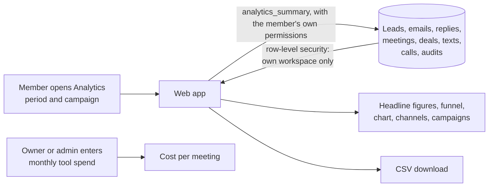

# F17 — Reporting and Analytics Dashboard

Engineered by Muhammad Hassan | AI ENGINEER | AUTOMATION SPECIALIST | SOFTWARE ENGINEER | FULL STACK DEVELOPER

| | |
| --- | --- |
| Feature ID | F17 |
| SRS reference | M10 (reporting and analytics: funnel, channel performance, cost per meeting, revenue, exports), M20 (sales records), M23 (workspace settings) |
| Location | `supabase/migrations/20261113043934_analytics.sql`, `web/src/lib/analytics.ts`, `web/src/app/w/[workspaceId]/analytics/` |
| Automated tests | 4 database, 5 web unit, 17 browser: 26 passed, 0 failed |
| Live checks | Spend columns, the analytics function (runs with the caller's permissions, not callable by visitors) verified on the hosted database |

## 1. Summary

A new **Analytics** tab shows how outreach is performing for the last 7 days, 30 days, 90 days or 12 months, for all campaigns or one:

- **Headline figures:** leads sourced, reply rate, meetings booked, deals won (and how many the AI closed), revenue and cost per meeting.
- **Funnel:** leads sourced, verified, emailed, replied, interested, meetings booked, meetings held, deals won. Each step shows its rate against the step before.
- **Day by day:** a chart of emails sent, replies and meetings booked.
- **Channels:** email, SMS, WhatsApp, AI calls, AI closer, AI receptionist and website audits, each with activity and results.
- **By campaign:** sourced, emailed, reply rate, interested, meetings, won and revenue, with a CSV download.
- **Tool spend:** owners and admins enter what the tools cost each month. It is spread over the period to give the cost per meeting booked.

All figures come from one database function. It runs with the signed-in person's own permissions, so row-level security means it only ever counts their own workspace.

## 2. Flow

## 3. Definitions

| Figure | Counted as |
| --- | --- |
| Leads sourced, verified | Leads created in the period; verified means a valid email |
| Emailed | Leads whose first email was sent in the period |
| Replied, interested | Leads who replied in the period (automatic out-of-office replies excluded); interested means interested, a question or a referral |
| Meetings booked, held | Meetings created in the period; held means completed with a start time in the period |
| Deals won, revenue | Deals won in the period and the sum of their value, per currency |
| Reply rate | Replied divided by emailed |
| Cost per meeting | Monthly spend × days in the period ÷ 30 ÷ meetings booked |
| Calls answered | AI calls with an outcome other than no answer, voicemail or failed |

## 4. Safety

| Rule | Detail |
| --- | --- |
| Access | `analytics_summary` runs as the caller (security invoker), so row-level security applies to every table it reads. A member of another workspace gets zeros. Signed-out visitors cannot call it |
| Period | At most one year, and the end must be after the start |
| Reading | The web app checks the result's shape before showing it; on any problem it shows a message rather than wrong figures |
| CSV | Members only; every cell quoted; cells starting with =, +, -, @ get a leading apostrophe so spreadsheets never run them as formulas |
| Spend | Only owners and admins can change it (workspace row security); the amount and currency are validated |

## 5. Screens

| Screen | Contents |
| --- | --- |
| Analytics (new tab, first in the menu) | Period and campaign filters, CSV download, headline figures, funnel with step rates, daily chart, channel table, campaign table, tool spend |

## 6. Database changes

| Change | Purpose |
| --- | --- |
| Workspace `monthly_spend_cents`, `spend_currency` | Tool spend for the cost per meeting |
| `analytics_summary(workspace, from, to, campaign)` | All dashboard figures in one call |
| Indexes on sent emails, replies and meetings by time | Fast period queries |

## 7. Configuration

Nothing to set up. Optionally enter the monthly tool spend on the Analytics tab. No new variables were added.

## 8. Known limits and next steps

| Item | Plan |
| --- | --- |
| Mixed currencies | Revenue totals are shown per currency; the campaign table assumes one currency per workspace |
| Spend | One monthly figure; costs per tool from each provider's billing can follow |
| Time zone | Days are counted in UTC |
| Next feature (F18) | CRM sync with HubSpot: leads, deals and activity mirrored both ways |
