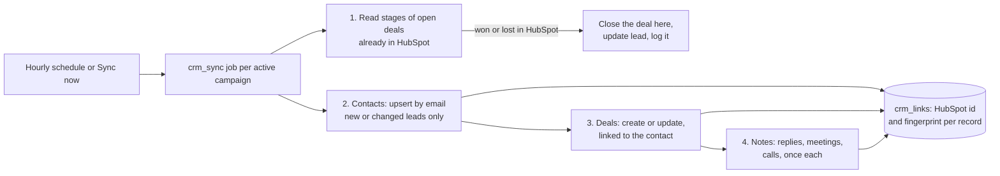

# F18 — CRM Sync with HubSpot

Engineered by Muhammad Hassan | AI ENGINEER | AUTOMATION SPECIALIST | SOFTWARE ENGINEER | FULL STACK DEVELOPER

| | |
| --- | --- |
| Feature ID | F18 |
| SRS reference | M9 (CRM integration: sync leads, deals and activity to an existing CRM), M20 (sales records), M23 (workspace settings) |
| Location | `supabase/migrations/20261113090353_crm_sync.sql`, `agents/src/crm.ts`, `agents/src/sources/hubspot.ts`, `web/src/lib/crm.ts`, Settings page (CRM sync section) |
| Automated tests | 6 database, 14 agent, 4 web unit, 17 browser: 41 passed, 0 failed |
| Live checks | Settings columns, `crm_links` table and its access rules, job type and hourly schedule verified on the hosted database; security advisor shows no new findings |

## 1. Summary

The platform already has its own sales workspace. Teams that also use HubSpot can now switch on **CRM sync** in Settings, and the CRM agent keeps HubSpot up to date every hour:

- **Contacts.** Leads are sent to HubSpot contacts, matched by email, so a lead who is already in HubSpot is updated rather than duplicated. The contact gets the name, phone, job title, company and website, plus a **lead status** that follows the lead's stage. Opt-outs show as Unqualified. Won leads become Customers.
- **Deals.** Each deal goes to the chosen pipeline and stage, linked to its contact. The deal is named after the company and plan and carries the amount.
- **Activity.** Replies, meetings and finished AI calls become notes on the contact. Each one is sent only once.
- **Back from HubSpot.** If a person marks a deal won or lost in HubSpot, the platform closes the deal the same way, updates the lead and logs the change.

You choose who is sent: only leads who engaged (the default), or everyone the agents contacted. Each sync sends only records that changed since the last one.

## 2. Flow

Stages are read back from HubSpot **before** anything is pushed. A change made by a person in the CRM is therefore never overwritten by an older value from the platform.

## 3. Mapping

| Platform lead stage | HubSpot lead status |
| --- | --- |
| New | New |
| Contacted | Attempted to contact |
| Engaged | Connected |
| Interested | In progress |
| Meeting booked, Won | Open deal (Won also sets lifecycle stage Customer) |
| Lost | Bad timing |
| Not interested, Do not contact | Unqualified |

| Platform deal stage | HubSpot stage (default sales pipeline) |
| --- | --- |
| Meeting booked | Appointment scheduled |
| Meeting held | Presentation scheduled |
| Proposal sent | Contract sent |
| Negotiation | Decision maker bought in |
| Won | Closed won |
| Lost | Closed lost |

To use another pipeline, enter its id and the stage id for each step in Settings. Stages left at their default are not stored.

## 4. Reliability and safety

| Rule | Detail |
| --- | --- |
| Only changes | A SHA-256 fingerprint of what was last sent is kept for each contact and deal. Unchanged records are skipped, and only records updated since their last sync are looked at |
| Once per activity | Each reply, meeting or call is noted once. Its HubSpot note id is stored |
| Limits | Up to 200 contacts (in batches of 100), 100 deals and 200 notes per campaign per run. The rest follows in the next hourly run |
| Rate limits | If HubSpot asks the agent to slow down (429), what was already saved stays saved, the run succeeds and is marked rate-limited, and the rest syncs next hour |
| Rejected token | A 401 or 403 fails the run with "HubSpot rejected the access token. Reconnect HubSpot in Setup." and marks HubSpot for reconnection. The token never appears in errors or logs |
| What leads wrote | Reply text, call summaries and meeting outcomes are HTML-escaped before they go into a HubSpot note |
| Closed deals | A deal already won or lost here is never changed by HubSpot. A lead marked Do not contact keeps that stage |
| Switching on | Only owners and admins can change CRM settings (workspace row security). Sync can only be switched on once HubSpot is connected; a run that finds sync off or HubSpot disconnected sends nothing |
| Records | `crm_links` is readable by workspace members and writable only by the agent service. It is deleted with the workspace |
| Kill switch | The emergency stop also stops scheduled syncs |

## 5. Screens

| Screen | Contents |
| --- | --- |
| Settings, CRM sync (new section) | On or off; who is sent; pipeline id; HubSpot stage for each deal stage; counts of contacts, deals and notes in HubSpot; last sync time; a warning when HubSpot is not connected or needs reconnecting; Sync now |
| Campaign task history | "CRM sync" runs, described in plain words, such as "3 contacts sent; 1 deal created; 2 activity notes added; 1 deal closed from HubSpot." |

## 6. Database changes

| Change | Purpose |
| --- | --- |
| `workspaces.crm_sync_enabled`, `crm_sync_scope`, `crm_pipeline_id`, `crm_stage_map`, `crm_synced_at` | Settings and last sync time, each with checks on allowed values and size |
| `crm_links` | One row per synced lead, deal or activity: HubSpot id, fingerprint, sync time |
| `agent_jobs` type `crm_sync` | The new agent task |
| `agent_jobs_enqueue_due` | Adds an hourly `crm_sync` for each active campaign while sync is on |

## 7. HubSpot API calls

| Call | Use |
| --- | --- |
| `POST /crm/v3/objects/contacts/batch/upsert` (idProperty email) | Create or update contacts |
| `POST /crm/v3/objects/deals`, `PATCH /crm/v3/objects/deals/{id}` | Create a deal linked to its contact (association type 3), or update it |
| `POST /crm/v3/objects/notes` | Activity note linked to the contact (association type 202) |
| `POST /crm/v3/objects/deals/batch/read` | Read deal stages back |

The private app token needs these scopes: `crm.objects.contacts.read/write` and `crm.objects.deals.read/write`. Notes are stored as engagements on the contact.

## 8. Limits

- HubSpot is the only CRM supported. The `provider` column allows others to be added later.
- Notes are not edited after they are sent. If a meeting is later cancelled, the platform's own records show it, and HubSpot keeps the note from when it was sent.
- Only won and lost are read back from HubSpot. Other stage changes made there stay in HubSpot.
