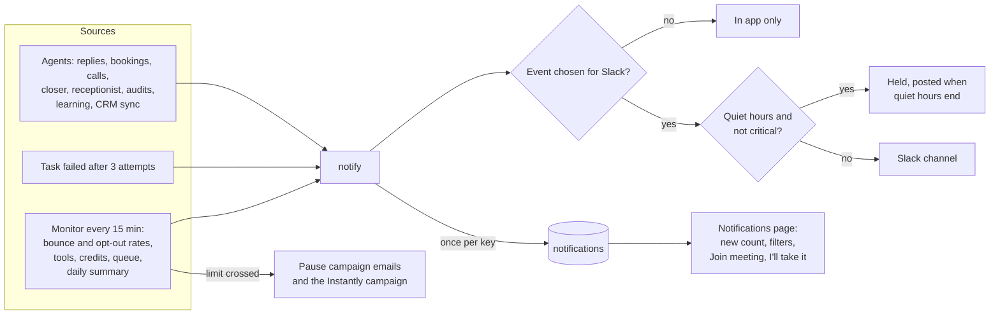

# F19 — Monitoring, Alerts and Notifications

Engineered by Muhammad Hassan | AI ENGINEER | AUTOMATION SPECIALIST | SOFTWARE ENGINEER | FULL STACK DEVELOPER

| | |
| --- | --- |
| Feature ID | F19 |
| SRS reference | M11 (monitoring, errors and alerts: FR-11.1 to FR-11.4), M22 (notifications: FR-22.1 to FR-22.4), section 10.4 (health and readiness), section 10.6 (alert tiers and deduplication), FR-23.4 (connection health and low credits) |
| Location | `supabase/migrations/20261113093031_monitoring_notifications.sql`, `agents/src/notify.ts`, `agents/src/monitoring.ts`, `agents/src/jobs.ts`, `agents/src/server.ts`, `web/src/lib/notifications.ts`, `web/src/app/w/[workspaceId]/notifications/`, the Notifications and alerts section of Settings |
| Automated tests | 8 database, 17 agent, 4 web unit, 17 browser: 46 passed, 0 failed |
| Live checks | New columns, tables, access rules, retry and monitor functions verified on the hosted database. The security advisor shows no new findings |

## 1. Summary

This feature gives the platform one way to tell a team that something happened, and a monitor that watches for problems around the clock.

- **One notification centre.** Every alert the agents raise is kept on a new **Notifications** page, whether or not it also went to Slack. The menu shows how many are new. Each alert carries the lead, a link to the lead's page (with the recording, transcript and timeline) and, for a meeting handoff, a **Join meeting** link.
- **Slack, the way each team wants it.** Owners and admins choose which events go to Slack and set quiet hours in their own time zone. During quiet hours Slack alerts are held and posted when quiet hours end. Critical alerts always go straight through.
- **One-click handoffs.** When the AI needs a person (a meeting the closer cannot run, a prospect who asked for a human, a caller who wants a call back), a rep clicks **I'll take it**. The handoff shows who took it, and the lead is assigned to that rep.
- **Retries with backoff.** A task that fails because a provider is down, timed out or asked the agent to slow down runs again after 2 minutes, then 4 minutes. Only a task that fails all three attempts counts as failed, and the team gets an alert.
- **A 15-minute monitor for each workspace:**
  - It pauses a campaign's emails, in Instantly too, when the bounce rate or opt-out rate crosses the workspace's limit.
  - It alerts on tools that stopped working or are low on credits.
  - It alerts on tasks stuck in the queue.
  - It posts held alerts once quiet hours end.
  - It sends a daily summary every morning.
- **Readiness check.** A new `/ready` endpoint on the agent service tells uptime monitors whether the database answers and the queue is moving.

## 2. Flow

## 3. Events

| Event | Raised when |
| --- | --- |
| Hot and positive replies | The reply agent finds replies that need a person (interested, question, referral) |
| Meetings booked | A meeting is booked through Calendly |
| Interested callers | An AI call ends interested, with a callback request, or with the caller wanting a meeting (outbound or inbound) |
| Handoffs to your team | The AI closer cannot run a meeting, a prospect asks for a person, a meeting is missed, a proposal must be sent by hand, an inbound caller asks for a call back or is put through |
| Proposals | A proposal is sent, requested or agreed on a closer call |
| Deals won, deals lost | A payment arrives through Stripe, or a deal is marked won or lost in HubSpot |
| Website audits opened | A prospect opens their audit |
| Weekly learning reports | The learning agent finishes its weekly report |
| Daily summary | Every morning from 8am in the workspace time zone: new leads, emails, calls, replies, positive replies, meetings, wins and failed tasks over the last 24 hours. It is not sent on a day with no activity |
| System alerts | A task failed after its retries; emails paused for a high bounce or opt-out rate; a tool stopped working or is low on credits; tasks are stuck in the queue |

Slack messages keep the wording they had before. Teams that used Slack alerts in earlier features see no change unless they change their settings.

## 4. Alert tiers (SRS 10.6)

| Tier | Examples | Delivery |
| --- | --- | --- |
| Critical | Emails paused for a high bounce or opt-out rate | Slack at once, even during quiet hours, and in the app |
| Needs attention | Failed tasks, broken tools, low credits, queue backlog, handoffs | Slack (outside quiet hours) and in the app |
| Info | Bookings, replies, wins, summaries | Slack (outside quiet hours) and in the app |

**Deduplication.** Every alert has a key, and the same key is only ever alerted once. That covers:
- each meeting, call and proposal;
- each failed task, per campaign per day;
- each broken tool and each tool low on credits, per day;
- each automatic pause, per campaign per day;
- the queue backlog, once per hour;
- the daily summary, once per day.

A task that fails every hour does not flood the channel.

## 5. Automatic pausing (FR-11.4)

| Rule | Detail |
| --- | --- |
| Window | The last 7 days of emails per campaign whose emails are live |
| Minimum | At least 50 emails, so a handful of early bounces never stops a campaign |
| Bounce limit | Default 5%, settable from 1% to 50% |
| Opt-out limit | Default 3%: leads who asked to stop, against emails sent |
| Action | The campaign's emails are paused and the reason is recorded on the campaign. The outreach agent pauses the Instantly campaign. A critical alert follows |
| Resume | The campaign page shows "Paused automatically" with the reason. Resuming email outreach clears it |

## 6. Retries (FR-11.2)

| Failure | What happens |
| --- | --- |
| Provider unreachable, timed out, rate limited (429) or erroring (5xx); every language model failed for one of these reasons | Retried after 2 minutes, then 4 minutes. A waiting task is not picked up before its time |
| Wrong settings, rejected keys, bad input | Fails at once, since a retry would fail the same way |
| Third attempt fails | The task is failed and the team is alerted once per campaign and task per day |

Every run, retried or not, stays in the run log with its status and error (FR-11.1).

## 7. Safety

| Rule | Detail |
| --- | --- |
| Who sees what | Members read their own workspace's notifications. Nobody can create, edit or delete them from the app; only the agent service writes them |
| Accepting a handoff | Owners, admins and reps can accept a handoff, only for themselves, and only once. Viewers and other workspaces cannot. The database allows only the two "accepted" columns to change |
| Last seen | Each person's "seen" time is their own and cannot be set for anyone else |
| Links | In-app links must stay inside the workspace; join links must be https. Both are checked by the database and again by the page |
| Text | Slack text from leads is escaped as before. The in-app text is plain text, so nothing a lead wrote can run as code |
| Agent-only functions | The retry and monitor functions can only be run by the agent service |
| Failures | A Slack problem is recorded on the notification and never stops the work that raised it. A Slack token rejection marks Slack for reconnection |

## 8. Screens

| Screen | Contents |
| --- | --- |
| Notifications (new tab, with a new count) | Alerts newest first. Filters: All, Needs attention, Open handoffs. Each alert shows its event, severity and Slack status, plus Open lead, Join meeting and I'll take it. Accepted handoffs show who took them |
| Settings, Notifications and alerts (new section) | Which events go to Slack; quiet hours and time zone; bounce and opt-out limits; low credit level |
| Campaign, Email outreach | "Paused automatically" with the reason and time |

## 9. Database changes

| Change | Purpose |
| --- | --- |
| `agent_jobs.run_after`, `agent_job_retry`, updated `agent_jobs_claim` | Retries with a wait |
| Workspace notification and limit settings, `monitored_at` | Events, quiet hours, time zone, bounce, opt-out and credit limits; when the monitor last checked |
| `campaigns.auto_paused_reason`, `auto_paused_at` | Why and when emails were paused automatically |
| `notifications` | The notification centre, with Slack delivery status, deduplication keys and handoff acceptance |
| `notification_seen` | Each person's last visit, for the new count |
| `monitoring_claim` | Hands out each workspace to the monitor at most every 15 minutes |

## 10. Agent service endpoints

| Endpoint | Use |
| --- | --- |
| `GET /health` | Liveness: the service runs and the database answers |
| `GET /ready` (new) | Readiness: the database answers and no task has waited more than 15 minutes. It returns only counts: queued, stuck and the age of the oldest task. Returns 503 on a backlog or a database outage |

## 11. Limits

- Alerts go to Slack and the in-app notification centre. Email and mobile push delivery are not part of this feature.
- Accepting a handoff assigns the lead and shows the meeting's join link. Joining a live AI call while it is in progress is not offered.
- Spam complaints are not reported by the sending service's webhooks, so the second automatic limit uses opt-outs.
- Alerts for the platform operator (across all workspaces) come from the `/ready` and `/health` checks in the uptime monitor, not from this notification centre.
