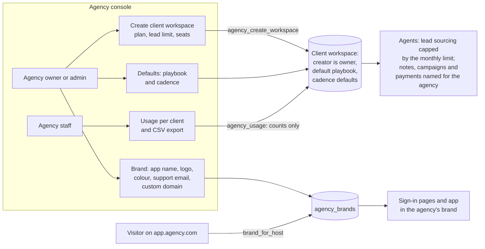

# F20 — White-Label Mode for Agencies

Engineered by Muhammad Hassan | AI ENGINEER | AUTOMATION SPECIALIST | SOFTWARE ENGINEER | FULL STACK DEVELOPER

| | |
| --- | --- |
| Feature ID | F20 |
| SRS reference | M26 (white-label mode: FR-26.1 to FR-26.6), section 7 (workspace data model: branding, white-label settings, parent agency), section 10.1 (roles per workspace and per agency) |
| Location | `supabase/migrations/20261113102439_white_label.sql`, `web/src/lib/brand.ts`, `web/src/lib/agency.ts`, `web/src/components/brand-mark.tsx`, `web/src/app/agency/`, `agents/src/store.ts` (brand and plan limits), `agents/src/crm.ts`, `agents/src/outreach.ts`, `agents/src/sources/stripe.ts` |
| Automated tests | 8 database, 3 agent, 6 web unit, 17 browser: 34 passed, 0 failed |
| Live checks | New tables, access rules, triggers and functions verified on the hosted database; the security advisor lists only the six expected console functions |

## 1. Summary

Agencies can now resell the platform under their own brand.

- **Their own brand (FR-26.1, FR-26.2).** The app name, logo and brand colour replace the platform's own:
  - on the sign-in, sign-up, home and error pages when the app is opened on the agency's custom domain;
  - throughout every client workspace;
  - in page titles.

  The agents use the agency's app name in what they create in connected tools: HubSpot activity notes, the name of the Instantly sending campaign, and the Stripe webhook description. Clients never see the underlying platform's name.
- **Agency console (FR-26.3).** Agency owners and admins:
  - create client workspaces;
  - give each client a plan, a monthly lead limit and a seat limit;
  - follow each client's usage for the last 7 days, 30 days, 90 days or 12 months: leads, emails, calls and call minutes, texts, meetings, deals won and revenue.
- **Per-client billing (FR-26.4).** The usage table downloads as a CSV for the agency's own invoicing.
- **Defaults (FR-26.5).**
  - New client workspaces start with the agency's default playbook, copied from a client workspace where it was built once.
  - New campaigns start with the agency's email, call and text cadence: follow-ups, delays, daily limits and contact hours.
- **Isolation (FR-26.6).**
  - Each client's data stays in its workspace.
  - Agency staff see only usage counts. They open a client workspace only where they hold a workspace role, which the person who creates a client workspace gets as its owner.
  - Clients cannot change their own plan, limits or agency.

## 2. Flow

## 3. Roles

| Role | Can |
| --- | --- |
| Agency owner | Everything below, and owns the agency |
| Agency admin | Create clients, change plans and limits, edit the brand and defaults, manage the agency team |
| Agency staff | See the console, client usage and the agency team |
| Client workspace roles | Unchanged: owner, admin, rep, viewer. Agency people see a client's records only through one of these roles |

## 4. Plan limits

| Limit | Enforced |
| --- | --- |
| Monthly lead limit | Lead sourcing adds at most the leads the plan still allows this calendar month, across all of the client's campaigns. Once reached, sourcing stops with "The monthly lead limit of your plan is reached. Ask your agency to raise it." |
| Seat limit | Adding a team member beyond the limit is refused: "This plan allows N team members. Ask your agency for more seats." |
| Plan name | Free text set by the agency, such as Starter or Growth |

The console flags clients at 90% or more of their monthly lead limit.

## 5. Custom domains

1. The agency enters its domain, such as `app.youragency.com`, under Brand.
2. It adds a CNAME record pointing the domain at the web app.
3. The domain is added to the web app's hosting project and to the sign-in redirect allow-list.

Pages opened on that domain look up the brand before anyone signs in, using a function that returns only the app name, logo, colour and support email. Each domain belongs to one agency.

## 6. Safety

| Rule | Detail |
| --- | --- |
| Plans and limits | A database trigger stops clients from creating a workspace under an agency, or from changing their agency, plan, limits or cadence defaults. Only the console functions, which check the caller's agency role, can |
| Usage | `agency_usage` returns counts and revenue totals only, never leads, messages or calls. It is limited to periods of up to a year |
| Brand values | Logo links must be https, colours are hex, domains are checked host names, and the support email is checked. Pages fall back to the platform brand if a stored brand is malformed, so a bad value never breaks a page |
| Cadence defaults | Only the 12 cadence fields can be stored; any other key is refused by the database |
| Agency data | Only the agency team can read the agency itself (default playbook, defaults). Client members can read only its public brand |
| Sign-in pages | The pre-sign-in brand lookup accepts only host names and returns only public brand fields |

## 7. Screens

| Screen | Contents |
| --- | --- |
| Agencies (new, linked from Workspaces) | The agencies you belong to, with your role; create an agency |
| Agency console (new) | Period filter and CSV download; clients with usage (linked where you hold a role), lead-limit warnings and paused status; change a client's plan and limits; new client workspace; brand; defaults; agency team |
| Every page | App name, logo and colour of the agency (custom domain or client workspace) |

## 8. Database changes

| Change | Purpose |
| --- | --- |
| `agency_members`, `agency_role` | Agency admins and staff, beside the agency owner |
| `agency_brands` | App name, logo, colour, support email, custom domain (unique) |
| `agencies.default_playbook`, `campaign_defaults` | Defaults for new clients. The unused `branding` and `custom_domain` columns from the foundation are replaced by `agency_brands` |
| `workspaces.monthly_lead_limit`, `seat_limit`, `campaign_defaults` | Client plan limits and cadence |
| Triggers | Plan guard, seat limit, cadence defaults on new campaigns |
| Functions | `agency_member_add`, `agency_members_list`, `agency_create_workspace`, `agency_set_plan`, `agency_usage`, `brand_for_host` |

The six functions run with elevated rights because agency staff are not members of client workspaces, and visitors on a custom domain are not signed in. Each one checks the caller's agency role itself, and `brand_for_host` returns public brand fields only. The security advisor lists them, like the earlier member and audit functions, and they are expected.

## 9. Limits

- **Sign-up and password emails.** These are sent by the authentication service with one template for the whole platform. An agency that needs them in its own name sets up its own sender with the platform operator.
- **Proposals.** These come from each client's PandaDoc template, so they already carry the client's or agency's own branding.
- **Billing.** Per-client billing is the usage export. Charging clients through the agency's own Stripe account is done in Stripe, outside the platform.
- **Agency access to client workspaces.** An agency person opens a client workspace only after a workspace owner adds them on its Team page. The person who creates a client workspace is its owner from the start.
