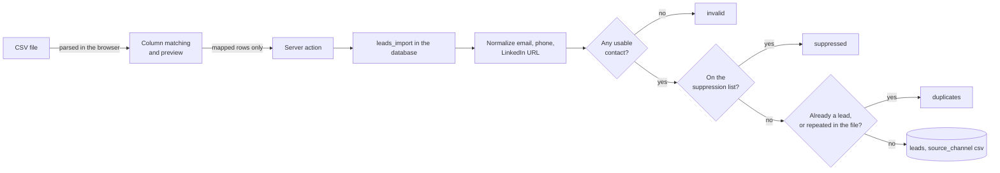

# F21 — CSV Import and Bulk Actions

Engineered by Muhammad Hassan | AI ENGINEER | AUTOMATION SPECIALIST | SOFTWARE ENGINEER | FULL STACK DEVELOPER

| | |
| --- | --- |
| Feature ID | F21 |
| SRS reference | M3 (hygiene: FR-3.3 deduplication, FR-3.4 suppression, FR-3.5 normalization), M15 (lead management: FR-15.1 source channels) |
| Location | `supabase/migrations/20261113120000_csv_import.sql`, `web/src/lib/csv.ts`, `web/src/app/w/[workspaceId]/leads/import/`, `web/src/app/w/[workspaceId]/leads/bulk-bar.tsx` |
| Automated tests | 11 database, 6 web unit, 17 browser: 34 passed, 0 failed |
| Live checks | Pending: the database connector was unavailable when this feature was finished. The migration is written and passes against a local Postgres, and applies on the next connected session |

## 1. Summary

The `csv` source channel existed in the schema from the first migration with no way to use it. A team could not bring its own list.

Now they can:

- **Import a CSV.** Upload a file, match its columns, see a preview with counts, and import. Every row goes through the same hygiene as a sourced lead.
- **Undo an import.** Owners and admins can remove an import's leads, except any that have already been worked.
- **Act on many leads at once.** Select leads on the list and change their stage, assign an owner, move them to a campaign, or suppress them.

## 2. Where the hygiene rules live

The agent service already owned normalization, deduplication and suppression, but the agent service is not required for an import, and duplicating those rules in the web app would let the two drift apart.

So the import runs in the database, as `leads_import()`:

One implementation, callable from the web app today and the agent service later. It is **security invoker**, so row-level security decides who may import — a viewer cannot.

## 3. What counts as what

| Outcome | Rule |
| --- | --- |
| **Invalid** | No usable contact: the email is not shaped like an address, the phone has fewer than 7 or more than 15 digits, and the LinkedIn URL is not on `linkedin.com` |
| **Suppressed** | The email, the phone, or the email's whole domain is on the workspace's suppression list |
| **Duplicate** | A lead with that email already exists in the workspace, or the address appears earlier in the same file. The first occurrence wins |
| **Added** | Everything else, written with `source_channel = 'csv'` and the filename recorded in `source_query` |

A company named in the file is created if the workspace does not have one by that name, matched without regard to case, and linked to its leads. One company is made per name, however many rows mention it.

Normalization before any of those checks: emails lower-cased and trimmed, phones reduced to digits and a leading `+`, names and titles capped at 200 characters.

## 4. Limits

| Limit | Value |
| --- | --- |
| Rows per import | 5,000, enforced in the database as well as the browser |
| File size | 5 MB |
| Leads per bulk action | 500 |

## 5. Undo

Undoing removes only leads that are **still untouched** — stage `new` and no activity recorded. Anything contacted, replied to, called or booked stays, because removing it would destroy history.

Only owners and admins can undo, because deleting leads is already an owner and admin action. A rep calling it is refused rather than silently marking the import undone.

## 6. Bulk actions

| Action | Effect |
| --- | --- |
| Change stage | Sets the stage and `stage_changed_at` on every selected lead |
| Assign owner | Assigns to you, or clears the owner |
| Move to campaign | Reassigns the campaign |
| **Suppress** | Adds each lead's email and phone to the suppression list and sets the stage to Do not contact. No agent contacts them again on any channel, and future imports skip them |

Viewers do not see the action bar, and the database refuses the write regardless.

## 7. Privacy and safety

| Rule | Detail |
| --- | --- |
| The file never leaves the browser | It is parsed client-side; only the mapped rows are sent. A column the user did not match is never transmitted |
| Suppression is honoured on import | Someone who opted out cannot be re-added by uploading a list |
| Row-level security | Both functions are security invoker, so a member of one workspace cannot import into another |
| Size caps in the database | The 5,000-row cap is enforced server-side, not only in the interface |
| Counts are reported honestly | The result says exactly how many were added, skipped as duplicates, suppressed and invalid |

## 8. Screens

| Screen | Contents |
| --- | --- |
| Leads → **Import CSV** (new) | File picker; column matching with automatic detection; optional campaign; preview with counts and the first five rows; recent imports with their results and an Undo button |
| Leads list | A checkbox per row and an action bar showing how many are selected |

## 9. Database changes

| Change | Purpose |
| --- | --- |
| `lead_imports` | One row per import: filename, totals, and who ran it |
| `leads.import_id` | Which import added a lead, so an import can be undone |
| `leads_import(ws, campaign, filename, rows)` | The import itself, with all hygiene |
| `lead_import_undo(import)` | Removes untouched leads from an import |

## 10. Limits of this feature

- Only CSV. Excel files must be saved as CSV first.
- Undo is all-or-nothing per import; individual leads are removed from the lead page.
