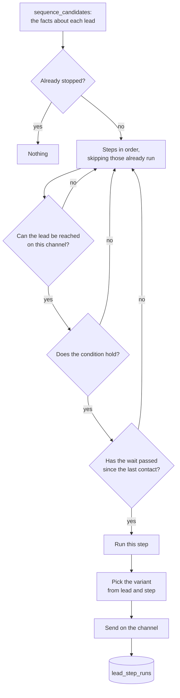

# F22 — Conditional Branching and A/B Testing

Engineered by Muhammad Hassan | AI ENGINEER | AUTOMATION SPECIALIST | SOFTWARE ENGINEER | FULL STACK DEVELOPER

| | |
| --- | --- |
| Feature ID | F22 |
| SRS reference | M6 (outreach cadence), M7 (multi-channel follow-up), M24 (self-learning: significance testing) |
| Location | `supabase/migrations/20261114010000_sequence_branching.sql`, `agents/src/sequence.ts`, `agents/src/sequenceRun.ts`, `web/src/lib/sequence.ts`, `web/src/app/w/[workspaceId]/campaigns/[campaignId]/sequence/` |
| Automated tests | 13 database, 21 agent, 14 web unit: **48 passed, 0 failed** |
| Live checks | Passed: migration applied to the hosted database, row security and privileges verified in place (LIVE-45, LIVE-46) |

## 1. Summary

Follow-ups were decided by elapsed days alone. A campaign had a follow-up count and a delay in days, and that was the whole cadence.

Now a campaign can carry a **sequence**: an ordered list of steps, each naming a channel, a minimum wait, and a condition that must hold of the lead for the step to run. The first step that fits is the one that runs, so a lead who went to voicemail can go straight to a text while a lead nobody reached at all carries on down the list.

Each step can carry up to three messages. Which message a lead was sent is recorded, and the self-learning agent scores them against each other with the same significance test it already applies to subject style and lead source.

Branching is **off by default on every campaign**, including the ones already running. Nothing changes for a live campaign until someone turns it on.

## 2. The problem that shaped the design

Email follow-ups were not sequenced by this system at all. `runEmailOutreach` wrote every step's draft up front and handed the whole sequence to Instantly, which owned the timing and stopped on reply. Instantly only sees replies to its own emails, so it would send step 2 on day 3 however the call went. **Conditional branching cannot live inside that model.**

Three ways out were considered:

| Approach | Why not |
| --- | --- |
| Keep Instantly as the sequencer and pull a lead out when a condition diverges | Needs a lead-level pause or removal endpoint. Instantly's v1 documentation had one; v1 is deprecated and no v2 equivalent could be confirmed in their published reference. Building on an unverified endpoint was refused |
| Push one email at a time through a single-send API | Same problem: no such endpoint could be confirmed |
| **One Instantly campaign per sequence step** | Chosen. Needs only what this codebase already uses successfully against v2 |

So each email step gets its own **one-step Instantly campaign**, created on first use. This system decides which step a lead reaches and when, then adds the lead to that step's campaign. Instantly keeps what it is good at — mailbox rotation, sending windows, daily limits — and stops being the sequencer.

Nothing has to be removed from a campaign, because a lead only reaches the next step when the conditions say so. A lead who replied simply stops matching the no-reply conditions, which replaces Instantly's own stop-on-reply with this system's reply state — the same state branching reads anyway.

## 3. How a step is chosen



The division of work is deliberate: **the database gathers the facts, the agent service evaluates the conditions.** `sequence_candidates()` collects everything a condition may ask about in one pass; `agents/src/sequence.ts` is pure, has no database access, and is unit tested on its own. Nothing in SQL interprets a condition.

## 4. The facts a condition may use

Every fact comes from a column that already existed. Nothing is inferred.

| Fact | Where it comes from |
| --- | --- |
| `emails_sent`, `email_bounced` | `emails.status` |
| `replied`, `reply_type` | `replies`, most recent classification |
| `calls_made`, `call_outcome` | `calls`, most recent outbound outcome |
| `texts_sent` | `messages`, outbound |
| `meeting_booked` | `meetings` |
| `stage`, `score` | `leads` |
| `hours_since_last_touch` | the latest of a sent email, an outbound call and an outbound text |
| `has_email`, `has_phone` | `leads.email` with a valid verification, `leads.phone` |
| `steps_run`, `steps_done`, `stopped` | `lead_step_runs` |

A lead never contacted has no last touch. Every comparison treats that as long enough ago, so the first step of a sequence runs.

**`email_opened` is the exception.** `campaignBody` sets `open_tracking: false` and no `email_opened` event is received, so an opens condition could never be satisfied. Open tracking is now a per-campaign switch, off by default because tracking pixels cost deliverability, and the opens condition is only offered when it is on. A sequence that depends on opens with tracking off is reported as a problem rather than silently never running.

## 5. Conditions

A condition is stored as JSON and read by a small, total grammar: `is`, `not`, `at_least`, `at_most`, `in`, combined with `all` and `any`. An empty condition means the wait alone governs.

```json
{"all": [{"fact": "call_outcome", "is": "voicemail"},
         {"fact": "replied", "is": false}]}
```

People do not type that. The interface offers ready-made triggers in the words a salesperson would use — "the call reached voicemail", "they were emailed and have not replied", "nothing has worked on any channel" — and each one maps to a stored condition. A condition the interface did not write is shown as custom and is never quietly replaced without saying so.

**A condition that cannot be parsed is treated as unmet, not as always true.** A broken sequence must not start contacting people.

## 6. A/B messages

| | |
| --- | --- |
| How many | Up to three per step, labelled A, B and C |
| Who gets which | Chosen from the lead and the step together, by hash. The same lead always gets the same message for that step, so there is no assignment table to keep and no drift across runs |
| Even split | Verified across 3,000 leads: each of three messages lands between 850 and 1,150 |
| Different per step | The hash includes the step, so a lead is not in the same arm all the way down the sequence |
| Turning one off | Keeps its past results for comparison, and it is never sent again |

Instantly's own step format supports variants, but if Instantly rotated them this system would not know which was sent. So the variant is chosen here and injected through `custom_variables`, which keeps measurement where `learning.ts` already requires it: every figure must be one the code measured.

The learning agent gained one dimension, `variant`, alongside subject style, body length, lead source and score band. It uses the same bar as the rest: at least 30 leads on each side, a two-proportion test at the 5% level, and a minimum 2% lift. Leads that were never in an A/B step do not form a group of their own.

## 7. What branching does not get to bypass

Every guard the single-channel agents apply still applies, by reusing the same code rather than reimplementing it:

| Guard | Reused from |
| --- | --- |
| Consent basis for texts, per channel | `textBasis()` |
| Lawful basis for calls, including the business-landline rule | `callBasis()` |
| Contact hours | `callWindowOpen()` |
| Workspace outreach pause and per-channel switches | `workspaceState()` |
| Suppression list | `app.is_suppressed()` in `sequence_candidates` |
| Opt-out line on every SMS | the same constant the text agent uses |
| Per-campaign daily limit | counted from `lead_step_runs` |

`sequence_candidates` returns the consent fields precisely so the real gates can be called. Leads who are won, lost, not interested, on the do-not-contact list, or suppressed are never candidates for another step.

## 8. Idempotency

`lead_step_runs` is unique on `(workspace_id, lead_id, step_id)`, and `lead_step_record()` returns false when a row already existed. A step therefore runs once per lead however often the agent wakes up or retries.

A **failed** step is recorded too, so it is not retried for ever — but it does not count as a send, and a failed last step does not stop the sequence. A step is **not** recorded when the lead cannot be reached on that channel or the condition does not hold: both can change later, and a step the lead never had should still be available when they do.

## 9. Database changes

| Change | Purpose |
| --- | --- |
| `sequence_steps` | The sequence: position, channel, wait, condition, whether it ends the sequence, and the one-step Instantly campaign for email steps |
| `sequence_variants` | Up to three messages per step, with an active switch |
| `lead_step_runs` | What was actually sent, to whom, which message, and the outcome. Read-only to everyone but the backend |
| `campaigns.branching_enabled` | Off by default, so live campaigns are untouched |
| `campaigns.open_tracking` | Off by default; enables the opens condition |
| `sequence_candidates()` | Every fact about every still-contactable lead, in one pass |
| `lead_step_record()` | Records a run idempotently |
| `agent_jobs` type `sequence` | The sequence agent is scheduled, retried, rate limited and logged like every other job |

## 10. Screens

| Screen | Contents |
| --- | --- |
| Campaign → **Sequence** (new) | Whether branching or the fixed cadence is in charge; the steps in order, each read back as a sentence; up to three messages per step with sends and share; the problems to fix before a run; and a button to run what is due now |
| Campaign | A link to the sequence, marked when the fixed cadence is still in charge |

## 11. Defects found and fixed during this feature

| Defect | How it was found | Fix |
| --- | --- | --- |
| `normalize()` in the web library read only `all` and dropped `any`, so a step with an `any` condition displayed as "Always" — and saving the form would have replaced a real condition while claiming it was "always" | Test WSEQ-03 | Both `all` and `any` are kept when comparing conditions |
| `lead_step_runs` was left with update and delete rights for signed-in users, because new tables in this schema arrive with full rights and the grant alone does not remove them | Checking the live privileges against `audit_log` and `run_logs`, the project's other record-only tables | An explicit `revoke all ... from authenticated` before the `select` grant, matching those two tables |
| A condition that failed to parse would have been treated as no condition at all, so a broken sequence would have contacted everyone | Reviewing the decision function before trusting it | An unparseable condition counts as unmet. Test SEQ-17 |

## 12. Limits of this feature

- A sequence cannot yet fork into two parallel branches that both continue; it chooses one step at a time. In practice conditions express the same shapes, but the model is a decision, not a tree.
- The `any` combinator is supported by the engine but not offered in the interface; a condition using it is shown as custom.
- Open tracking has to be on for opens-based conditions, and that is a deliberate trade against deliverability.
- Email steps rely on Instantly for sending. If Instantly later exposes a confirmed single-send endpoint, the step campaigns become unnecessary; the branching engine would not change.
