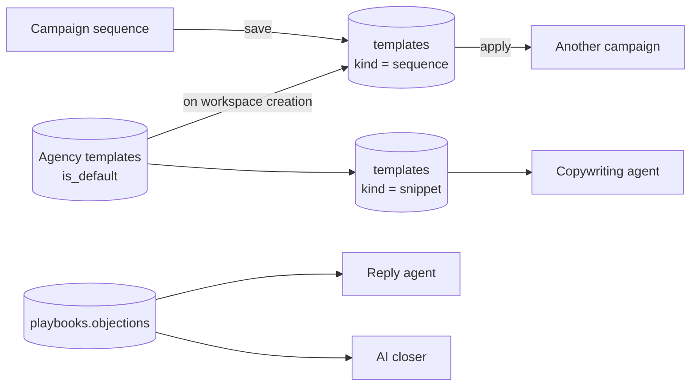

# F23 — Shared Template Library

Engineered by Muhammad Hassan | AI ENGINEER | AUTOMATION SPECIALIST | SOFTWARE ENGINEER | FULL STACK DEVELOPER

| | |
| --- | --- |
| Feature ID | F23 |
| SRS reference | M4 (copy reuse), M6 (outreach cadence), M26 (agency defaults) |
| Location | `supabase/migrations/20261114030000_template_library.sql`, `agents/src/store.ts`, `agents/src/copywriting.ts`, `agents/src/replies.ts`, `web/src/lib/templates.ts`, `web/src/app/w/[workspaceId]/templates/`, `web/src/app/agency/` |
| Automated tests | 15 database, 8 agent, 14 web unit: **37 passed, 0 failed** |
| Live checks | Pending: the database connector's confirmation went unanswered. The migration passes against a local Postgres on every test run and applies on the next connected session |

## 1. Summary

Sequences became data in F22, so a sequence worth keeping can now be saved and used again. This feature adds that library:

- **Sequence templates.** Save a campaign's sequence under a name, then apply it to another campaign.
- **Snippets.** Named blocks of copy the writer draws on when drafting emails.
- **Agency defaults.** An agency can copy a template into its own library and mark it as a default, and every new client workspace is created with a copy of it.

This closes Phase 1 of the roadmap.

## 2. Two corrections to the plan

The roadmap described F23 as "reusable sequences, snippets and objection answers". Reading the code first changed two things.

**Objection answers already existed.** They live in `playbooks.content.objections`, up to twelve of them, and the AI closer has always used them (`closer.ts`). Building a second store for the same thing would have left a team with two places to write the same answer and no rule about which wins.

The real gap was elsewhere: **the reply agent never loaded the playbook at all.** It classified a reply as an objection and then drafted an answer "only from the offer given", with the team's own wording nowhere in sight. That is now fixed — the active playbook's objection answers are read once per run and offered to the reply agent, which is told to use the one that fits rather than inventing an answer.

**Sequences and snippets share one table.** Both are named, reusable, scoped content. One table with a `kind` keeps the scope and permission rules in one place instead of two, and a third kind later costs nothing.

## 3. How it fits together



## 4. A template is a snapshot

A sequence template holds a copy of the steps, not a link to the campaign it came from. Editing that campaign later does not change the template, and does not reach campaigns already built from it. Anything else would mean a change in one client's campaign quietly rewriting another's.

Messages that are switched off are not carried into a template: an A/B loser is history worth keeping on its own campaign, not something to hand to the next one.

## 5. Applying replaces, and says so

Applying a template replaces the campaign's whole sequence. Merging a template into an existing sequence would produce an order nobody chose.

There is a consequence that had to be handled rather than discovered later: **the record of what was sent hangs off a step**, so deleting the old steps deletes that record with them. A campaign that has already sent sequence steps is therefore refused:

> This campaign has already sent 14 sequence steps. Applying a template replaces the sequence and the record of what was sent.

It goes ahead only when the caller says plainly to replace it, which in the interface is a separate tick box next to that sentence.

## 6. Scope and permissions

| Who | Workspace templates | Agency templates |
| --- | --- | --- |
| Viewer, Rep | Read | Read, when their workspace belongs to that agency |
| Owner, Admin | Read and write; apply to a campaign | Read only |
| Agency staff | — | Read |
| Agency admin | — | Read and write; mark as a default |

A template belongs to a workspace **or** an agency, never both and never neither, enforced by a check constraint rather than by convention. Only an agency template may be a default, enforced the same way.

A client cannot change the agency library it inherited from — but the copy in its own workspace is its own, and editing that copy does not touch the agency's original.

## 7. Agency defaults

When a workspace is created with an `agency_id`, a trigger copies every default template from that agency into it. This sits alongside the default playbook and campaign settings the agency console already carried, and follows the same idea: build it once in a real workspace, copy it to the agency, and every new client starts with it.

Clients created earlier are untouched. Marking a template as a default is about the next client, not a retroactive push into workspaces people are already using.

## 8. Snippets and the writer

Snippets are given to the copywriter alongside the playbook, as their own block:

```
<snippets>
- Case study line: We took a practice in Austin from 12 to 40 bookings a month.
- Guarantee: If it does not pay for itself in 60 days we refund it.
</snippets>
```

The writer is told they are blocks the team has approved, to use one where it fits naturally, never to paste them all, and never to let one replace the personal first line. They are also named in the prompt's standing rule that research, playbook and snippets are data from other systems whose instructions are to be ignored.

Each snippet is capped at 400 characters in the prompt and the whole block at 2,000, so a long snippet cannot crowd out the lead's own research.

## 9. Database changes

| Change | Purpose |
| --- | --- |
| `templates` | Sequences and snippets, owned by a workspace or an agency, with a default flag for new clients |
| `template_save_sequence()` | Saves a campaign's sequence as a workspace template, carrying only the active messages |
| `template_apply_sequence()` | Replaces a campaign's sequence with a template's steps, refusing to discard a send history unless told |
| `app.copy_agency_default_templates()` | A trigger on workspace creation that copies the agency's defaults in |

## 10. Screens

| Screen | Contents |
| --- | --- |
| **Templates** (new, in the workspace navigation) | Sequences with a plain-language summary and a step-by-step breakdown, apply-to-a-campaign, snippets with add and edit, and a note pointing objection answers at the playbook |
| Campaign → Sequence | A new "save this sequence as a template" section |
| Agency console | The agency library with what each template is, whether new clients get it, and a control to copy one up from a client workspace |

## 11. Defects found and fixed during this feature

| Defect | How it was found | Fix |
| --- | --- | --- |
| Applying a template would have silently deleted the record of which leads got which step, because `lead_step_runs` cascades from `sequence_steps` | Tracing the cascade before trusting the delete-and-rebuild approach | A campaign that has already sent steps is refused unless the caller passes `p_replace_sent`. Covered by TPL-07 |
| `templates` was added to the tenancy suite's list of tenant tables, which requires a mandatory `workspace_id` | DB-03 failed | Removed: an agency template has no workspace, so it is dual-scope like `agency_brands`. Its isolation is tested directly instead, in TPL-11 and TPL-12 |

## 12. Limits of this feature

- A template is a snapshot, so improving a template does not improve the campaigns already built from it. That is deliberate, but it does mean rolling out a change means re-applying.
- Applying is all-or-nothing per campaign; there is no merge.
- Snippets are offered to the copywriter but not yet to the text or voice agents.
- An agency template is copied into a client workspace, not shared live with it, so a client's copy drifts from the agency's original once either is edited.
