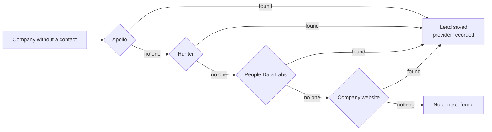

# F25 — Waterfall Enrichment

Engineered by Muhammad Hassan | AI ENGINEER | AUTOMATION SPECIALIST | SOFTWARE ENGINEER | FULL STACK DEVELOPER

| | |
| --- | --- |
| Feature ID | F25 |
| SRS reference | M3 (enrichment, verification and hygiene), FR-3.1 (decision makers at known companies) |
| Location | `supabase/migrations/20261114050000_waterfall_enrichment.sql`, `agents/src/waterfall.ts`, `agents/src/sources/hunter.ts`, `agents/src/sources/pdl.ts`, `agents/src/enrichment.ts`, `agents/src/store.ts`, `web/src/lib/enrichment.ts`, `web/src/lib/integrations.ts`, `web/src/lib/connection-tests.ts`, `web/src/app/w/[workspaceId]/settings/` |
| Automated tests | 9 database, 13 agent, 7 web unit: **29 passed, 0 failed** |
| Live checks | Passed: the migration is applied to the hosted database; row security, privileges, the new columns, the extended tool list and the stats function verified in place |

## 1. Summary

Until now a company found without a contact got one Apollo lookup, then a read of its own website. Whatever Apollo did not know about stayed unreached.

Enrichment is now a **chain of contact providers** tried in an order the workspace chooses:

- **Stops at the first hit.** A provider is only asked about the companies the providers before it missed, so no credits are spent finding someone twice.
- **Records who found each lead.** `leads.enrichment_provider` and one `enrichment_attempts` row per company per provider asked.
- **Match rates per provider** on the Settings screen, over the last 30 days.
- **Falls back to the website**, as before, and it is still free.

## 2. Providers chosen, and why these

| Provider | What it is asked | Why |
| --- | --- | --- |
| Apollo | People at these domains with the campaign's titles | Already connected by most workspaces; unchanged |
| Hunter | Personal addresses at one domain (Domain Search); one named person's address (Email Finder) | Strong on email at small and mid-sized companies, where Apollo is thinnest; Email Finder is not charged when nothing is found |
| People Data Labs | People at these company websites with a senior job level or a requested title | Strong person coverage, including mobile numbers; billed per record returned, so the request size is the spending cap |

Every endpoint, parameter and response field used was checked against the provider's published documentation before any code was written. Two things from that reading shaped the code:

- **Hunter answers 403 for its rate limit and 429 for the plan's usage limit**, the reverse of what most APIs mean. Read naively, a busy minute would have marked a working key as broken. The adapter translates both before the shared error handling sees them.
- **People Data Labs returns contact fields as `true`/`false` on free plans.** Treated as values, a free account would look like a provider that never finds anyone. The adapter only accepts strings, and tells the team the plan is hiding contacts (WF-11).

Personal email addresses from People Data Labs are deliberately not used: only the work email is. Cold outreach to a personal address is the riskiest thing this system could do under GDPR and PECR, and it is not worth the extra match rate.

## 3. A person without an email

Apollo often knows who runs a company without knowing their address. Previously that person was saved with only a LinkedIn URL. Now, when Hunter is connected, the agent asks Hunter's Email Finder for that person's work address before moving on (WF-07). The lead keeps Apollo as its provider, and its source line says the email came from Hunter.

A named person who still has no email or phone is kept as a last resort, if neither the rest of the chain nor the website finds anything better.

## 4. Failures fall through

One vendor's bad day is not the end of the chain:

| What happens | Behaviour |
| --- | --- |
| A provider refuses the key (401, 402) | The tool is flagged on the setup screen; the next provider carries on (WF-10) |
| A provider errors on some companies (500, timeouts) | Those companies go on down the chain; any still not found stay **pending** and are retried tomorrow, rather than being marked as having no contact (WF-09) |
| A company website cannot be read | Counted as no match: an unreachable site is not worth a daily retry |

Before this change, an Apollo error held back every company in the run. Now only the companies that were actually affected wait.

## 5. Measuring providers fairly

A provider placed second only sees the companies the first one missed: the harder ones. Comparing raw hit counts would always flatter whichever provider is first. So `enrichment_provider_stats()` counts a provider's match rate **only over the companies it was actually asked about**, and lookups that failed are counted separately rather than as misses. The Settings screen says this in a sentence under the table.

## 6. Spending

| Limit | Value |
| --- | --- |
| Paid lookups per provider per run | The campaign's remaining daily lead limit, at most 50 |
| People per company | 2 |
| Stop asking | Once enough companies have a contact to meet the daily limit |
| People Data Labs request size | The smaller of the remaining budget and two per company |

The job result reports `tried`, `found`, `errors` and `credits_used` for each provider, and `apollo_credits_used` is kept so earlier dashboards still read it.

## 7. Database changes

| Change | Purpose |
| --- | --- |
| `integrations_tool_check` | Accepts `hunter` and `pdl` |
| `workspaces.enrichment_order` | The order, `{apollo,hunter,pdl}` by default; any subset, each provider once, enforced by `app.valid_enrichment_order()` |
| `leads.enrichment_provider` | Which provider found the lead: `apollo`, `hunter`, `pdl` or `website` |
| `enrichment_attempts` | One row per company per provider asked. Members read; only the agent service writes, so match rates cannot be edited. `found` exactly when contacts > 0, by constraint |
| `enrichment_provider_stats(ws, days)` | Attempts, matches, errors, match rate and leads per provider. `security invoker`, so row-level security decides who sees it |

## 8. Screens

| Screen | Change |
| --- | --- |
| Setup | An optional step, **More contact finders**, with Hunter and People Data Labs, each tested before saving. The People Data Labs test is a search built to match no one, so it proves the key without spending a credit |
| Settings | **Contact finders**: the order as three positions, a sentence that says what will happen, and the 30-day match-rate table |

## 9. Defects found and fixed during this feature

| Defect | How it was found | Fix |
| --- | --- | --- |
| The catalog test compared tools against the **first** definition of the integration constraint, so any later migration that widened it would fail the test | ONB-01 failed when the constraint was redefined | The test now reads the last definition, the one in force |
| The order test expected no Apollo calls at all, but Apollo is still asked for company details, a separate step | WF-08 failed on `organizations/enrich` | The test now checks that Apollo's people search is not called; company details are unaffected by the order, as intended |

## 10. Limits of this feature

- The order is per workspace, not per campaign.
- Hunter's credit count is an estimate (one per search that returned addresses, one per email found); the provider's own dashboard is the authority.
- Match rates cover the last 30 days and are not yet broken down by campaign or niche, which is where they would differ most.
- Company details (industry, size) still come from Apollo only.
