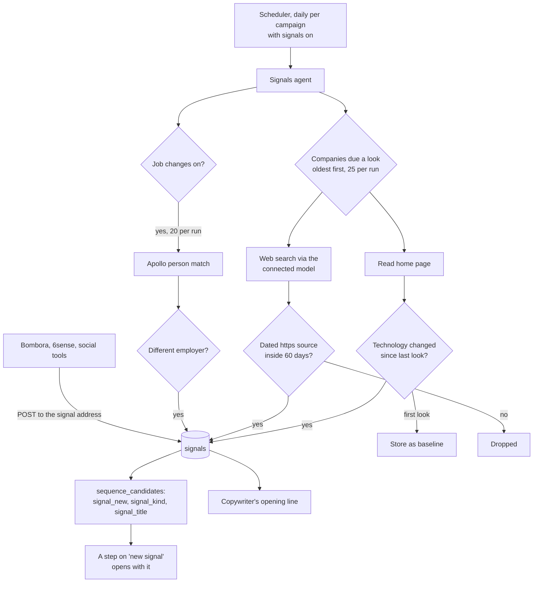

# F26 — Signals Agent (agent #17)

Engineered by Muhammad Hassan | AI ENGINEER | AUTOMATION SPECIALIST | SOFTWARE ENGINEER | FULL STACK DEVELOPER

| | |
| --- | --- |
| Feature ID | F26 |
| SRS reference | M2 (research and intent), M6 (outreach timing), M7 (multi-channel follow-up) |
| Location | `supabase/migrations/20261117020000_signals.sql`, `agents/src/signals.ts`, `agents/src/signalsRun.ts`, `agents/src/sources/apollo.ts`, `agents/src/sequence.ts`, `agents/src/sequenceRun.ts`, `agents/src/copywriting.ts`, `web/src/lib/signals.ts`, `web/src/app/api/signals/[token]/route.ts`, `web/src/app/w/[workspaceId]/signals/` |
| Automated tests | 10 database, 23 agent, 9 web unit, 1 browser: **43 passed, 0 failed** |
| Live checks | Passed: migration applied to the hosted database and verified in place (LIVE-52, LIVE-53) |

## 1. Summary

The agents found leads and contacted them on a schedule, but nothing noticed when something changed about a lead already in the pipeline. A company that raised money last week, or a contact who moved to a bigger employer, looked exactly like it did a month ago.

The signals agent watches for those changes and records them as **signals**. A signal is a reason to get in touch now, and it is used in two places:

- **The sequence** (F22) gains a trigger, "a new signal arrived", and a `{{signal}}` placeholder that writes the signal as an opening line. A step on that trigger may run **even after the rest of the sequence has finished**, which is what re-opening a conversation means.
- **The copywriter** is given the newest unused signal and may open the first email with it.

The agent itself **only records**. It cannot contact anyone; contacting is always a sequence step, with every consent gate, contact window and daily limit F22 already applies.

## 2. Three tiers, as the roadmap set out

| Tier | Signals | How they arrive | Needs |
| --- | --- | --- | --- |
| **Built in** | Funding, news, hiring | Web search through whichever language model the workspace connected | Nothing new: OpenAI, Anthropic and Gemini all support web search |
| **Built in** | Technology changes | The company's own home page, compared with the last look | Nothing new |
| **Built in** | Job changes | Apollo's person match | Apollo, already connected for sourcing. Opt-in, see §5 |
| **Paid** | Buying intent, in-market accounts | Sent by the tool to the workspace's signal address | A Bombora or 6sense subscription |
| **Social** | Posts describing the problem | Sent by a listening tool to the same address | A social listening tool |

**Why the paid and social tiers have no dedicated integration.** Bombora's and 6sense's APIs are only documented behind enterprise access, so a client for them could not be checked against their real responses. Building on unverified endpoints was refused, as it was for Instantly in F22. Instead, the workspace gets a **signal address**: any tool — or Zapier or Make in front of one — can send signals to it. This covers every vendor, including ones nobody has picked yet, and the agent has nothing to "skip" when none is used.

## 3. How a run works

## 4. Why a signal is trusted, or not

A made-up hook in a cold email is worse than no hook, so the agent keeps only what a person could check:

- **Web search results** must have an `https` link, must not be a search-results page, and must carry a date inside the last 60 days (and not in the future). The model is told to leave out anything it cannot source, and the response schema requires a URL and a date for every item. At most three items per company per run.
- **Technology changes** are only reported from the second look onwards. The first look is a baseline; reporting it would make every tool on every site look "new".
- **Job changes** are only reported when Apollo returns an employer that differs from ours, by domain where both are known and by name otherwise, ignoring suffixes such as "LLC" and "Inc.". A match Apollo itself rates as having no confidence is treated as no match.
- **The same event twice is one signal.** Each signal has a fingerprint: for web results the canonical URL without tracking parameters, for ingested signals the sending tool's own event id scoped by the tool.

## 5. Cost controls

| Check | Limit |
| --- | --- |
| Companies per run | 25, the longest-unchecked first |
| How often a company is looked at | At most weekly |
| Job-change checks per run | 20 |
| How often a person's employer is checked | At most monthly |
| Job changes overall | **Off by default.** Each Apollo match costs one credit, so a campaign has to opt in, and the screen says so |

## 6. Apollo's person match, verified first

The job-change check uses `POST /api/v1/people/match`. Its field names were taken from Apollo's published OpenAPI specification, not assumed: `person.title`, `person.organization.name` and `.primary_domain`, and `employment_history[].current` as the fallback. The request asks Apollo **not** to reveal personal emails or phone numbers, which would cost extra credits and are not needed to see where someone works.

A job-change signal carries a note that the email on file probably belongs to the previous employer, so nobody writes to a dead inbox thinking it is current.

## 7. The signal address

`POST /api/signals/{token}`, where the token is the workspace's existing 64-character webhook secret. Owners and admins see the address on the Signals page; rotating it in Settings moves every webhook together.

| Rule | Detail |
| --- | --- |
| Body | One signal, or `{"signals": [...]}` with up to 50; at most 64 KB; each signal at most 8 KB |
| Matching | By email to a lead, or by domain to a company. A signal about nobody in the workspace is **not stored**, so the address cannot be used to dump arbitrary data |
| Kinds | `intent_surge`, `social_post`, `funding`, `news`, `hiring`, `tech_change`, `job_change` |
| Wrong or malformed token | 404 with the same message either way, so the endpoint does not reveal which tokens exist |
| Errors | Only known, safe database messages are passed back; anything else becomes "The signal could not be stored" |
| Links | A `url` that is not `http(s)` is dropped, so `javascript:` links cannot be planted in the interface |

## 8. Permissions

| Who | Can |
| --- | --- |
| Members | Read signals |
| Reps, admins, owners | Dismiss or restore a signal. Column-level grants allow only `status` and `used_at` to change; what was found cannot be edited, added or deleted by a person |
| Owners, admins | Turn signals on per campaign, choose the kinds, see the signal address |
| The agent service | Write signals |
| A tool with the address | Send signals into that one workspace |

## 9. Database changes

| Change | Purpose |
| --- | --- |
| `signals` | One row per event, about a company, a person or both; never about nobody |
| `companies.tech_stack`, `companies.signals_checked_at` | What the site ran at the last look, and when |
| `leads.job_checked_at` | When the person's employer was last checked |
| `campaigns.signals_enabled`, `campaigns.signal_kinds` | Off by default; job changes not in the default kinds |
| `signal_ingest()` | The signal address, matching and de-duplication |
| `sequence_candidates()` | Three new facts: `signal_new`, `signal_kind`, `signal_title` |
| `agent_jobs_enqueue_due()` | Queues the signals agent daily where a campaign has signals on |
| `agent_jobs` type `signals` | Scheduled, retried and logged like every other agent |

## 10. Screens

| Screen | Contents |
| --- | --- |
| **Signals** (new, in the workspace navigation) | Signals filtered by status and kind, each with its source link, who it is about and what found it; dismiss and restore; the signal address with an example body |
| Campaign → Sequence | A Signals section: on or off, and which kinds to look for, each explained, with the Apollo credit cost stated for job changes. The new "a new signal arrived" trigger, and `{{signal}}` in the placeholder help |

## 11. Defects found and fixed during this feature

| Defect | How it was found | Fix |
| --- | --- | --- |
| **F22: the sequence agent was never scheduled**, and **with branching on the fixed email, call and text agents still ran**, so a lead would have been contacted twice | Reading the scheduler to add the signals agent | Fixed first, separately, and released before F26. See the F22 report §12. No campaign had branching on |
| Ingested signals used the tool's event id alone as the fingerprint, so two tools both numbering events from 1 would have overwritten each other, the second dropped as a "duplicate" | SIGB-04 | The fingerprint always includes the sending tool and is a fixed-length hash |
| A finished sequence that had a signal step but no new signal reported itself as "waiting", as if a step were due | SIG-15 | Reported as "stopped" until a signal arrives |
| The browser checks had been run against an old build: stopping `next start` left its `next-server` child running, so the new server could not take the port | E2E-18 returned an HTML 404 from the old build | The child server is stopped by name. All 18 checks pass twice on the current build. The same flaw affected the F22 and F23 browser runs; those pages did not change between features, and they pass on this build |

## 12. Limits of this feature

- Each signal step runs once per lead. A lead who gets a second signal months later needs a second signal step to be contacted about it.
- Web search quality depends on the connected model's search tool; the validation drops what cannot be sourced, but cannot find what the search did not.
- Technology detection recognises 21 common tools from the HTML a visitor's browser receives. Tools loaded only after sign-in, or server-side, are not seen.
- The paid and social tiers depend on the tool being able to send a webhook, directly or through Zapier or Make.
