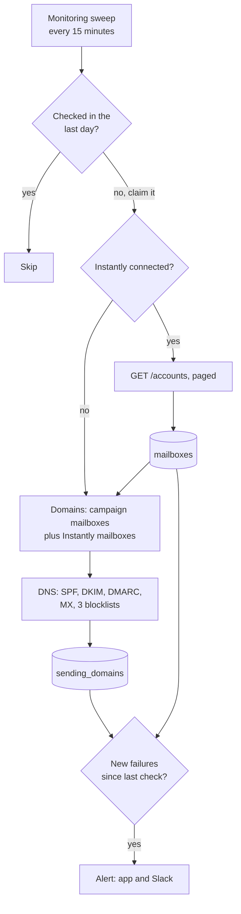

# F27 — Deliverability Dashboard

Engineered by Muhammad Hassan | AI ENGINEER | AUTOMATION SPECIALIST | SOFTWARE ENGINEER | FULL STACK DEVELOPER

| | |
| --- | --- |
| Feature ID | F27 |
| SRS reference | M6 (outreach), M10 (reporting), M11 (monitoring and alerts) |
| Location | `supabase/migrations/20261117040000_deliverability.sql`, `agents/src/deliverability.ts`, `agents/src/deliverabilityRun.ts`, `agents/src/sources/instantly.ts`, `agents/src/monitoring.ts`, `web/src/lib/deliverability.ts`, `web/src/app/w/[workspaceId]/deliverability/` |
| Automated tests | 7 database, 22 agent, 8 web unit, browser redirect check extended: **37 passed, 0 failed** |
| Live checks | Passed: migration applied to the hosted database and verified in place (LIVE-54, LIVE-55) |

## 1. Summary

Since F19, a campaign whose bounce or opt-out rate crosses the workspace's limit is paused automatically. That protects a domain only after the damage has begun. This feature adds the view a team needs beforehand:

- **Per sending domain:** SPF, DKIM, DMARC and MX, each passed, warned or failed with a plain-language fix, and the domain checked against three domain blocklists. A score out of 100 summarises the domain.
- **Per mailbox:** Instantly's sending status and warm-up health, and the last 30 days of sends, bounces and replies.
- **Alerts:** in the app and on Slack, only for problems that are **new** since the last check, so a known issue is not repeated every morning.

Checks run once a day per workspace inside the existing 15-minute monitoring sweep, so no new job type, worker or schedule was needed. An owner or admin can ask for a check straight away.

## 2. Which domains are checked

The domains of every mailbox in a non-archived campaign's email settings, plus the domains of every mailbox in the connected Instantly workspace. Domains nobody sends from any more disappear from the page. At most 20 domains are checked per workspace per day; anything over is reported, not silently dropped.

## 3. The checks

| Check | Fails when | Warns when |
| --- | --- | --- |
| **SPF** | No record; more than one; `+all`; more than 10 DNS lookups (RFC 7208 §4.6.4); a Google or Microsoft mailbox on the domain but the provider's include missing | `?all`; no `~all`/`-all`; `ptr`; an include with no record |
| **DKIM** | The team's own selector has no key; the only key found is revoked (`p=` empty) | No key at the provider's or common selectors |
| **DMARC** | No record (Gmail and Yahoo require one from bulk senders); more than one; no valid `p=` | `p=none` (meets the rule, protects nothing); no `rua` reports address |
| **MX** | No MX, or a null MX | — |
| **Blocklists** | Listed on Spamhaus DBL, SURBL, or URIBL black or red | URIBL grey list |

**SPF lookups** are counted the way receivers count them: `include`, `redirect`, `a`, `mx`, `ptr` and `exists` each cost one, and includes are followed recursively. Loops end; macro arguments (`%{i}`) are counted but cannot be followed.

**DKIM** cannot be checked exhaustively: DNS has no way to list selectors. The agent tries the team's own selector first, then the provider's (`google` for Google Workspace, `selector1`/`selector2` for Microsoft 365), then common ones. Not finding a key at guessed selectors is therefore a **warning**, never a failure; the page asks for the selector when the provider uses another one.

**DMARC** falls back to the registered domain when a subdomain has no record of its own, as receivers do (`mail.acme.co.uk` → `acme.co.uk`).

## 4. Never a false red

A lookup that fails for any reason other than "no such record" — a timeout, a refused query — makes that check **"Not checked"**, never a pass or a fail, and costs no score. A red badge for a working domain sends a team chasing a problem that does not exist.

The blocklists are a particular case. Their return codes were taken from each list's documentation, including the codes that mean "your query was refused" rather than "listed":

| List | Listed | Refused, read as "not checked" |
| --- | --- | --- |
| Spamhaus DBL | 127.0.1.2–6, 127.0.1.102–106 | 127.0.1.255, 127.255.255.252/254/255 (Spamhaus does not answer public resolvers) |
| SURBL | last-octet bits 8, 16, 64, 128 (and 4) | 127.0.0.1 |
| URIBL | bit 2 black, 8 red, 4 grey | 127.0.0.1, 127.0.0.255 |

On a host whose DNS goes through a public resolver, Spamhaus will usually show "not checked". The page says why. The other checks are unaffected.

## 5. Score

100, minus 25 per failure and 8 per warning, never below zero. "Not checked" costs nothing. 90 and above is shown as *good*, 60–89 *needs work*, below 60 *at risk*. The weights are this platform's own, stated on the page, not an industry standard.

## 6. Mailboxes, verified against Instantly first

`GET /api/v2/accounts`, paged with `limit` and `starting_after` / `next_starting_after`, up to 1,000 mailboxes. Field meanings were taken from Instantly's API reference, not assumed:

| Field | Values |
| --- | --- |
| `status` | 1 active, 2 paused, 3 maintenance, −1 connection error, −2 soft bounce error, −3 sending error |
| `warmup_status` | 0 paused, 1 active, −1 banned, −2 spam folder unknown, −3 permanent suspension |
| `provider_code` | 1 IMAP/SMTP, 2 Google, 3 Microsoft, 4 AWS, 8 and 11 Airmail |
| `stat_warmup_score`, `daily_limit`, `setup_pending` | as named |

A warm-up health below 70 is flagged. That threshold is this platform's choice, and is labelled as such in the code.

An envelope the client does not recognise is an error, never "no mailboxes", so an API change cannot empty the page. A rejected key flags Instantly in Setup, keeps yesterday's mailboxes, and the domain checks still run.

**Per-mailbox statistics** come from Instantly's own webhook events, already stored since F7. Instantly documents the mailbox field on those events as optional, so events that do not name a mailbox are counted separately and shown as a note, not assigned to a guess. Rates are shown once a mailbox has sent 20 emails.

## 7. How a check runs

The check is **claimed before it runs**: a check that fails is retried tomorrow, not every 15 minutes, and two sweeps never run it at once. Any failure inside it is caught and logged so the rest of the monitoring sweep — automatic pausing, integration alerts, the daily summary — always completes.

## 8. Alerts

| Alert | Severity | When |
| --- | --- | --- |
| Domain blocklisted | Critical (passes quiet hours) | A new listing |
| Domain set-up problem | Warning | A new failure: SPF, DKIM, DMARC or MX |
| Mailbox needs attention | Critical for a stopped or banned mailbox, warning otherwise | A new mailbox problem |

"New" compares the problem with yesterday's, ignoring changed numbers, so "SPF needs 11 lookups" becoming "12 lookups" is not a new alert. Warnings appear on the page but do not alert. Each alert is also de-duplicated per day.

## 9. Permissions

| Who | Can |
| --- | --- |
| Members | See domains, mailboxes and per-mailbox counts |
| Owners, admins | Ask for a check now; set a domain's DKIM selector (the only column a person can change) |
| The agent service | Write results |
| Visitors | Nothing |

The raw Instantly events are visible to owners and admins only, because they carry lead addresses. The per-mailbox counts carry no lead data, so `mailbox_stats()` reads the events itself after checking membership, and every member sees the counts. This is the one function the security advisor lists for this feature, by design.

## 10. Database changes

| Change | Purpose |
| --- | --- |
| `sending_domains` | One row per domain: each check's status, the records found, blocklist results, issues with fixes, score |
| `mailboxes` | One row per Instantly mailbox: status, warm-up, daily limit, provider |
| `workspaces.deliverability_checked_at` | When the daily check last ran; empty means "check at the next sweep" |
| `mailbox_stats(ws, days)` | Sends, bounces, replies and opt-outs per mailbox, 1 to 90 days |

## 11. Defects found and fixed during this feature

| Defect | How it was found | Fix |
| --- | --- | --- |
| Reps and viewers would have seen zero sends for every mailbox: the counts read events that only owners and admins may see | DLB-04 | The function checks membership itself and returns counts only |
| An Instantly address with a numeric top-level domain would have failed the table's check and lost every mailbox in that save | Review of the save against the table's rules | Such addresses are skipped before the save |

## 12. Limits of this feature

- DKIM keys at selectors that are neither common nor given by the team are not found; the page asks for the selector.
- Spamhaus does not answer queries from public DNS resolvers; where the agent service uses one, that list shows "not checked".
- IP blocklists are not checked: Instantly's sending IPs belong to Instantly and the mail provider, not the workspace.
- Inbox placement (inbox versus spam folder) cannot be measured from DNS; Instantly's warm-up health is the closest signal shown.
