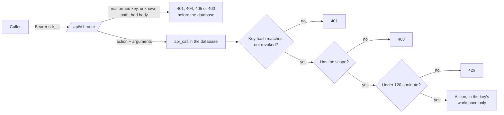
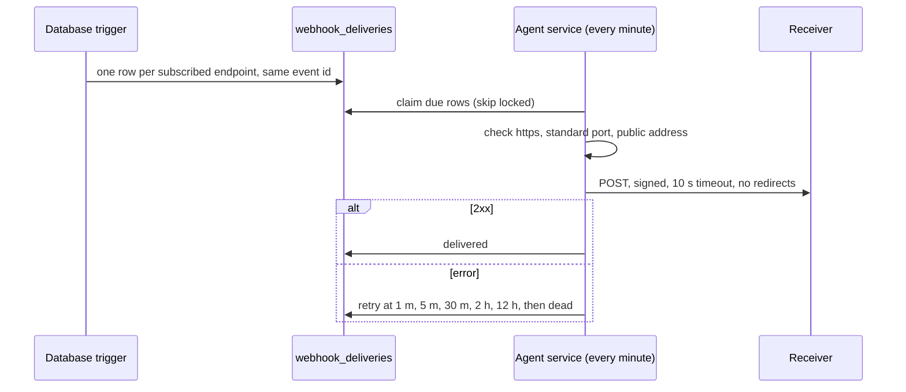

# F29 — Public API and Outbound Webhooks

Engineered by Muhammad Hassan | AI ENGINEER | AUTOMATION SPECIALIST | SOFTWARE ENGINEER | FULL STACK DEVELOPER

| | |
| --- | --- |
| Feature ID | F29 |
| SRS reference | M23 (integrations), M12 (security), M11 (monitoring and alerts) |
| Location | `supabase/migrations/20261117060000_public_api.sql`, `web/src/app/api/v1/[...path]/route.ts`, `web/src/lib/api.ts`, `web/src/app/w/[workspaceId]/developers/`, `agents/src/webhooksOut.ts`, `agents/src/jobs.ts`, `agents/src/store.ts`, `docs/API.md` |
| Automated tests | 15 database, 8 agent, 7 web unit, 1 browser: **31 passed, 0 failed** |
| Live checks | Passed: migration applied to the hosted database and verified in place (LIVE-58, LIVE-59) |

## 1. Summary

Until now, data left the platform only through the built-in integrations, and entered it only through sourcing, CSV import and the signal address. This feature adds the two general-purpose doors other systems need:

- **A REST API** at `/api/v1` with scoped API keys: read leads, deals, campaigns and meetings; add leads; change a lead's stage.
- **Outbound webhooks**: the team registers https endpoints, and six events are sent to them as signed POSTs within a minute, with retries.

Together they let Zapier, Make, n8n or a team's own code work with the platform without anything being built for each tool. The full reference is `docs/API.md`.

## 2. How a request is checked

**Why the checks live in the database.** The web app holds only the publishable key, never the service key. A key-authenticated request therefore cannot read tables directly, and it should not: `api_call` is the single entry point, a security-definer function that hashes the key, checks the scope and the rate limit, and then runs exactly one of seven fixed actions with the workspace taken from the key. There is no path from a key to a table, another workspace or another action. The same design is used for the signal address (F26).

**Keys.** A key is 64 random hex characters behind `sdr_`. It is returned once at creation, and only its SHA-256 hash is stored. People see the first 12 characters, the permissions and when it was last used; the hash and the rate-limit counters are not readable columns. At most 20 active keys per workspace.

**Rate limit.** A fixed one-minute window per key, kept on the key's row. Requests that fail validation are not counted, because the failed transaction leaves the counter untouched.

**Input.** Every argument is validated in the database: ids must be UUIDs, times must be ISO 8601 (Postgres would otherwise accept words such as "yesterday"), cursors must have their exact shape, page sizes are capped at 100, and bodies at 16 KB. The route passes only known query parameters for each list, and the path's lead id always wins over an `id` in the body.

## 3. Adding leads through the API

`POST /leads` applies the same hygiene as a CSV import (F21):

- a lead needs an email, a phone or a LinkedIn address;
- every field is validated and normalised (lower-case email, phone digits, domain without scheme or `www`);
- a suppressed email, phone or domain is not added, and the answer says so;
- an email that already exists returns the existing lead instead of a duplicate;
- the company is matched by domain, then by name, before one is created.

The lead's source is `api`, and its source note names the key, so its origin is always visible.

`PATCH /leads/{id}` changes only the stage. The change is written to the lead's history with the key's name. `do_not_contact` also suppresses the email, and **a lead that asked not to be contacted cannot be reopened from outside**; that decision stays with a person in the app.

## 4. Webhooks

| Event | Raised by |
| --- | --- |
| `lead.created` | A database trigger on new leads, whatever created them |
| `lead.stage_changed` | A trigger on stage changes only; carries `previous_stage` |
| `reply.received` | A trigger on new replies |
| `meeting.booked` | A trigger on new meetings |
| `deal.won`, `deal.lost` | A trigger when a deal reaches either stage |

Triggers mean no code path can forget to emit an event: an AI call booking a meeting, a CRM marking a deal won (F28) and a person changing a stage all produce the same event. A workspace with no active endpoint pays one indexed lookup per change and nothing else.

**Signing.** `X-SDR-Signature: t=<seconds>,v1=<HMAC-SHA256 of "<t>.<body>">` with the endpoint's own secret, the same scheme Stripe uses, so receivers can reject both forgeries and replays. The secret is never a readable column; owners and admins reveal it, or replace it, through a function that checks their role.

**Safety of the sender.** Before every attempt the address must be https on the standard port, not an IP literal, and must resolve only to public addresses. This reuses the checks from the website reader (F5), so a team member cannot point the sender at the platform's own network. Redirects are not followed, because a redirect could lead to a private address. The receiver's answer body is never read.

**Retries and switching off.** Six attempts over about 15 hours. An endpoint that fails 15 times in a row is switched off, with the last error recorded, and the team is alerted once. Switching it back on resets the count. A delivery left in "sending" by a stopped worker is picked up again after ten minutes. History is trimmed after 30 days.

## 5. Permissions

| Who | Can |
| --- | --- |
| Owners, admins | Create and revoke keys; add, switch on or off, and delete endpoints; reveal or replace a signing secret; send a test event; see the delivery history |
| Reps, viewers | Nothing on this page |
| A key | Only its permissions, only in its workspace, 120 times a minute |
| The agent service | Claim and record deliveries; nobody else can |
| Visitors | Only `api_call`, which does nothing without a valid key |

## 6. Database changes

| Change | Purpose |
| --- | --- |
| `api_keys` | Name, prefix, hash, permissions, last use, revocation, rate-limit window |
| `api_key_create()`, `api_key_revoke()` | Owners and admins only; the key is returned once |
| `api_call()` | The single entry point for every API request |
| `webhook_endpoints` | Address, events, signing secret (not readable), on or off, failure count |
| `webhook_deliveries` | One row per event per endpoint: status, attempts, next attempt, last result |
| Four triggers | Leads, replies, meetings and deals raise events |
| `webhook_deliveries_claim()`, `webhook_delivery_result()` | Agent service only |
| `leads.source_channel` | Adds `api` |

## 7. Screens

| Screen | Contents |
| --- | --- |
| **API** (new, in the workspace navigation) | Keys with their permissions and last use; create (shown once) and revoke. Endpoints with their events and state; test, reveal or replace the secret, switch on or off, delete. A verification example. The last 50 deliveries with their result |

## 8. Defects found and fixed during this feature

| Defect | How it was found | Fix |
| --- | --- | --- |
| `updated_after=yesterday` was accepted, because Postgres reads words such as "yesterday" and "epoch" as times | API-05 | Times must be ISO 8601 |
| Listing leads with a page subquery lost the row type the lead formatter needs | API-05 failed to compile the function | The page is chosen by id, then formatted from the table row |
| Webhook endpoints on other ports would have been accepted, then refused by the sender on every attempt | Comparing the table's rule with the sender's checks | The table only accepts the standard port |

## 9. Limits of this feature

- The API covers the records a sync or a form needs; campaign settings, sequences and messages are managed in the app.
- `lead.created` is raised for every lead, including each row of a large CSV import. Up to 50 deliveries are sent per minute per agent worker, so a 5,000-row import reaches an endpoint over about 100 minutes.
- The rate limit is per key, not per workspace; a team can create more keys, up to 20.
