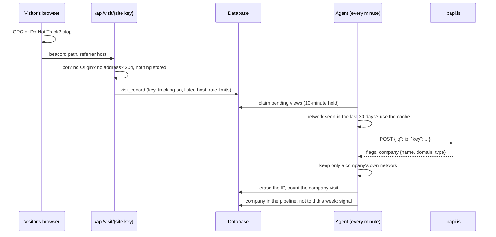

# F30 — Website Visitor Identification (Company Level)

Engineered by Muhammad Hassan | AI ENGINEER | AUTOMATION SPECIALIST | SOFTWARE ENGINEER | FULL STACK DEVELOPER

| | |
| --- | --- |
| Feature ID | F30 |
| SRS reference | M2 (research and intent), M7 (multi-channel follow-up), M12 (security and compliance) |
| Location | `supabase/migrations/20261117070000_visitor_identification.sql`, `web/public/v.js`, `web/src/app/api/visit/[key]/route.ts`, `web/src/lib/visitors.ts`, `web/src/app/w/[workspaceId]/visitors/`, `agents/src/visitors.ts`, `agents/src/sources/ipapi.ts`, `agents/src/jobs.ts`, `agents/src/store.ts` |
| Automated tests | 8 database, 9 agent, 7 web unit, 1 browser: **25 passed, 0 failed** |
| Live checks | Passed: migration applied to the hosted database and verified in place (LIVE-60, LIVE-61) |

## 1. Summary

A team adds one line of script to its own website. When someone from a company **already in the pipeline** visits, the platform records a `website_visit` signal (F26). A sequence step on "a new signal arrived" (F22) can then follow up while the interest is fresh, and the copywriter can open with it. Visiting companies not yet in the pipeline are listed too, as accounts worth sourcing.

**Only the company is identified, never the person.** That was the roadmap's decision: company-level identification works under EU rules and carries far lower privacy risk than the person-level kind.

## 2. How it works

## 3. Choosing the lookup provider

Several providers were checked before any code was written:

| Provider | Finding | Decision |
| --- | --- | --- |
| Clearbit Reveal | Folded into HubSpot; no longer available as a standalone API | Not usable |
| IPinfo | Company data is only in its Enterprise plan, with custom pricing | Not self-serve |
| Small free "IP to company" services | Return the address block's owner, often the ISP, with no business or ISP distinction documented | Not reliable enough |
| **ipapi.is** | Documented developer API; a `company` object from the most specific WHOIS record with a `type` (business, banking, education, government, isp, hosting); flags for VPN, proxy, Tor, data-centre, mobile and crawler traffic; 1,000 free lookups a day for commercial use | **Chosen** |

The request and response shapes were taken from ipapi.is's developer documentation:

- **Request:** `POST https://api.ipapi.is` with `{"q": ip, "key": key}`. This is the documented POST form, chosen so the key is never part of a URL.
- **Response flags:** `is_bogon`, `is_mobile`, `is_satellite`, `is_crawler`, `is_datacenter`, `is_tor`, `is_proxy` and `is_vpn`.
- **Company:** a `company` object with `name`, `domain` and `type`, plus `location.country_code`.
- **Errors:** a bad key answers 403 (`ERR_FORBIDDEN_INVALID_API_KEY`); a used-up quota answers 429 (`ERR_QUOTA_EXCEEDED`).

Paid tools such as Leadfeeder or Snitcher can still send visits through the existing signal address (F26), with no extra integration.

## 4. Which visits count

A visit names a company only when **every** one of these holds:

| Discarded | Why |
| --- | --- |
| VPN, proxy, Tor | The network is not the visitor's organisation |
| Data centres and hosting | Bots, cloud browsers, scrapers |
| Mobile and satellite networks | Personal devices |
| ISP networks | Homes and small offices: the "company" would be the internet provider |
| Crawlers, and known bot user agents | Not people |
| No organisation, or no valid domain | Nothing to match |
| The team's own website domains | The team itself |

What remains is an organisation's own network: business, banking, education or government.

## 5. Privacy by design

| Measure | Detail |
| --- | --- |
| No cookies, no storage | The script sets nothing in the browser; it is a few lines that send one beacon per page |
| Global Privacy Control and Do Not Track | Checked in the browser and again on the server; such visits are never recorded |
| The IP address | Kept only until the lookup, then erased. A view never looked up is erased after a day regardless. Only a one-way hash remains, salted per workspace, to count repeats and rate-limit |
| What is kept | The company, the paths visited (without query strings or fragments) and the referring site |
| The lookup cache | Shared across workspaces, keyed by a hash of the address, holding only what the network is; it says nothing about any workspace and is refreshed after 30 days |
| Who can read raw views | Nobody but the agent service. Members see only the per-company summary |
| Off by default | Each workspace switches it on and lists its own website hosts; the page reminds the team to mention company-visit analysis in its privacy policy |
| Retention | Page views are deleted after 90 days |

## 6. Abuse controls

The site key is public by nature, because it sits in the website's source, so it grants nothing except recording page views for that workspace:

- **Listed hosts only.** Views are only accepted from the hosts the team lists, read from the browser's `Origin`. Subdomains of a listed host are included; look-alikes such as `acme.com.evil.com` are not.
- **Rate limits.** At most 60 views an hour from one network, and 20,000 a day per workspace.
- **Nothing given away.** The endpoint always answers 204 with no body, so it reveals nothing about keys or settings.
- **Key rotation.** The key can be replaced at any time.
- **Cost.** Each network is looked up at most once a month across all workspaces, which keeps a busy site within ipapi.is's free tier.

## 7. Signals

A visit from a company that matches a company in the workspace (by domain) becomes a `website_visit` signal titled "Bright Dental visited your website", with the most viewed pages and a note that the person is not known. At most one signal per company per week, so a team reading the pricing page all afternoon is one signal, not fifty. Because the signal is about the company, it reaches every lead at that company through the sequence's `signal_new` fact (F26).

## 8. Database changes

| Change | Purpose |
| --- | --- |
| `workspaces.visitor_tracking_enabled`, `visitor_site_key`, `visitor_allowed_hosts` | Off by default; a unique random key per workspace; the hosts the script may report from |
| `site_visits` | Page views, with the IP until lookup; agent service only |
| `site_visitors` | One row per identified company: visits, first and last seen, top paths, matched company |
| `ip_lookups` | What each network is, cached for 30 days |
| `visit_record()` | The page-view entry point, callable without signing in |
| `workspace_rotate_site_key()` | Owners and admins |
| `site_visits_claim()` | Agent service only; erases stale IPs and trims old views |
| `integrations` tools | `ipapi` may be connected |

## 9. Screens

| Screen | Contents |
| --- | --- |
| **Visitors** (new, in the workspace navigation) | On or off, the website hosts, the script to paste, key replacement; visiting companies filtered to "In your pipeline" or "All", with visits, most viewed pages and the last visit |
| Setup | An optional "Website visitors" step for ipapi.is, checked live before saving |

## 10. Defects found and fixed during this feature

| Defect | How it was found | Fix |
| --- | --- | --- |
| The first design put the ipapi.is key in the query string, which the platform's own rule forbids for credentials | CT-03, the existing rule that secrets never travel in an address | The documented POST form, with the key in the body |
| Two workers could have looked up the same views, because the claim held no lease | Design review of the claim | Each claim holds its views for ten minutes |
| A host pattern using `LIKE` would have treated `_` and `%` in a listed host as wildcards | Review of the host check | An exact suffix comparison |
| Raw page views and the lookup cache had row security but no policy, which the platform's rule DB-04 forbids | DB-04 | Explicit deny-all policies, as for other service-only tables |

## 11. Limits of this feature

- Visits from home, mobile or VPN connections, which are most remote work, cannot be attributed to a company by design.
- A company with no network of its own (a small office on a consumer ISP) is not identified.
- WHOIS data names the organisation an address block is registered to; for large groups that may be a parent company's domain.
- The free tier covers 1,000 new networks a day; beyond that, views wait for the next day's quota and are erased if still unresolved after a day.
