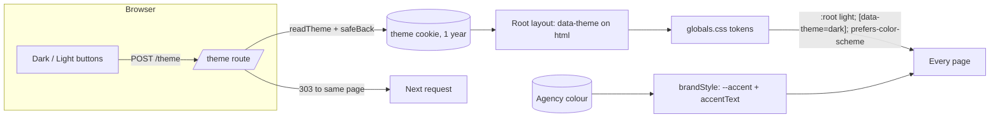

# F32 — Midnight & Brass Interface

Engineered by Muhammad Hassan | AI ENGINEER | AUTOMATION SPECIALIST | SOFTWARE ENGINEER | FULL STACK DEVELOPER

| | |
| --- | --- |
| Feature ID | F32 |
| SRS reference | Web app interface; M12 (security) for the theme switch redirect |
| Location | `web/src/app/globals.css`, `web/src/app/layout.tsx`, `web/src/app/theme/route.ts`, `web/src/app/w/[workspaceId]/layout.tsx`, `web/src/app/w/[workspaceId]/page.tsx`, `web/src/components/workspace-nav.tsx`, `web/src/components/icons.tsx`, `web/src/components/brand-mark.tsx`, `web/src/lib/theme.ts`, `web/src/lib/nav.ts`, `web/src/lib/overview.ts`, `web/src/lib/brand.ts` |
| Design | [Design](../../docs/superpowers/specs/2026-11-17-luxury-ui-design.md) and [plan](../../docs/superpowers/plans/2026-11-17-luxury-ui.md) |
| Automated tests | 8 web unit, 1 updated web unit, 1 browser: **9 new or updated, all passing**; full regression 877 passed |
| Database changes | None |

## 1. Summary

The whole platform now has a premium look, Midnight & Brass, and is easier to use. **No feature was added or removed**: every page, form, action, permission and address works as before.

- **Two themes.** Deep midnight navy with brass gold, or a bright warm-white version with deep-navy text. Each person chooses with a Dark / Light switch. The choice is remembered and applied on the server, so a page never flashes the wrong theme. Until someone chooses, their device's setting decides.
- **Typography.**
  - Fraunces, a high-contrast serif, for headings and figures.
  - Plus Jakarta Sans for everything else.
  - Both are bundled with the app, so no request goes to a third party.
- **Grouped sidebar.** The single row of 20 tabs is now a sidebar with icons, in five groups: Home, Inbox and Notifications; then Sell, Outreach, Insights and Manage. Unread notifications and open inbox replies show as counts, and the current page is highlighted.
- **Top bar.** Lead search (using the leads page's existing search), a notifications bell, the person's email and Sign out.
- **Home screen led by what needs a person.**
  - A plain status line ("All 17 AI agents are working", or that outreach is paused).
  - A greeting in the workspace's time zone.
  - "Needs your attention" cards built from real data: conversations handed to a person, emails waiting for approval, and new warnings. Each card links to the page that already handles it.
- **White-label safe.** An agency's colour replaces brass everywhere: buttons, highlights, links and focus rings. Button text switches automatically between dark and white, whichever reads better on that colour.

## 2. How it works

- **Tokens.** Light values sit on `:root`. Dark values apply under `[data-theme="dark"]`, and under `prefers-color-scheme: dark` when no choice has been made.
- **Accent colours.** Colours derived from the accent (link ink, tints, outlines) are computed with `color-mix` on the elements that carry the agency colour, so a white-label colour flows into all of them.
- **No JavaScript needed.** The switch is a plain form, so it works before scripts load.
- **Safe redirect.** The return address goes through `safeBack`, which accepts only a path on this site. Anything else becomes `/workspaces`.
- **Readable button text.** `accentText` picks dark (`#1a1408`) or white text by WCAG contrast ratio.

## 3. Sidebar map

| Group | Pages (address unchanged) |
| --- | --- |
| (top) | Home `/`, Inbox `/inbox`, Notifications `/notifications` |
| Sell | Campaigns, Leads, Deals, Meetings |
| Outreach | Calls, Texts, Templates, Playbook |
| Insights | Buying signals `/signals`, Website visitors `/visitors`, Reports `/analytics`, AI learning `/learning` |
| Manage | Email health `/deliverability`, Setup, Team `/members`, Settings, API & webhooks `/developers` |

A test (NAV-01) pins the set of 20 addresses, so no page can drop out of the menu.

## 4. Design decisions

| Decision | Reason |
| --- | --- |
| Restyle the shared classes instead of adopting a component library | Every page already uses `card`, `stats`, `table`, `btn`, `badge` and `field`, so all pages change at once with no risk to their logic |
| Theme in a cookie, applied on the server | No flash of the wrong theme, and it works without JavaScript |
| Fonts bundled (Fontsource variable fonts) | Faster, private and reliable: no third-party request, and `font-display: swap` |
| "Needs your attention" only from real counts, and hidden at zero | The home screen never shows invented numbers; "You are all caught up" when nothing waits |
| Status labels never wrap | Found while reviewing the design: a wrapped pill breaks its shape |
| On phones the sidebar sits above the page as one scrollable row | Fits a 390 px screen with no sideways page scroll (E2E-15) |

## 5. Verification

- **Visual check.** Both themes and a phone layout were rendered and reviewed. The fonts were confirmed loaded with `document.fonts.check`.
- **Automated tests.** All suites pass; see the [test cases](test-cases.md).
